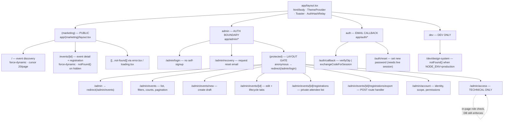
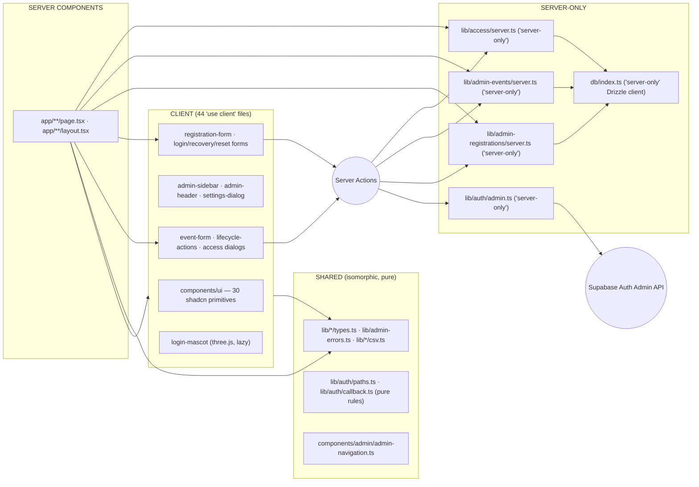
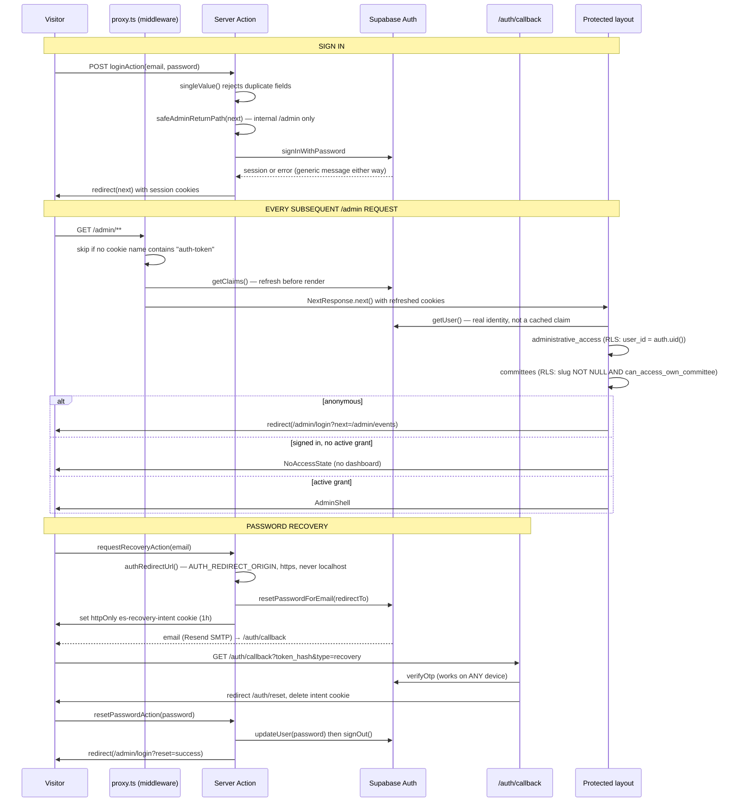
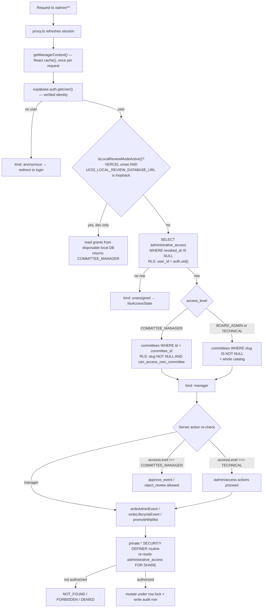
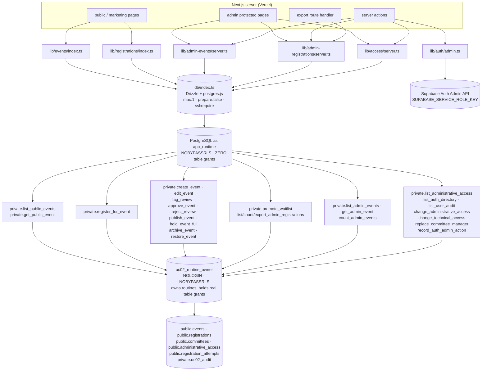
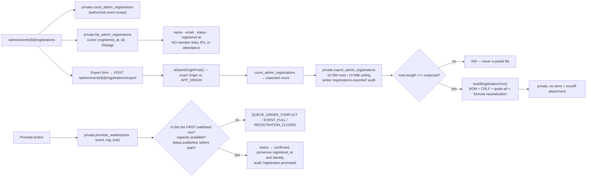
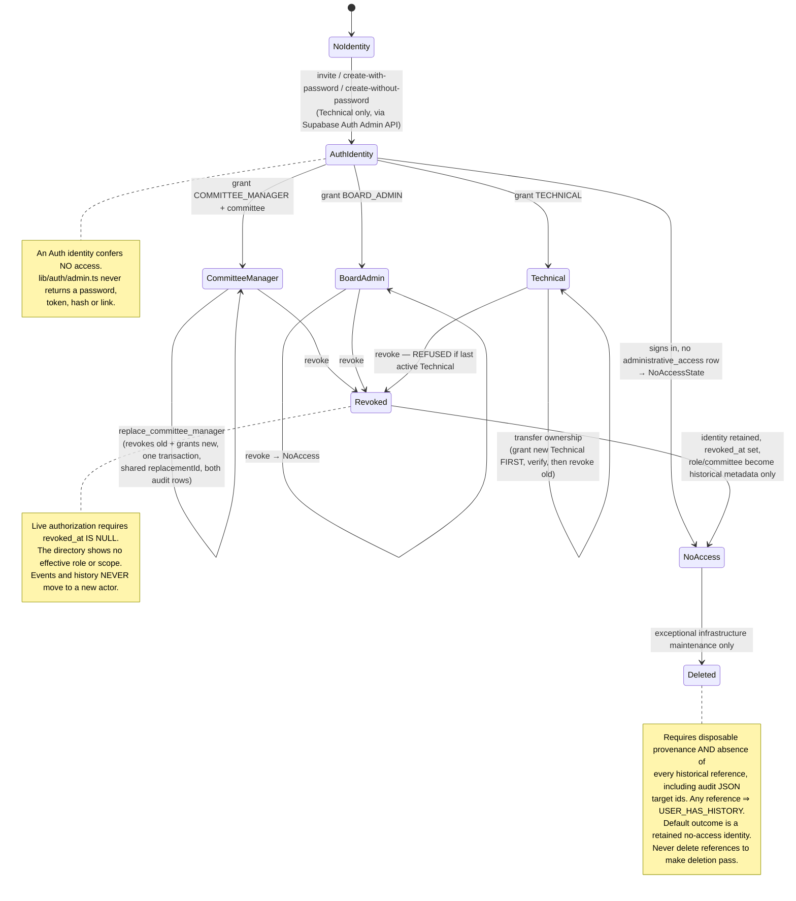
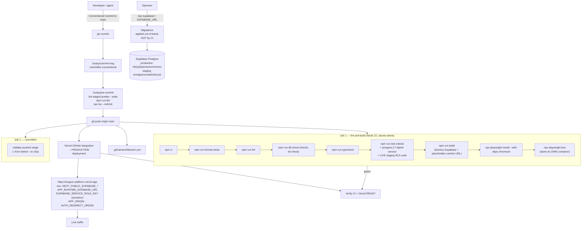
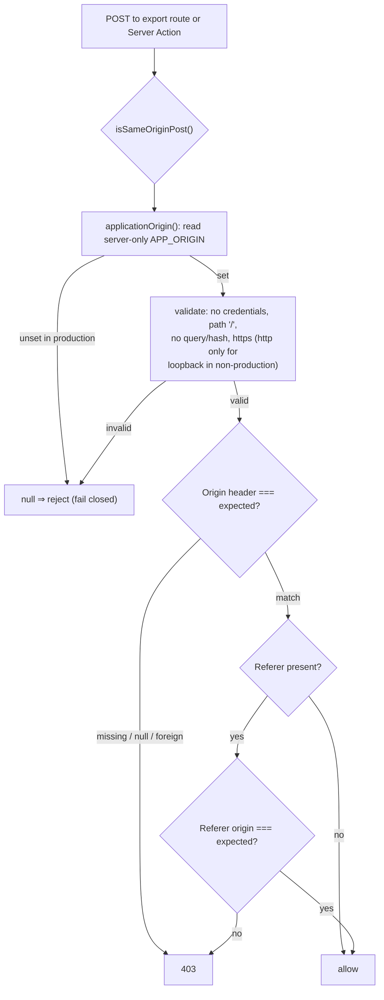

# Architecture Map — Engineering Society Platform

**Source of truth:** the code at HEAD `a0f8ffb`. Where this document and any
other document disagree, the code wins — see `docs/DEEPSEEK_PLATFORM_AUDIT.md` §9
for the known documentation drift.

**Scope of this map:** route tree, component boundaries, authentication flow,
authorization flow, database access flow, event lifecycle, registration flow,
access lifecycle, and deployment flow.

---

## 1. Route map

There are **no API routes for domain operations**. Next.js Server Actions are the
only mutation surface; one route handler exists for the CSV export, and one for
the Auth email callback.



### Route inventory

| Route                                     | Type                           | Rendering                        | Gate                                                           |
| ----------------------------------------- | ------------------------------ | -------------------------------- | -------------------------------------------------------------- |
| `/`                                       | Server Component               | `force-dynamic`                  | public                                                         |
| `/events/[id]`                            | Server Component               | `force-dynamic`                  | public; hidden/draft/archived/malformed → `notFound()`         |
| `/admin/login`                            | Server Component + client form | dynamic                          | public (no signup)                                             |
| `/admin/recovery`                         | Server Component + client form | dynamic                          | public                                                         |
| `/admin`                                  | Server Component               | dynamic                          | protected layout → redirect                                    |
| `/admin/events`                           | Server Component               | dynamic                          | protected layout                                               |
| `/admin/events/new`                       | Server Component               | dynamic                          | protected layout                                               |
| `/admin/events/[id]`                      | Server Component               | dynamic                          | protected layout + routine scope                               |
| `/admin/events/[id]/registrations`        | Server Component               | dynamic, `referrer: same-origin` | protected layout + routine scope                               |
| `/admin/events/[id]/registrations/export` | **Route handler (POST only)**  | —                                | same-origin + session + routine scope                          |
| `/admin/account`                          | Server Component               | dynamic                          | protected layout                                               |
| `/admin/access`                           | Server Component               | dynamic                          | protected layout + **in-page TECHNICAL check** + routine guard |
| `/auth/callback`                          | **Route handler (GET)**        | —                                | token_hash or PKCE code                                        |
| `/auth/reset`                             | Server Component + client form | `force-dynamic`                  | live session required                                          |
| `/dev/design-system`                      | Server Component               | —                                | 404 in production                                              |

### Server actions (the actual mutation surface)

| Action                                                                                                                     | File                                                         | Authorization                                                                                       |
| -------------------------------------------------------------------------------------------------------------------------- | ------------------------------------------------------------ | --------------------------------------------------------------------------------------------------- |
| `registerForEventAction`                                                                                                   | `app/(marketing)/actions.ts`                                 | public by design; DB routine enforces capacity/duplicate/rate limit                                 |
| `saveEventAction`                                                                                                          | `app/admin/(protected)/events/actions.ts`                    | `manager.kind === "manager"` then routine                                                           |
| `lifecycleEventAction`                                                                                                     | `app/admin/(protected)/events/actions.ts`                    | manager; `approve_event`/`reject_review` additionally require `accessLevel !== "COMMITTEE_MANAGER"` |
| `promoteWaitlistAction`                                                                                                    | `app/admin/(protected)/events/[id]/registrations/actions.ts` | manager then routine                                                                                |
| `changeAccessAction`                                                                                                       | `app/admin/(protected)/access/actions.ts`                    | `accessLevel === "TECHNICAL"` then routine                                                          |
| `replaceManagerAction`                                                                                                     | `app/admin/(protected)/access/actions.ts`                    | `accessLevel === "TECHNICAL"` then routine                                                          |
| `createUserAction`, `sendResetEmailAction`, `resendInvitationAction`, `setTemporaryPasswordAction`, `getUserHistoryAction` | `app/admin/(protected)/access/user-actions.ts`               | `requireTechnical()` on every entry                                                                 |
| `loginAction`, `requestRecoveryAction`, `logoutAction`                                                                     | `app/admin/actions.ts`                                       | public                                                                                              |
| `resetPasswordAction`                                                                                                      | `app/auth/reset/actions.ts`                                  | requires live recovery session                                                                      |

---

## 2. Component boundaries



### Boundary rules actually enforced in the code

1. **`import "server-only"`** guards `lib/access/server.ts`,
   `lib/admin-events/server.ts`, `lib/admin-registrations/server.ts`,
   `lib/auth/admin.ts`, `lib/auth/local-review.ts`, `db/index.ts`. Importing any of
   these from a client component is a build error.
2. **Domain modules are imported only through `index.ts`.** `lib/events/db.ts`,
   `lib/events/types.ts`, `lib/registrations/db.ts` are private implementation.
3. **`"use server"` modules export only async functions.** This is not stylistic:
   `app/(marketing)/action-state.ts` carries an explicit comment that a non-async
   export from a `"use server"` file crashes at request time in a production build
   ("A 'use server' file can only export async functions, found object"), even
   though `next build` does not catch it. Types and constants live in sibling
   `*-state.ts` / `*-types.ts` files for this reason.
4. **The service-role key has exactly one reader** — `lib/auth/admin.ts`
   `adminClient()`. It is never returned, logged, or included in an action result.
5. **Client visibility is never the authorization boundary.**
   `components/admin/admin-sidebar.tsx` hides the Technical nav group for
   non-Technical users, but the database routine is what actually denies.

---

## 3. Authentication flow



### Verified authentication properties

- **Login errors are indistinguishable** between "no such account" and "wrong
  password" — `app/admin/actions.ts` returns one generic message.
- **No open redirect.** `lib/auth/paths.ts` `safeAdminReturnPath` only accepts
  internal `/admin` paths, rejecting absolute URLs, protocol-relative URLs and
  backslashes.
- **No localhost fallback in production.** `authRedirectUrl()` returns `null` when
  `NODE_ENV === "production"` and the configured origin is not https or is a
  loopback host. A `null` result surfaces as "Password recovery is temporarily
  unavailable," never as a weaker redirect.
- **Tokens are never rendered in a URL.** Recovery accepts a PKCE `code` or a
  `token_hash`; an implicit-flow fragment is stripped by
  `components/auth/auth-hash-relay.tsx` at the root.
- **Recovery does not change authorization.** The reset page states this
  explicitly, and `resetPasswordAction` only calls `updateUser`.
- **Password policy:** minimum 12, maximum 1024, enforced server-side in
  `lib/auth/callback.ts` `validateNewPassword` and shared by the reset page and the
  Technical fallback.
- **Sessions:** `proxy.ts` refreshes only when an `auth-token` cookie exists, so
  anonymous public traffic never pays an Auth round-trip.

---

## 4. Authorization flow



### The authoritative scope predicate

Both RLS and every admin routine converge on one function
(`0016_application_access_hierarchy.sql:102-111`):

```sql
CREATE OR REPLACE FUNCTION private.can_access_committee(p_actor uuid, p_committee uuid)
RETURNS boolean LANGUAGE sql STABLE SECURITY DEFINER SET search_path = public, pg_temp AS $$
  SELECT EXISTS (
    SELECT 1 FROM public.administrative_access a
    JOIN public.committees c ON c.id = p_committee AND c.slug IS NOT NULL
    WHERE a.user_id = p_actor AND a.revoked_at IS NULL
      AND (a.access_level IN ('BOARD_ADMIN','TECHNICAL')
           OR (a.access_level = 'COMMITTEE_MANAGER' AND a.committee_id = p_committee))
  );
$$;
```

Two consequences worth stating explicitly:

- **Technical authority comes from `access_level`, never from the `Technical Team`
  committee** name, slug, or membership (`ADR 0012`).
- **`c.slug IS NOT NULL`** excludes the archived legacy `Events` committee from
  normal administration by construction, not by convention.

### Browser-side RLS (the `authenticated` role)

`lib/auth/manager.ts` uses the **anon key with the user's cookie**, so its reads
are subject to RLS as `authenticated` — not privileged:

| Table                   | Policy                                     | Predicate                                                   |
| ----------------------- | ------------------------------------------ | ----------------------------------------------------------- |
| `administrative_access` | `authenticated_select_own_grants`          | `user_id = auth.uid()`                                      |
| `committees`            | `authenticated_select_admin_committees`    | `slug IS NOT NULL AND private.can_access_own_committee(id)` |
| `events`                | `authenticated_select_admin_events`        | `private.can_access_own_committee(committee_id)`            |
| `registrations`         | `authenticated_select_admin_registrations` | event's committee is accessible                             |

`private.can_access_own_committee` resolves the caller from the JWT claims
(`0022:14-19`): it reads `request.jwt.claims ->> 'sub'` with a fallback to the
legacy `request.jwt.claim.sub` GUC. Migration 0022 exists because PostgREST
stopped setting the legacy GUC, which had silently made every signed-in
administrator see **zero** committees — a real production bug that was found and
fixed (commit `b4bba16`).

---

## 5. Database access flow



### Credential separation (verified)

| Credential                      | Role                                                                         | Used by                                                                 | Never used by                                |
| ------------------------------- | ---------------------------------------------------------------------------- | ----------------------------------------------------------------------- | -------------------------------------------- |
| `APP_RUNTIME_DATABASE_URL`      | `app_runtime` — NOBYPASSRLS, **zero table grants**, `EXECUTE` on 28 routines | `db/index.ts` — the only runtime connection                             | migrations                                   |
| `DATABASE_URL`                  | migration/admin (`postgres`)                                                 | `drizzle.config.ts` only                                                | application runtime — **no fallback exists** |
| `NEXT_PUBLIC_SUPABASE_ANON_KEY` | `anon` / `authenticated` via RLS                                             | browser + `lib/auth/server.ts` + `proxy.ts`                             | privileged reads                             |
| `SUPABASE_SERVICE_ROLE_KEY`     | Auth Admin API                                                               | `lib/auth/admin.ts` only                                                | anything else                                |
| `app_maintenance`               | maintenance login                                                            | operator/runbook only; `EXECUTE` on `private.set_technical_access` only | the application                              |

`db/index.ts` throws if `APP_RUNTIME_DATABASE_URL` is unset — there is deliberately
**no fallback to `DATABASE_URL`**, so a misconfigured deployment fails closed
rather than silently running as the migration role.

### Base-table privilege matrix at head

| Table                                                                | anon                                              | authenticated         | app_runtime | app_maintenance | uc02_routine_owner     |
| -------------------------------------------------------------------- | ------------------------------------------------- | --------------------- | ----------- | --------------- | ---------------------- |
| `events`                                                             | SELECT (id,title,description,event_date,location) | SELECT (RLS-scoped)   | **none**    | none            | SELECT, INSERT, UPDATE |
| `registrations`                                                      | none                                              | SELECT (RLS-scoped)   | **none**    | none            | SELECT, INSERT, UPDATE |
| `committees`                                                         | none                                              | SELECT (RLS-scoped)   | **none**    | none            | SELECT                 |
| `administrative_access`                                              | none                                              | SELECT (own row only) | **none**    | SELECT          | SELECT, INSERT, UPDATE |
| `registration_attempts`                                              | none                                              | none                  | **none**    | SELECT, DELETE  | SELECT, INSERT         |
| `private.uc02_audit`                                                 | none                                              | none                  | **none**    | SELECT          | SELECT, INSERT         |
| `members`, `certificates`, `archive_items`, `mentorship_connections` | none                                              | none                  | **none**    | none            | none                   |

Every table is RLS-enabled **and** RLS-forced. Tables with no policy are
default-deny. No role holds `DELETE` on any business table; no role holds
`UPDATE` or `DELETE` on the audit table.

---

## 6. Event lifecycle

### Stored vs derived state

```mermaid
stateDiagram-v2
  [*] --> draft : create_event
  draft --> published : publish_event<br/>(future start, non-empty description,<br/>review satisfied)
  published --> full : hold_event_full<br/>(manual hold)
  full --> published : publish_event (reopen)<br/>(future event)
  published --> draft : revert<br/>ONLY before any registration/waitlist entry
  full --> draft : revert<br/>ONLY before any entry
  draft --> archived : archive_event
  published --> archived : archive_event
  full --> archived : archive_event
  archived --> draft : restore_event<br/>(returns to prior status;<br/>never reopens a past event)

  note right of draft
    review_required / flagged_by / approved_by
    live on the row, not as a state.
    Editing a review-relevant field while
    review_required clears approval →
    back to "review" until re-approved by a
    DIFFERENT Board/Technical user.
  end note

  note right of published
    "past" and numerical "full" are DERIVED
    (event_date <= now(), confirmed >= capacity),
    never stored.
  end note
```



**Stored `status` values are only `draft`, `published`, `full`.** The seven states a
manager _sees_ — `draft | review | approved | published | full | past | archived` —
are computed by `lib/admin-events/status.ts` `getEventLifecycleStatus()` in this
precedence: archived → past → full → published → review/approved → draft.

### Transition matrix

| From                       | Operation                       | To                        | Actor                                 | Guards (all DB-enforced)                                                                                  |
| -------------------------- | ------------------------------- | ------------------------- | ------------------------------------- | --------------------------------------------------------------------------------------------------------- |
| —                          | `create_event`                  | `draft`                   | manager of target committee           | committee has non-null slug; title/description/date/location bounds                                       |
| `draft`                    | `flag_review` / `unflag_review` | `draft`                   | committee-scoped                      | revision match                                                                                            |
| `draft`                    | `approve_event`                 | `draft` (approved)        | BOARD_ADMIN or TECHNICAL              | `can_review_event`; **actor ≠ flagged_by**; revision match                                                |
| `draft`                    | `reject_review`                 | `draft` (review required) | BOARD_ADMIN or TECHNICAL              | reviewer authority; clears approval; increments revision; audited                                         |
| `draft`                    | `publish_event`                 | `published`               | committee-scoped                      | future start; description non-empty; `review_required` false **or** `approved_by` set at current revision |
| `draft`                    | `edit_event`                    | `draft`                   | committee-scoped                      | revision match; clears approval if a review-relevant field changes                                        |
| `published`                | `hold_event_full`               | `full`                    | committee-scoped                      | future event                                                                                              |
| `published`                | `edit_event`                    | `published`               | committee-scoped                      | capacity ≥ confirmed count; date immutable once any entry exists; past events cannot change date/capacity |
| `full`                     | `publish_event` (reopen)        | `published`               | committee-scoped                      | future event                                                                                              |
| `published`/`full`         | revert to draft                 | `draft`                   | committee-scoped                      | **only when zero registrations and zero waitlist entries**                                                |
| `draft`/`published`/`full` | `archive_event`                 | `archived`                | committee-scoped                      | sets `archived_at`; status and history retained                                                           |
| `archived`                 | `restore_event`                 | prior status              | committee-scoped                      | never reopens a past event                                                                                |
| any                        | **hard delete**                 | —                         | **denied to every application actor** | no `DELETE` grant exists for any role                                                                     |

### Review invariants (double-enforced)

- **Self-approval is denied twice**: a database `CHECK` (`events_no_self_approval`,
  `0003:79`) _and_ a routine guard returning `SELF_APPROVAL_DENIED` (`0016:228-230`).
- **Reviewer authority is Board/Technical only**, implemented by
  `private.can_review_event` (requires `access_level IN ('BOARD_ADMIN','TECHNICAL')`),
  with a matching server-action pre-check returning `GLOBAL_ACCESS_REQUIRED`.
- **Approval is per-revision**: `approved_revision` is compared, and editing a
  review-relevant field while `review_required` clears the approval under the same
  lock.
- **Revision locking**: every mutation takes an expected integer `revision` and
  returns `CONFLICT` (with `currentRevision`) on mismatch. No last-write-wins.

---

## 7. Registration flow

```mermaid
sequenceDiagram
  participant V as Visitor
  participant Form as registration-form.tsx (client)
  participant SA as registerForEventAction
  participant LR as lib/registrations
  participant DB as private.register_for_event (app_runtime)
  participant T as events / registrations / registration_attempts

  V->>Form: name + email + phone, submit
  Form->>SA: FormData (eventId, attendeeName, attendeeEmail, attendeePhone, intent)
  SA->>SA: reject duplicate fields and unexpected domain fields
  SA->>SA: getClientIp() — x-vercel-forwarded-for only
  SA->>LR: registerForEvent({...})
  LR->>LR: name ≤200 & no control chars; email ≤254 & shape check;<br/>phone canonical or null → invalid_phone;<br/>eventId UUID; IP parses
  Note over LR,DB: one call, one round trip —<br/>the phone changed the signature, not the shape
  LR->>DB: SELECT private.register_for_event(...)
  DB->>T: pg_advisory_xact_lock(hashtext(ip))
  DB->>T: count attempts in last 10 min → ≥5 ⇒ RATE_LIMITED
  DB->>T: INSERT attempt row (allowed AND rejected both counted)
  DB->>T: SELECT event FOR UPDATE
  DB->>DB: archived/draft ⇒ EVENT_NOT_FOUND;<br/>start passed ⇒ REGISTRATION_CLOSED
  DB->>T: existing active row for normalized email?
  alt already confirmed
    DB-->>LR: ALREADY_REGISTERED
  else already waitlisted
    DB-->>LR: ALREADY_WAITLISTED
  else intent = register and seat available
    DB->>T: INSERT status='confirmed' with canonical phone
    DB->>T: audit 'registration.created'<br/>(action + target only, never the phone)
    DB-->>LR: SUCCESS
  else intent = register and numerically full
    DB-->>LR: EVENT_FULL
  else intent = join_waitlist
    DB->>T: INSERT status='waitlisted'
    DB->>T: audit 'registration.waitlisted'
    DB-->>LR: WAITLISTED
  end
  LR-->>SA: domain result
  SA-->>Form: success / error code
  Form-->>V: confirmation or safe message
```

### Manager-side flow



### Registration invariants

| Invariant                                                             | Enforced by                                                                                              |
| --------------------------------------------------------------------- | -------------------------------------------------------------------------------------------------------- |
| Exactly one active row per `(event_id, lower(btrim(attendee_email)))` | Partial unique index `registrations_active_event_email_idx` `WHERE status IN ('confirmed','waitlisted')` |
| Canonical email storage                                               | `CHECK registrations_email_canonical`                                                                    |
| Canonical phone storage                                               | `CHECK registrations_phone_canonical` — NULL, or optional `+` then 7–15 digits                           |
| Phone required for new registrations                                  | `private.register_for_event` returns `INVALID_PHONE` and writes nothing; the domain refuses first        |
| Historical registrations stay valid with no phone                     | Column is nullable; no backfill, no fabricated value, in the database or the CSV                         |
| Phone is never on a public path                                       | `PublicEvent` has no phone field; only committee-scoped admin routines return it                         |
| No oversubscription under concurrency                                 | Event row `FOR UPDATE` serialises seat allocation; verified by a real capacity-1 race test               |
| FIFO waitlist                                                         | `ORDER BY (registered_at, id)`; routine rejects promoting any row that is not first                      |
| Rate limit 5 per IP per 10 min                                        | Inside the routine, under a per-IP transaction advisory lock; rejected attempts count                    |
| Registration closes at event start                                    | `REGISTRATION_CLOSED` when `event_date <= now()`                                                         |
| Anonymous identity is self-asserted, never verified                   | By design (ADR 0004) — names/emails capture identity without a Member row                                |
| `member_id` is nullable                                               | ADR 0004; no `Attendee` entity introduced                                                                |
| CSV formula injection neutralized                                     | `lib/admin-registrations/csv.ts`, tested                                                                 |
| Every export audited                                                  | `registrations.exported` written inside the same transaction before bytes are returned                   |

---

## 8. Access lifecycle



### Concurrency and safety mechanisms

- **One global lock serialises all access mutations**:
  `PERFORM pg_advisory_xact_lock(hashtextextended('technical-ownership', 0));`
  (`0023:18`). Taken **before** row locks, so it also serialises concurrent
  elevated/ordinary grants for the same identity.
- **Operational writes hold a share lock on the grant row** (`lock_committee_access`
  uses `FOR SHARE`), so either an authorized operation completes before a
  revocation, or it observes the revocation and is denied.
- **Last-Technical protection** is a database guard and also applies to the
  external `app_maintenance` path:
  `IF (SELECT count(*) ... WHERE access_level = 'TECHNICAL' AND revoked_at IS NULL) <= 1 THEN RETURN LAST_TECHNICAL_ADMIN`.
- **Self-escalation is refused**: `IF p_actor = p_user THEN RETURN SELF_ESCALATION`
  (`0019:43`), and `change_administrative_access` rejects
  `p_level = 'TECHNICAL'` outright — Technical can only be granted through
  `change_technical_access` / `set_technical_access`.
- **One access row per user**: single-column primary key on `administrative_access`
  (`0016:58`), so a manager cannot hold two committee assignments.
- **`SECOND_MANAGER_SCOPE`** is a _per-user_ check, not a per-committee uniqueness
  constraint — the model permits several managers per committee (ADR 0014), each
  with exactly one committee.
- **Audit atomicity**: access mutations fail atomically if the audit write fails.
  The external Auth-API operations (create/invite/reset) cannot be atomic with
  their audit row — that boundary is documented, logged as
  `auth_admin_audit_failed`, and has a reconciliation procedure.

### Session semantics (documented limitation)

`auth.admin.signOut` requires the **target user's session JWT**; there is no
supported user-ID-only sign-out. The application deliberately does not collect or
store target tokens. Therefore **revocation does not terminate an existing
session**, but it _does_ remove authorization immediately: every request
re-reads `administrative_access` on the server and again inside the routine, so a
stale token yields a signed-in user with no scope. Access tokens can remain valid
until expiry (JWT lifetime 3600 s per the hardening audit).

---

## 9. Deployment flow



### Deployment facts

| Aspect              | Reality                                                                                                            |
| ------------------- | ------------------------------------------------------------------------------------------------------------------ |
| Deploy trigger      | Push to `main` (Vercel GitHub integration). PRs are exceptional.                                                   |
| CI triggers         | `push` to `main` and `pull_request` → `main`                                                                       |
| Required checks     | The workflow is the de facto gate; **branch protection is unavailable** on this GitHub plan (HTTP 403)             |
| Migrations          | **Never run by CI.** Applied out-of-band via Supabase CLI / Drizzle against `DATABASE_URL`                         |
| Secrets in CI       | **None.** The staging anon key is a literal in `ci.yml` (public by design)                                         |
| Preview deployments | Optional; only for exceptional PRs                                                                                 |
| Rollback            | Vercel instant rollback for the app; **database rollback is documented but has never been executed on production** |
| Release evidence    | Commit SHA → CI run id → Vercel deployment id, recorded in `docs/CURRENT_WORK.md` and the hardening audit          |

### Verified current production state (read-only, this audit)

| Check                            | Result                                                        |
| -------------------------------- | ------------------------------------------------------------- |
| Deployed commit                  | `a0f8ffb` → GitHub Production deployment 2026-10-08T11:00:16Z |
| Latest CI run                    | `37767106448`, `conclusion: success`, on `a0f8ffb`            |
| `/`                              | 200, all security headers present                             |
| `/admin/access`, `/admin/events` | 307 → `/admin/login?next=/admin/events`                       |
| `/admin/login`, `/auth/reset`    | 200                                                           |
| `/dev/design-system`             | **404** (dev route correctly excluded)                        |

---

## 10. Request-origin / CSRF boundary



Design notes verified in code:

- The trust anchor is **fixed server configuration** (`APP_ORIGIN`), never
  `Host`, `x-forwarded-host`, or `VERCEL_URL`.
- In **unconfigured development**, only loopback origins are accepted.
- The registrations page sets `referrer: "same-origin"` in its metadata so a native
  form POST sends an identifiable `Origin` without leaking a cross-site `Referer`;
  the root layout otherwise restores `no-referrer`.
- A related production incident is recorded in history: the CSV export failed
  because the global `no-referrer` policy made native form POSTs send
  `Origin: null`. The fix (`749cdc5`) preserved the origin requirement and added
  the page-scoped referrer policy rather than weakening the check.

---

## 11. Where to look next

| Question                                     | File                                                             |
| -------------------------------------------- | ---------------------------------------------------------------- |
| What does the platform guarantee?            | `docs/ARCHITECTURAL_INVARIANTS.md`                               |
| What must stay canonical during a migration? | `docs/MIGRATION_READINESS.md`                                    |
| What is wrong or risky today?                | `docs/DEEPSEEK_PLATFORM_AUDIT.md`                                |
| How is access operated?                      | `docs/ACCESS_CONTROL.md`, `docs/Platform_Maintenance_Runbook.md` |
| How does auth/email work?                    | `docs/AUTH_AND_EMAIL.md`                                         |
| Why was a decision made?                     | `docs/adr/`                                                      |
