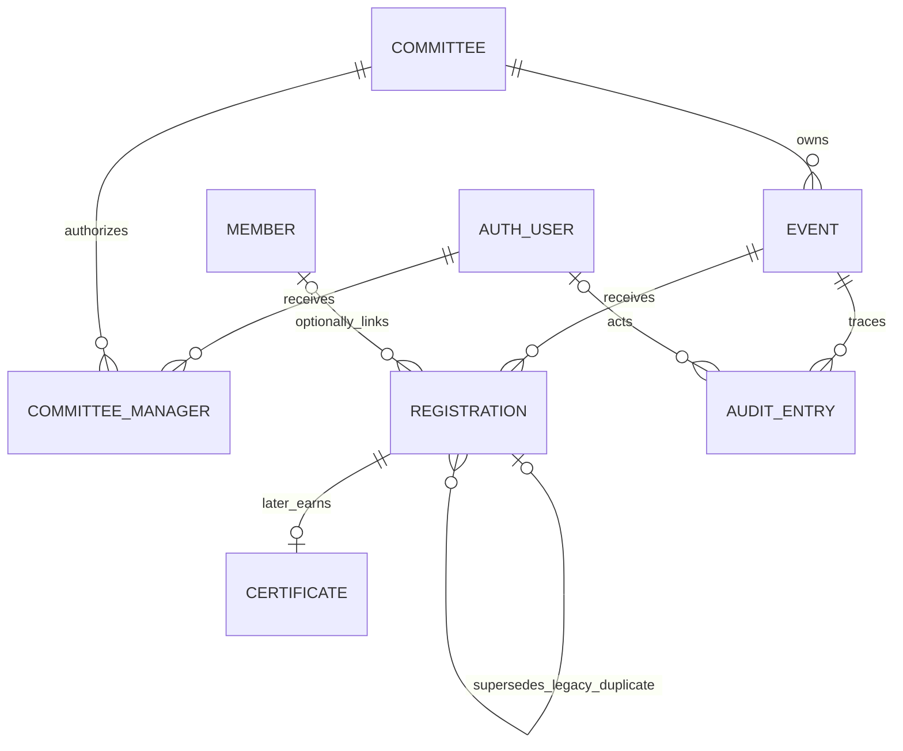

# UC-02 data and security contract

**Access revision (October 4, 2026):** [ADR 0012](adr/0012-application-access-hierarchy.md)
and the [access contract](ACCESS_CONTROL.md) specify the owner's replacement
hierarchy, single-committee constraint, global reviewers, legacy isolation and
audit. Sections 1 and 4 through 7 below describe the deployed manager-only
baseline until the new migration is applied. Public registration and attendee
privacy rules remain binding.

Revision 3, September 15, 2026. Companion to [the deep dive](UC-02_Deep_Dive.md).
**Approved data contract.** O-01 and its approval fields were delivered in M2.
Staging and the selected main project have applied the UC-02 migrations through
0015; the September 24 main-project catalog check confirmed ENABLE/FORCE RLS
on all ten UC-02 tables. The migration chain and live catalog, rather than this
design document alone, establish deployed state.
The deep dive owns product rules; this file specifies their representation.

## 1. Entity relationships

Technical Blueprint p4 is the historical v1 ER model. This diagram is its
UC-02 addendum, incorporating the already accepted ADR 0004 nullable link.
Unrelated Archive and Mentorship relationships remain unchanged.

COMMITTEE_MANAGER references auth.users directly, not members.
AUDIT_ENTRY can also represent a grant change without an event; it retains
committee scope. Registration attempts are short-lived technical bookkeeping,
not permanent attendee history. No Attendee or separate Waitlist entity.

Notation: N = NOT NULL; ? = nullable. Timestamp means PostgreSQL timestamptz.
All UUID IDs are generated by the database except Supabase Auth IDs.
FK deletion defaults to RESTRICT/NO ACTION, never cascade-delete domain history.
All dates crossing an API boundary are ISO 8601 strings with UTC Z.

## 2. Event contract

| Field / PostgreSQL type           | Null/default         | Contract and reason                                                                |
| --------------------------------- | -------------------- | ---------------------------------------------------------------------------------- |
| id / uuid PK                      | N, gen_random_uuid() | Immutable public event identifier                                                  |
| title / text                      | N                    | Trimmed 1–200 code points, no controls                                             |
| description / text                | ?                    | Blank -> null in draft; max 10,000; required on publication; plain text            |
| event_date / timestamptz          | N                    | Start instant, minute precision for new admin input; existing precision preserved  |
| location / text                   | ?                    | Trimmed max 500; blank -> null; no controls                                        |
| committee_id / uuid FK committees | N                    | Owning committee, immutable after creation                                         |
| status / event_status             | N, draft             | Existing draft/published/full enum retained                                        |
| capacity / integer                | ?, null              | NEW; positive if present; optional numerical seat limit                            |
| created_at / timestamptz          | N, now()             | Immutable creation time                                                            |
| revision / integer                | N, 1                 | NEW; increment once per domain mutation for stale edit rejection                   |
| archived_at / timestamptz         | ?, null              | NEW; records non-destructive archive action                                        |
| review_required / boolean         | N, false             | NEW (O-01); owning manager flags a draft as needing a different manager's approval |
| flagged_by / uuid FK auth.users   | ?, null              | NEW (O-01); manager who set review_required true; null when never flagged          |
| approved_by / uuid FK auth.users  | ?, null              | NEW (O-01); different manager who approved the current revision                    |
| approved_at / timestamptz         | ?, null              | NEW (O-01); approval time                                                          |
| approved_revision / integer       | ?, null              | NEW (O-01); revision value at approval; publish requires it to equal revision      |

CHECKs: bounded trimmed title; valid optional text lengths; capacity > 0;
revision > 0; status other than draft requires nonempty description.
review_required = (flagged_by IS NOT NULL). When review_required is false,
approved_by/approved_at/approved_revision are all null (unflagging clears any
prior approval along with flagged_by). approved_by, approved_at and
approved_revision are all null or all non-null together. When approved_by is
set it is not equal to flagged_by (self-approval denied at the data layer as
well as in the routine). Multirow/time-dependent checks belong in mutation
routines, not volatile CHECKs.
Prevent changing committeeId/id/createdAt through any ordinary update routine.
Event date immutability and capacity floor use all history/confirmed count
respectively as defined by the deep dive.

Indexes: existing PK; (committee_id, event_date, id) for admin list;
(event_date, id) WHERE archived_at IS NULL AND status IN ('published','full')
for public time-ordered discovery. Do not add a unique title constraint.
No stored attendee count or capacity-derived status. “Full” label is derived
from manual full OR confirmed count >= capacity OR pending waitlist.
Past and active/archive filters derive from eventDate/archivedAt.

O-01 selected the five review_required/flagged_by/approved_by/approved_at/
approved_revision columns above over a separate approval-record table: the
fields are few, always 1:1 with the event row, and the append-only audit
table (section 5) already carries the durable history, so a side table would
duplicate that without adding a guarantee. See deep dive section 11 for the
full behavior.

## 3. Registration contract

| Field / PostgreSQL type               | Null/default         | Contract and reason                                                                                                                                                                                                                                              |
| ------------------------------------- | -------------------- | ---------------------------------------------------------------------------------------------------------------------------------------------------------------------------------------------------------------------------------------------------------------- |
| id / uuid PK                          | N, gen_random_uuid() | Stable internal identity for attendance/certificate use                                                                                                                                                                                                          |
| event_id / uuid FK events             | N                    | Immutable, never move a registration to another event                                                                                                                                                                                                            |
| member_id / uuid FK members           | ?                    | Existing optional future link; all UC-02 writes set null                                                                                                                                                                                                         |
| attendee_name / text                  | N                    | Canonical trimmed 1–200 code points, Unicode allowed, no controls                                                                                                                                                                                                |
| attendee_email / text                 | N                    | Canonical trimmed lowercase ASCII, max 254, practical syntax from deep dive                                                                                                                                                                                      |
| attendee_phone / text                 | ?, null              | Added by migration 0024. Canonical: optional leading `+` then 7–15 digits. Required for every NEW registration; NULL only on rows captured before the column existed. Text, never numeric, so a leading zero and a leading `+` survive. Not unique, not indexed. |
| status / registration_status          | N, confirmed         | NEW: confirmed, waitlisted, superseded                                                                                                                                                                                                                           |
| superseded_by / uuid FK registrations | ?, null              | NEW: preserve legacy duplicates without deletion                                                                                                                                                                                                                 |
| attended / boolean                    | N, false             | Existing UC-03 field; UC-02 cannot modify it                                                                                                                                                                                                                     |
| checked_in_at / timestamptz           | ?, null              | Existing UC-03 field; UC-02 cannot modify it                                                                                                                                                                                                                     |
| registered_at / timestamptz           | N, now()             | Immutable request acceptance time; FIFO key with id                                                                                                                                                                                                              |

Active = status IN (confirmed, waitlisted). Superseded is migration history,
never a public/admin create option. No cancelled state or public cancellation.
There is exactly one active row per (event_id, lower(btrim(attendee_email))):
a partial unique expression index enforces this, independent of app checks.
Normalize before insert; CHECK that stored email is already canonical.
No separate normalizedEmail column; no provider-specific alias equivalence.

Email is the registration identity; phone is contact detail, not identity. There
is no uniqueness rule on phone and no index on it, because nothing searches,
joins or deduplicates by it. Adding one would be cost without a query that
needs it.

Phone is normalized to one canonical form by `private.normalize_phone` and by
`lib/registrations/phone.ts`, and the `registrations_phone_canonical` CHECK
permits only that form (or NULL). Arabic-Indic and Eastern Arabic-Indic digits
become ASCII; letters and control characters are refused rather than stripped;
presentation separators (spaces, hyphens, brackets, dots) are dropped; at most
one leading `+` is kept; 7–15 digits are required. The rule is deliberately not
country-specific, because registration is open to anyone rather than only to
Omani numbers.

The column is nullable so historical registrations stay valid, and no phone
number is ever fabricated or backfilled for one. Every new registration through
`private.register_for_event` must supply a valid number or the routine returns
`INVALID_PHONE` and writes nothing.

CHECK status=superseded iff superseded_by IS NOT NULL; no self-reference.
Controlled migration validates target belongs to the same event/email and is
active; it disallows chains/cycles. Normal runtime cannot create/change these
links or reactivate superseded rows. Existing certified/attended/member-linked
duplicates require case-by-case reconciliation, never automatic reassignment.

Index (event_id, status, registered_at, id) supports counts, FIFO and list pages.
Retain existing PK and Member/Event FKs. No duplicated committee_id: resolve
ownership through Event. Count only confirmed; expose waitlisted count separately
to managers. Superseded rows remain privately retained but are absent from
ordinary lists/counts/CSV. Owner maintenance can inspect their audit/history.

Promotion is waitlisted -> confirmed on the same row, no identity/time changes.
Two retries do not create a new row. Database audit records promotion time/actor,
so no duplicate confirmedAt field is needed. UC-03/04 must use this identity
even without Member. New waitlisted rows always have attended=false and
checked_in_at=null; future attendance implementations must preserve eligibility.

## 4. Committee and manager grant

**Historical UC-02 baseline:** ADR 0012 and [ACCESS_CONTROL.md](ACCESS_CONTROL.md)
supersede this section's manager-only, multi-committee grant model. The current
database uses one `administrative_access` row per Auth user: Technical and Board
have global application scope; an ordinary manager has exactly one committee.
Technical access is explicit and never inferred from committee identity. The
tables and fields below remain as migration history, not a current schema guide.

Committee retains id UUID PK default random, name text N UNIQUE; names are
nonempty, operational identifiers. No new committee creation/renaming UI.

New committee_managers:

| Field                             | Null/default | Meaning                                       |
| --------------------------------- | ------------ | --------------------------------------------- |
| user_id / uuid FK auth.users      | N            | Authorized Auth identity, no Member required  |
| committee_id / uuid FK committees | N            | Exact scope                                   |
| granted_at / timestamptz          | N, now()     | Latest grant activation                       |
| granted_by / uuid FK auth.users   | N            | Verified owner/provisioner identity           |
| revoked_at / timestamptz          | ?, null      | Null means active; revoke instead of deleting |
| revoked_by / uuid FK auth.users   | ?, null      | Who revoked it                                |

Composite PK (user_id, committee_id); CHECK revoked_at and revoked_by are
both null or both non-null. Regrant updates the retained row and logs prior
values. Index (committee_id, user_id) for committee-scoped provisioning checks.
No role enum with speculative board/super-admin roles: presence of an active
grant is the manager capability. Current business users cannot grant themselves
or others access. The provisioner is a deployment/maintenance authority,
not an application role. Grant/revoke changes are audited.

## 5. Audit and technical attempts

New private.uc02_audit:

| Field                              | Null/default      | Meaning                                                                                                                                                                                                                          |
| ---------------------------------- | ----------------- | -------------------------------------------------------------------------------------------------------------------------------------------------------------------------------------------------------------------------------- |
| id / uuid PK                       | N, random         | Audit identity                                                                                                                                                                                                                   |
| occurred_at / timestamptz          | N, database clock | Mutation time                                                                                                                                                                                                                    |
| committee_id / uuid FK             | N                 | Scope for authorized reads                                                                                                                                                                                                       |
| event_id / uuid FK                 | ?                 | Null for committee grant changes                                                                                                                                                                                                 |
| registration_id / uuid FK          | ?                 | Subject when registration changes                                                                                                                                                                                                |
| actor_kind / text CHECK            | N                 | anonymous, authenticated, maintenance, migration                                                                                                                                                                                 |
| actor_user_id / uuid FK auth.users | ?                 | Required for authenticated/maintenance; null for anonymous/migration                                                                                                                                                             |
| action / text CHECK                | N                 | event.created/updated/published/held/reopened/archived/restored/review_flagged/review_unflagged/approved, registration.created/waitlisted/promoted/superseded, grant.activated/revoked, registrations.exported, history.imported |
| changes / jsonb object             | N                 | Allowlisted old/new changed fields or export metadata                                                                                                                                                                            |

Event/registration creation stores subject references and creation facts;
identity edits are outside runtime scope. Existing PII is not copied on every
unrelated mutation. Superseding records the target; promotion records
prior/new status and contact attestation. event.approved records
approvedBy/approvedRevision; event.review_flagged records flaggedBy; an
idempotent re-approval or re-publish writes no second row (deep dive section 11).
Export logs selected status, snapshot time and row count, not CSV contents.
Do not put raw IPs, tokens or unbounded user-provided objects in audit JSON.
Immutable append-only privileges; no runtime UPDATE/DELETE/TRUNCATE.
Index (event_id, occurred_at, id) and (committee_id, occurred_at, id).
Audit reads are owner-scoped via the verified server; no public audit table API.

registration_attempts retains its existing UUID, inet and created_at fields and
(ip_address, created_at) index. It moves behind revoked anon/auth grants with
RLS enabled. Add (created_at) index only for the hourly purge access pattern.
Job deletes entries older than one hour; these technical attempts are explicitly
not domain records under NFR-01 (ADR 0005 anticipated cleanup).
No mirrored IP audit; no permanent fingerprint/hash replacement.
Job failure is observable; limiter queries still scope to the last ten minutes.
Use a narrowly privileged database job, not a second app deployment pipeline.

## 6. Application authorization matrix

ALLOW always includes the row/lifecycle guards, never unconditional permission.
NS = NOT IN CURRENT SCOPE; API absence is enforced as denial. Other-committee
column means a manager with no grant for the target event's committee.
Authenticated users without a grant have only the public column's capabilities.
Board/technical titles without an explicit grant also have only public access.

| Resource/action                         | Public/anon | Owning manager               | Other committee | Board without target grant |
| --------------------------------------- | ----------- | ---------------------------- | --------------- | -------------------------- |
| Public event list/view, visible rows    | ALLOW       | ALLOW                        | ALLOW           | ALLOW                      |
| Admin event list/view, drafts, archived | DENY        | ALLOW own                    | DENY            | DENY                       |
| Create draft                            | DENY        | ALLOW own                    | DENY            | DENY                       |
| Edit event details                      | DENY        | ALLOW guarded                | DENY            | DENY                       |
| Publish/reopen                          | DENY        | ALLOW guarded (O-01)         | DENY            | DENY                       |
| Approve required review                 | DENY        | ALLOW guarded, not flaggedBy | DENY            | DENY                       |
| Mark manually full                      | DENY        | ALLOW guarded                | DENY            | DENY                       |
| Archive/restore                         | DENY        | ALLOW guarded                | DENY            | DENY                       |
| Hard delete                             | DENY        | DENY                         | DENY            | DENY                       |
| Create own public entry via action      | ALLOW       | ALLOW as public              | ALLOW as public | ALLOW as public            |
| Bulk/admin attendee creation            | NS          | NS                           | NS              | NS                         |
| Read/list registrations and counts      | DENY        | ALLOW own event              | DENY            | DENY                       |
| Promote FIFO waitlist entry             | DENY        | ALLOW guarded                | DENY            | DENY                       |
| Modify identity/cancel/transfer entry   | NS          | NS                           | NS              | NS                         |
| Event-scoped CSV                        | DENY        | ALLOW own                    | DENY            | DENY                       |
| Platform-wide export                    | DENY        | DENY                         | DENY            | DENY                       |
| Read scoped event audit                 | DENY        | ALLOW own via server         | DENY            | DENY                       |
| Rewrite/remove audit                    | DENY        | DENY                         | DENY            | DENY                       |
| Grant/revoke committee access           | DENY        | DENY                         | DENY            | DENY                       |
| Attendance read/update workflow         | NS          | NS                           | NS              | NS                         |
| Certificate issuance/access workflow    | NS          | NS                           | NS              | NS                         |
| Historical Member linking               | NS          | NS                           | NS              | NS                         |

There are no implicit global application roles, including for approval: an
approver is simply a second committee_managers grant holder for the event's
own committee, distinct from whoever flagged the draft (flaggedBy). Board
participants use the same grant mechanism, not a separate role.
The owner maintenance identity can provision/revoke through a separate audited
procedure (migration 0010: `private.grant_committee_manager` and
`revoke_committee_manager`, executable only by `app_maintenance`, which write
the grant and its audit row atomically; see the maintenance runbook).
Ordinary application credentials cannot invoke that operation.

## 7. Database and RLS boundary

### Access architecture

Browser -> Next Server Component/Action -> existing lib/events or
lib/registrations entry point -> parameterized Drizzle -> PostgreSQL.
Admin identity verification lives in a server-only auth module.
Supabase Auth validates identity; database grants establish committee scope.
Client pages never receive database or service-role credentials.

All mutating UC-02 database operations use fixed private schema routines.
They are the only mutation privileges granted to a dedicated runtime login.
The runtime login is NOBYPASSRLS, owns no tables/functions, cannot provision
roles, and has no direct business-table INSERT/UPDATE/DELETE. Use separate
migration credentials; never run migrations with the application connection.
No service-role client or postgres superuser is an application fallback.

Routine ownership: a dedicated NOLOGIN NOBYPASSRLS executor, distinct from
the table owner, with only the table/column rights and RLS policies below.
SECURITY DEFINER is an intentional capability boundary, not a permission-error
workaround: fixed search_path, schema-qualified objects, no dynamic SQL,
explicit revoke EXECUTE from PUBLIC/anon/authenticated, and private schema
absent from PostgREST exposure. Only runtime login may execute approved
public/admin routines; maintenance routines have a separate grant.
Tests must prove raw API clients cannot invoke these mutation routines.

Public registration routine gets no user ID and accepts only validated public
fields, intent and a trusted IP from the server. Admin routines accept the
Auth user ID from fresh server verification, never from client form data.
The routine checks current committee_managers itself on every call before
accessing/changing the target. Runtime connection is therefore a trusted
server boundary: compromise of that credential is not an anonymous actor.
Anonymous callers cannot select the admin routine through an operation-name
field or pass an actor ID. Each Server Action binds exactly one routine.

All tables in exposed schemas have RLS enabled and explicit operation grants.
Private tables also have RLS. Defaults for future tables/functions revoke
unintended PUBLIC/anon/authenticated privileges.

### Public/API role policy matrix

Each cell includes both grants and policies. A revoked grant may return 42501;
an allowed SELECT with a denying row policy may return an empty result.

| Table                  | anon SELECT                                                        | anon INSERT/UPDATE/DELETE | authenticated SELECT                                            | authenticated INSERT/UPDATE/DELETE |
| ---------------------- | ------------------------------------------------------------------ | ------------------------- | --------------------------------------------------------------- | ---------------------------------- |
| events                 | ALLOW only visible published/full, unarchived; public columns only | DENY / DENY / DENY        | ALLOW own committee rows only, including drafts/archived        | DENY / DENY / DENY                 |
| registrations          | DENY                                                               | DENY / DENY / DENY        | ALLOW rows whose event is in a current manager grant            | DENY / DENY / DENY                 |
| committees             | DENY                                                               | DENY / DENY / DENY        | ALLOW committees with current grant                             | DENY / DENY / DENY                 |
| committee_managers     | DENY                                                               | DENY / DENY / DENY        | ALLOW only caller's own rows; authority uses revoked_at IS NULL | DENY / DENY / DENY                 |
| registration_attempts  | DENY                                                               | DENY / DENY / DENY        | DENY                                                            | DENY / DENY / DENY                 |
| private.uc02_audit     | DENY                                                               | DENY / DENY / DENY        | DENY direct; authorized server read only                        | DENY / DENY / DENY                 |
| members                | DENY                                                               | DENY / DENY / DENY        | DENY in UC-02                                                   | DENY / DENY / DENY                 |
| certificates           | DENY                                                               | DENY / DENY / DENY        | DENY in UC-02                                                   | DENY / DENY / DENY                 |
| archive_items          | DENY                                                               | DENY / DENY / DENY        | DENY in UC-02                                                   | DENY / DENY / DENY                 |
| mentorship_connections | DENY                                                               | DENY / DENY / DENY        | DENY in UC-02                                                   | DENY / DENY / DENY                 |

Public raw event columns: id/title/description/event_date/location only.
Column grants prevent committee_id/created_at/revision exposure. No SELECT *.
The public application always uses an explicitly anonymous read context,
even when its browser has an admin session. Authenticated raw SELECT privileges
are confined to owned events; public browsing other committees uses the public
projection, not the admin table query. No public registration join is allowed.

Authenticated predicates use verified auth.uid() and an active grant where
grant.committee_id = event.committee_id and grant.user_id = auth.uid().
Registration predicates join Event, never trust a supplied committeeId.
Grant lookup is self-readable and non-recursive; no policy on the grant table
depends on querying itself. Never use user_metadata as authorization.

Public derived availability is returned by a narrow server read routine:
only the public DTO below, for visible events. It reads counts internally but
never returns registration rows or exact counts. No publicly exposed
SECURITY DEFINER view or anonymous count endpoint is needed.

### Private executor and maintenance policies

Executor needs event SELECT/UPDATE (including to take the row lock), registration
SELECT/INSERT/UPDATE, manager/committee SELECT, attempts SELECT/INSERT, audit
SELECT/INSERT. RLS grants those operations only to this non-login executor;
the fixed routines enforce per-user/operation scope before reads or writes.
These policies deliberately do not pretend the executor is the browser's
authenticated role. No client can SET ROLE to it, own it or inherit it.
Registration updates from runtime routines only perform FIFO promotion;
generic row patching is not an exposed capability.

Executor has no business DELETE or audit UPDATE/DELETE/TRUNCATE. A maintenance
role separately provisions grants, writes audit, imports history, and purges
expired attempts; it has no public endpoint. An immutable-delete trigger
rejects runtime business deletion in addition to grants.
Published visibility, field invariants, revision and audit generation are
tested through routines and raw client denials, not solely privileged queries.
The publish routine's private validation checks review_required/approved_by/
approved_revision/flagged_by (deep dive section 11) before the existing
lifecycle guards; approve is a separate routine with the same grant/lock
discipline as edit.

## 8. Transaction and concurrency contracts

### Attempt bookkeeping

Separate short READ COMMITTED transaction: take pg_advisory_xact_lock of the
canonical IP hash; count attempts with created_at > database now minus ten
minutes; insert this attempt; commit; allow only if prior count < 5.
Hash collisions can only reduce throughput, never authorize extra attempts.
Use transaction locks, never session locks with transaction-mode pooling.
No event lock held while doing rate limiting. A bookkeeping failure fails closed.

### Public mutation

One READ COMMITTED transaction, no network/email call inside:

1. Lock Event by ID FOR UPDATE. Fixed routine returns unavailable unless
   status is published/full and archivedAt null.
2. In a subsequent statement after lock acquisition, read current active
   event/email entry; return duplicate code if found.
3. Sample clock_timestamp() after any lock wait. If start <= that instant,
   return REGISTRATION_CLOSED. Decision time is this serialized allocation
   instant, not the request-arrival or transaction-start time.
4. Count confirmed and inspect pending waitlist under the same event lock.
   Apply manual full, numerical capacity and queue-priority rules.
5. Insert confirmed or waitlisted according to explicit intent. Immutable
   identity, null Member, false attendance, DB-generated time/ID.
6. Insert audit in the same transaction; return only after successful commit.

Every path that can consume/release capacity or change event start/status uses
the same event-first locking discipline. No direct API INSERT/UPDATE exists.
The unique partial index is an independent duplicate guarantee. A uniqueness
race returns the existing active outcome, never a second row or 500.
Only retry the whole transaction on PostgreSQL deadlock/serialization failure,
at most twice, with bounded backoff; never retry arbitrary failure after an
unknown commit. A client retry resolves an uncertain commit by uniqueness.

### Final seat race

Capacity=1, two different emails: transaction A locks event, sees 0, inserts
confirmed and commits. B acquires lock afterwards and sees 1 in a new statement;
B gets EVENT_FULL, creates nothing until explicit waitlist submission.
If A rolls back, B may claim the seat. Same-email race: B sees A's row and
returns ALREADY_REGISTERED. Different events do not share event locks.

### Administration

Verify identity before transaction. Lock active manager grant FOR SHARE,
then event FOR UPDATE, then registration if needed. Grant revocation locks
the grant row to wait for in-flight authorized work; completed revocation
prevents subsequent operations. Public entry takes only the event lock.
Multi-grant maintenance takes grants in stable (user_id, committee_id) order.

Edit checks expectedRevision under lock. Capacity cannot drop below confirmed
count; date cannot change once history exists. Hold/archive/start changes and
registration races have one serialized order; no stale client count decides.
Promotion additionally checks current first waitlisted row and capacity,
updates one row and audits once. Return QUEUE_ORDER_CONFLICT if another manager
already promoted the selected first row and this request targets a different
queue state; a retry of the same now-confirmed row is idempotent success.
No time-of-check/time-of-use gap between ownership check and mutation.

## 9. Query and transport contracts

M8 implementation note (September 24, 2026): the manager event overview calls
`private.count_admin_events(actor, committee)` for the full selected committee
scope. Its `total_count` includes archived records; the seven state counts
(draft, review, approved, published, full, past, archived) partition that
total. These counts come from the database and are independent of the current
page or status filter. Event list/detail registration totals remain derived
from `public.registrations`; the registration page uses the scoped count
routine, and export compares its row count to that authorized count before
returning CSV. A mismatch is an explicit retryable failure, never a successful
empty file.

Domain Date objects may be used internally; serialize ISO timestamps at the
client boundary and derive DTO field types from the canonical schema where safe.

| Operation                 | Accepted input                                                                    | Returned data                                                                |
| ------------------------- | --------------------------------------------------------------------------------- | ---------------------------------------------------------------------------- |
| listPublicEvents          | period upcoming/past, cursor?, limit default 20/max 50                            | PublicEvent[] and nextCursor?                                                |
| getPublicEvent            | UUID                                                                              | PublicEvent or null, never draft metadata                                    |
| registerForEvent          | public fields and trusted IP                                                      | Public result code/field errors only                                         |
| listAdminEvents           | verified user, permitted committee?, filter, cursor?, limit 20/max 50             | AdminEvent[] and nextCursor?                                                 |
| createEvent               | verified user, permitted committee and draft fields                               | Event UUID/revision or admin result                                          |
| edit/hold/archive/restore | verified user, UUID, expectedRevision, operation-specific fields                  | New revision or admin result                                                 |
| flagReview/unflagReview   | verified user, UUID, expectedRevision                                             | New revision or admin result                                                 |
| publish/reopen            | verified user, UUID, expectedRevision                                             | New revision or admin result (APPROVAL_REQUIRED if unresolved)               |
| approve                   | verified user, UUID, expectedRevision                                             | New approval state or admin result (SELF_APPROVAL_DENIED, CONFLICT if stale) |
| listRegistrations         | verified user, event UUID, status confirmed/waitlisted, cursor?, limit 50/max 100 | AdminRegistration[] plus nextCursor? and counts                              |
| promoteWaitlist           | verified user, event UUID, registration UUID, contactConfirmed=true               | Admin result                                                                 |
| exportRegistrations       | verified user, event UUID, selected status                                        | CSV from a single scoped snapshot or safe failure                            |

PublicEvent = id, title, description (non-null for visible events), eventDate,
location nullable, availability (open/waitlist/closed). No committeeId,
registration data, raw capacity, count or approval metadata.
AdminEvent adds committeeId, status, capacity, revision, archivedAt,
reviewRequired, flaggedBy, approvedBy, approvedAt, approvedRevision,
confirmedCount and waitlistedCount. AdminRegistration = id, attendeeName,
attendeeEmail, attendeePhone, status, registeredAt; Member link is not needed in
this DTO, and the phone arrives on the same row as the rest — adding it did not
add a query.

`attendeePhone` is nullable in that DTO, because a registration captured before
migration 0024 genuinely has none. The admin list renders "Not captured" for it
and the CSV exports an empty cell; neither invents a value. The public event DTO
has no phone field at all, and must never gain one.

Validate cursors as base64url-encoded bounded JSON (max 1 KiB): v=1,
resource kind, filter, parent event/committee where applicable, timestamp and UUID.
A cursor is pagination position, never authority; reapply all scope filters.
Invalid/mismatched cursors return validation error, not an unbounded first page.
Use keyset comparison on (eventDate,id) or (registeredAt,id), request limit+1.
Do not load all rows to count or page. Count queries are event-scoped.
Concurrent inserts may appear on a refresh; pagination is not a long-lived
snapshot and does not promise a frozen live list.

CSV uses a single REPEATABLE READ transaction, scoped verified grant and event,
ordered selected rows; audit snapshot/count before commit and return.
Read in bounded batches without changing snapshot. Limit initial export to
10,000 rows / 10 MiB; on excess return a clear export-limit error with no
truncated “successful” file. These are operational limits, not capacity limits.
A later larger export requires an explicit bounded-delivery design.

Admin pages, errors and downloads are private/no-store; never share cached
responses across users. Public pages fetch current data; only public DTOs
cross public rendering boundaries. API success never means just “query queued.”

## 10. Planned migrations and environment safety

1. Inspect destination identity, tables, grants, functions, constraints,
   migration journals and counts. Take/verify a restorable backup. Do not
   infer “development” from DATABASE_URL alone.
2. Preserve 0000/0001 and staging-only 0002 history. Generate a uniquely named
   forward Drizzle migration plus snapshot/journal entry; explicitly adopt
   existing staging RLS when present. Fresh replay and already-staged upgrade
   must converge. Do not pretend unjournaled 0002 is automatically replayed.
3. Add non-approval columns/grant/audit objects, then finalized O-01 fields.
   Preflight text violations, capacity/date history and duplicate groups
   before validating constraints; no invented description or attendee data.
4. Initialize existing registrations confirmed. For verified synthetic
   unattended/unlinked/uncertified duplicate groups, keep earliest
   (registeredAt,id) active; mark others superseded_by it and audit. Preserve
   every row and FK. Any ambiguous real or dependent record blocks that
   group's migration until owner-reviewed mapping exists.
5. Canonicalize stored names/emails only after logging changed values privately;
   add CHECKs and active unique index. Existing events retain status/date;
   capacity defaults null; revision 1; archive null. Backfill history.imported
   with migration actor, never a fabricated human or date.
6. Create executor/runtime privileges, fixed routines, all RLS, audit and
   immutable-domain guards in the same migration set. Revoke legacy anon
   INSERT atomically with the replacement boundary. M1 rehearsal (below)
   confirmed anon/authenticated currently hold Supabase's platform-default
   ALL-privileges grant on every public table on both staging and main; this
   grant is not produced by any tracked migration (0000/0001/0002 grant
   nothing to these roles), so a fresh environment built from our history
   alone would not reproduce it. This migration must explicitly REVOKE those
   default grants from anon/authenticated on every business table, not only
   add the new restricted routine, or the safety boundary continues to rest
   entirely on RLS default-deny rather than on grants the migration owns.
7. Verify constraints/grants with actual anon/authenticated/runtime roles.
   Reconcile Supabase/Drizzle applied versions in a committed deployment record.

**M1 rehearsal evidence (September 15, 2026):** a disposable local Postgres 17
container (matching both projects' engine version) replayed 0000/0001/0002
after creating the anon/authenticated/service_role roles Supabase provisions
by default; resulting RLS-enabled state, the 2 existing policies, and full
column/type/default shape matched staging's live schema exactly (A55). A
second isolated container received a pg_dump/pg_restore of the first,
including seeded fixture rows; RLS, policies and row data (including a null
memberId) survived intact with zero writes to any hosted project (A60). A
duplicate-group preflight against staging's live registrations (A54) found
exactly one group — 11 rows, all the RLS test suite's own documented
`vitest-rls-test@example.com` fixture (tests/rls-staging-anon.test.ts, which
already notes it cannot clean up without a staging service-role key) — no
other ambiguous or real duplicate exists. Both containers were removed after
the rehearsal; no artifact was left running.

Apply first to a disposable test database and the confirmed staging project.
Production remains a separate authorized release action; current operating
instructions prohibit running development migrations there. Before a
schema-dependent main deployment, verify the serving database has compatible
additive schema through the approved production procedure. Gate new code until
the database/routines are ready; never ship code that assumes missing columns.
Do not solve that constraint with silent production SQL during specification.

Fresh tests create owned temporary fixtures and clean up only through test
maintenance privileges in isolated databases; no test may append permanent
production data. The old shared-fixture direct-anon success test is replaced
by the new server-boundary success plus raw-anon-denial assertions at cutover.
