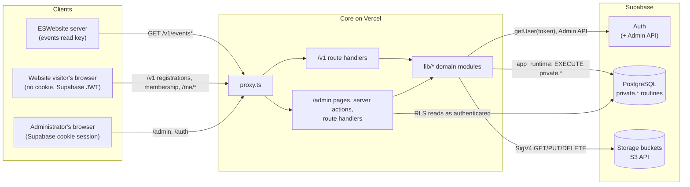
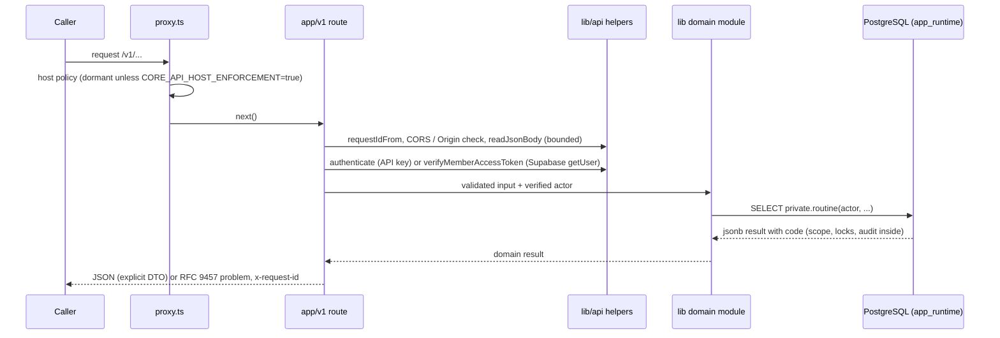

# Architecture

## What Core is

`engsoc-platform` ("Core") is the Engineering Society's system of record. It owns:

- **the versioned public API** (`/v1`), used by the separate public website (ESWebsite);
- **the administration dashboard** (`/admin`), for committee managers, Board Administration and
  the Technical Team;
- **Auth integration**: Supabase Auth sign-in for the dashboard, token verification for website
  members, and user administration through the Auth Admin API;
- **every business rule**: events, capacity, waitlists, registrations, attendance, membership
  review and activation, member profiles, projects, committees, access and permanent deletion.
  These rules are enforced in PostgreSQL routines;
- **files** in private Supabase Storage buckets.

It also still serves a minimal public event list at `/` (`app/(marketing)`), which predates the
separate website.

## Technology

| Concern   | Choice                                                                                                         |
| --------- | -------------------------------------------------------------------------------------------------------------- |
| Framework | Next.js 16.4.2 App Router, React 19.2.8; production build uses webpack (`next build --webpack`)                |
| Language  | TypeScript 5.9                                                                                                 |
| UI        | Tailwind CSS 4, shadcn-style components on Radix (`components/ui`), Lucide icons, `motion`, Sonner             |
| Database  | Supabase PostgreSQL; `postgres` (postgres.js) 3.4.9 with Drizzle ORM 0.45.2 for execution and types            |
| Auth      | Supabase Auth via `@supabase/ssr` 0.12.7 (cookie sessions) and `@supabase/supabase-js` 2.116.0                 |
| Storage   | Supabase Storage through its S3-compatible API with hand-written SigV4 signing; `sharp` 0.35.5 for images      |
| Email     | Supabase Auth email through custom SMTP configured in Supabase (Resend per ADR 0003); no application mail code |
| Tests     | Vitest 5 (unit and disposable-database suites), Playwright 1.63 (browser suites)                               |
| Hosting   | Vercel, through the GitHub integration (ADR 0001, ADR 0007)                                                    |

## Directory map

```text
app/
  (marketing)/          Core's own public event list, event detail and registration server action
  admin/login|recovery  Dashboard sign-in and recovery
  admin/(protected)/    Dashboard pages, server actions and dashboard route handlers
  auth/                 /auth/callback (Auth email links) and /auth/reset (new password)
  v1/                   Public API route handlers (thin transport adapters)
  dev/design-system/    Component gallery (development only)
components/             admin/ (shell, lists, dialogs), auth/ (forms, hash relay), ui/ (primitives)
db/                     schema.ts (partial Drizzle model), index.ts (runtime client), migrations/, rollback/
docs/                   This documentation, ADRs, use-case contracts, runbooks, API contract
lib/
  api/                  Shared /v1 plumbing: API-key auth, CORS, problems, DTOs, body limits, host policy, logging
  auth/                 Cookie client, manager context, member token check, Auth Admin API, callback helpers
  access/ administration/  Access-management and Administration-section server logic
  admin-events/ admin-registrations/ event-management/  Dashboard event, registration and attendance logic
  events/ registrations/  Public event reads and guest registration
  membership/ members/ projects/  Membership applications, member profile and photos, member projects
  client-ip/ security/ db/ supabase/  Trusted client IP, same-origin POST guard, schema version, proxy session refresh
proxy.ts                Request boundary for /admin, /auth and /v1
scripts/                Release gate, format check, staging and production verification scripts
tests/                  Unit tests (tests/*.test.ts), database suites (tests/db), browser suites (e2e, event-flow, profile-flow, project-flow, admin-flow), opt-in staging integration
```

Most domain modules in `lib/` have a short `README.md`. `lib/api`, `lib/client-ip`, `lib/db`,
`lib/security` and `lib/supabase` do not.

## System context



## Request lifecycle

### Public API (`/v1`)



- Route files are thin. The rules live in `lib/*` and, ultimately, in the routine.
- The actor is the verified Supabase user ID, or `null` for anonymous calls. It is never a request
  field (ADR 0015).
- Client IPs for rate limits come only from `x-vercel-forwarded-for`
  ([`lib/client-ip/server.ts`](../../lib/client-ip/server.ts)). Requests without one get 503 on
  routes that rate-limit by IP.
- Server failures are logged with the event name, error class and SQLSTATE only
  ([`lib/api/log.ts`](../../lib/api/log.ts)). SQLSTATEs `42883`, `42P01`, `42703` and `42704` are
  flagged as `schemaMismatch`.

### Dashboard (`/admin`)

1. `proxy.ts` refreshes the Supabase cookie session when an `auth-token` cookie exists.
2. Server Components and server actions call `getManagerContext()`. It verifies the user and reads
   their active grant and visible committees through the RLS-protected Supabase client, as the
   `authenticated` role.
3. Writes and privileged reads call `private.*` routines over `app_runtime` with the user ID, and
   the routine re-checks scope.
4. Next.js protects server actions with its built-in origin checks. The two CSV routes, which are
   plain POST route handlers, add `isSameOriginPost` against `APP_ORIGIN`
   ([`lib/security/request-origin.ts`](../../lib/security/request-origin.ts)).

Details: [Dashboard](../reference/dashboard.md).

## Three ways a caller is identified

| Caller                       | Credential                                                 | Verified by                                                           | Grants                                                   |
| ---------------------------- | ---------------------------------------------------------- | --------------------------------------------------------------------- | -------------------------------------------------------- |
| Website server (event reads) | `Authorization: Bearer essq_(live\|test)_…`                | `private.verify_api_client` (hash, scope, environment, expiry)        | `events:read` only                                       |
| Website visitor (member)     | `Authorization: Bearer <Supabase access token>`, no cookie | Supabase `auth.getUser(token)`                                        | Identity only; membership is decided by routines         |
| Administrator                | Supabase SSR session cookies on Core's origin              | `supabase.auth.getUser()` plus the active `administrative_access` row | The access level and committee scope                     |
| Anonymous                    | none                                                       | none                                                                  | Guest registration, membership application, public reads |

## The database boundary

PostgreSQL is the authority. The runtime role cannot read or write any table directly. It can
only call approved `SECURITY DEFINER` routines, which:

- validate inputs again;
- check the actor's live access (Committee Manager scope, Board or Technical, membership
  reviewer, project reviewer);
- lock rows in a canonical order;
- apply the state change;
- write one or more audit rows in `private.uc02_audit`, in the same transaction;
- return `{code: …}`.

Forced RLS on every table ensures that even a mistaken grant would expose nothing to browser
roles. See [Database security](../reference/database-security.md).

## External services and boundaries

| Service                 | Used for                                                                      | Configuration                                                                                                                                            |
| ----------------------- | ----------------------------------------------------------------------------- | -------------------------------------------------------------------------------------------------------------------------------------------------------- |
| Supabase Auth           | Dashboard sessions, member token verification, recovery and invitation emails | `NEXT_PUBLIC_SUPABASE_URL`, `NEXT_PUBLIC_SUPABASE_ANON_KEY`, `AUTH_REDIRECT_ORIGIN`; dashboard settings (Site URL, redirect allow-list, templates, SMTP) |
| Supabase Auth Admin API | Create, invite, reset, delete users                                           | `SUPABASE_SERVICE_ROLE_KEY`                                                                                                                              |
| Supabase PostgreSQL     | All data, through the transaction pooler                                      | `APP_RUNTIME_DATABASE_URL`                                                                                                                               |
| Supabase Storage (S3)   | ID cards, event covers, project images, member photos                         | `SUPABASE_S3_*`                                                                                                                                          |
| Vercel                  | Hosting, CDN, client-IP header, build-time release gate                       | Vercel project settings (not in the repository)                                                                                                          |
| SMTP (Resend)           | Auth emails, configured inside Supabase                                       | Supabase dashboard; `RESEND_API_KEY` is reserved and unused by code                                                                                      |

## Cross-cutting behaviour

- **Security headers** ([`next.config.ts`](../../next.config.ts)) on every response:
  `frame-ancestors 'none'; base-uri 'self'; object-src 'none'`, `X-Frame-Options: DENY`, `nosniff`,
  `Referrer-Policy: no-referrer` and a restrictive `Permissions-Policy`. `poweredByHeader` is off.
- **Server actions** accept bodies up to 4 MB (`experimental.serverActions.bodySizeLimit`).
- **Release gate** (ADR 0022): `npm run build` first runs
  [`scripts/check-schema-compat.mjs`](../../scripts/check-schema-compat.mjs). On Vercel Production
  it fails the build when the runtime database is older than the code or the runtime role bypasses
  RLS. Preview only warns; outside Vercel it is skipped.
- **Health:** `GET /v1/health` reports `ok` or `schema-behind` without version numbers.
- **Host policy:** the code can split `api.essqu.com` (API only) from `admin.essqu.com` (dashboard
  only), but it is dormant until `CORE_API_HOST_ENFORCEMENT=true`.

## Where decisions are recorded

ADRs in [`docs/adr/`](../adr/) explain why the architecture looks like this. The most relevant:

- 0001, 0002, 0003: stack;
- 0007: direct-to-main workflow;
- 0012–0015: access hierarchy, user administration, lifecycle, trusted actor;
- 0016: separate public API;
- 0017–0019: membership and member accounts;
- 0020–0024: events, projects, reliability, profiles, administration.

This documentation describes what the code does. It does not restate those decisions.
