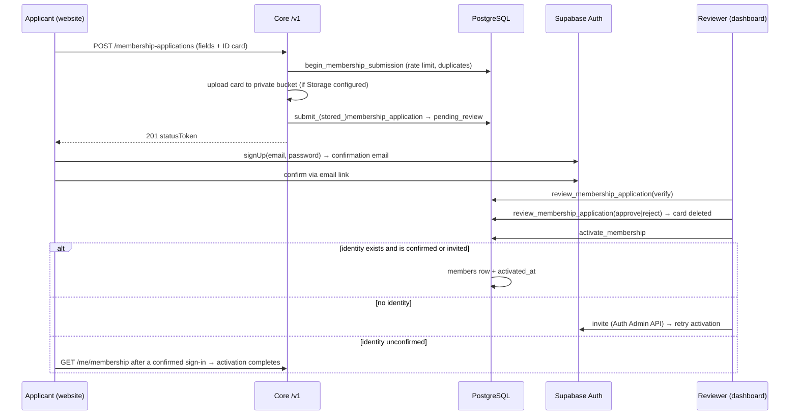
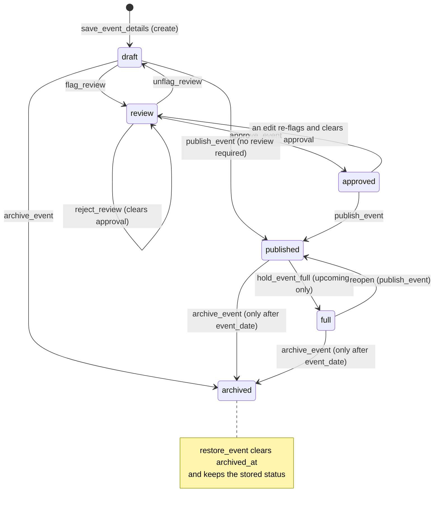
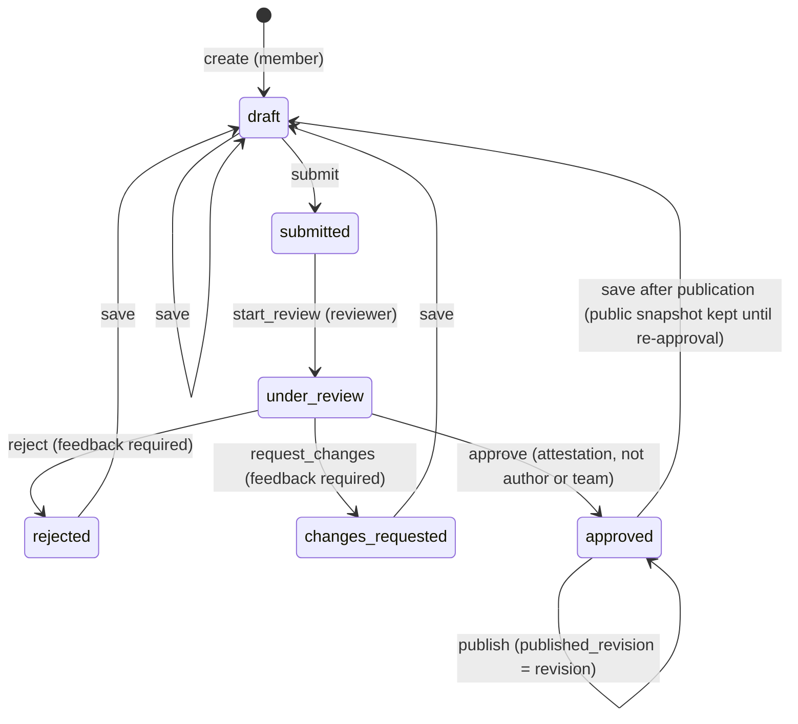

# Business workflows

Each workflow below lists:

- its entry points;
- the states it moves through;
- who may act;
- what it writes;
- how it fails;
- what it depends on outside Core.

Everything is **Source** unless labelled otherwise. The routines named are in `db/migrations/`
and listed in [Database security](../reference/database-security.md#routine-catalog). The website's
side of the same flows is in ESWebsite's
[workflows](https://github.com/EngCrafters/essqu-web/blob/main/docs/explanation/workflows.md).

## Membership: application to active member

| Step               | Entry point                                                                                                   | Who                                                                                                              | Writes                                                                                                                                                                        | Failure cases                                                                                                                                                                                |
| ------------------ | ------------------------------------------------------------------------------------------------------------- | ---------------------------------------------------------------------------------------------------------------- | ----------------------------------------------------------------------------------------------------------------------------------------------------------------------------- | -------------------------------------------------------------------------------------------------------------------------------------------------------------------------------------------- |
| Submit             | `POST /v1/membership-applications`                                                                            | Anyone; SQU email                                                                                                | `membership_applications` (`pending_review`, token hash), `membership_documents` (bytes or Storage reference), `membership_submission_attempts`, audit `membership.submitted` | 422 validation; 409 `already-applied` or `already-member`; 429 after 20 per IP per hour; 503 when Storage is misconfigured or fails (nothing saved; an orphan upload is queued for deletion) |
| Account            | Website → Supabase `signUp`                                                                                   | Applicant                                                                                                        | `auth.users` (unconfirmed)                                                                                                                                                    | Sign-up failure keeps the application; the website offers a retry                                                                                                                            |
| Link               | `GET /v1/me/membership` (any confirmed sign-in)                                                               | Applicant                                                                                                        | `membership_applications.auth_user_id`, audit `membership.account_linked`                                                                                                     | Unconfirmed email links nothing (`emailConfirmed:false`)                                                                                                                                     |
| Verify             | Dashboard `reviewMembershipAction` (`verify`)                                                                 | Society Affairs manager, Board, Technical; not their own email                                                   | `status = verified`, `verified_by`, `revision + 1`, audit                                                                                                                     | `STALE_REVISION`, `INVALID_TRANSITION`, `SELF_REVIEW`, `FORBIDDEN`                                                                                                                           |
| Approve or reject  | Dashboard `reviewMembershipAction`                                                                            | Per policy: `single_step` any reviewer; `two_step` a Senior reviewer other than the verifier, after verification | Decision fields, note (≤ 500 characters), ID card row deleted (Storage object queued), audit                                                                                  | `POLICY_NOT_CONFIRMED` while the policy is unset; `VERIFICATION_REQUIRED`, `SENIOR_APPROVAL_REQUIRED`, `SECOND_REVIEWER_REQUIRED`                                                            |
| Activate           | Dashboard `activateMembershipAction`; or automatically at the applicant's next confirmed `GET /me/membership` | Reviewers; or the applicant's own confirmed sign-in                                                              | `public.members` row (id = Auth user ID), `activated_at`, `member_id`, audit `membership.activated`                                                                           | `NEEDS_INVITATION` (the action invites through the Admin API, then retries); `EMAIL_UNCONFIRMED` (waits); `CONFLICT` (two identities with the email, or a member with the same email or ID)  |
| Policy             | `setMembershipPolicyAction`                                                                                   | Technical                                                                                                        | `membership_settings.approval_policy`, audit `membership.policy_changed`                                                                                                      | `FORBIDDEN`                                                                                                                                                                                  |
| Correct name or ID | `POST /v1/me/profile/changes`, then dashboard `decideCorrectionAction`                                        | Member; then a membership reviewer                                                                               | `member_change_requests`; on approval the member row is updated; audit `member.change_requested` and `member.change_decided`                                                  | `ALREADY_PENDING`, `UNCHANGED`, `VALIDATION_ERROR`                                                                                                                                           |

**External dependencies:**

- Supabase Auth for sign-up, confirmation and invitations. Invitations need
  `SUPABASE_SERVICE_ROLE_KEY` and a redirect on the allow-list.
- Storage for ID cards (optional fallback to the database).
- The website, for the applicant UI.

**Not implemented:**

- automatic expiry or deletion of applications;
- membership suspension.

## Sign-in, sessions, sign-out and recovery

| Audience        | Sign-in                                                               | Session                                                                                                                        | Recovery                                                                                                                                                                                                                                                                                                      |
| --------------- | --------------------------------------------------------------------- | ------------------------------------------------------------------------------------------------------------------------------ | ------------------------------------------------------------------------------------------------------------------------------------------------------------------------------------------------------------------------------------------------------------------------------------------------------------- |
| Dashboard users | `/admin/login` → `loginAction` (`signInWithPassword` on the server)   | Supabase SSR cookies on Core's origin, refreshed by `proxy.ts`. Access is re-read from the database on every request.          | `/admin/recovery` → email to `AUTH_REDIRECT_ORIGIN/auth/callback` (PKCE code needs the same browser; token-hash links work anywhere) → `/auth/reset` → new password → recovery session ended → `/admin/login?reset=success`. `AuthHashRelay` converts `#access_token` links sent from the Supabase dashboard. |
| Website members | Website `/login` in the browser (`signInWithPassword`, implicit flow) | Browser storage on the website's origin. Core receives only the Bearer access token, verified per request with `auth.getUser`. | Website `/forgot-password` → email to `<site>/reset-password` → recovery verified in that page load → new password → global sign-out                                                                                                                                                                          |

- **Sign-out.** Dashboard: `logoutAction` (`supabase.auth.signOut()`). Website: local sign-out,
  or global after a password reset.
- **Revocation.** Revoking dashboard access ends authorization on the next request. Core does not
  invalidate the user's Auth session (ADR 0014).
- **Messages.** Both apps answer "no account" and "wrong password" the same way, and give the same
  recovery answer for every address.
- **Dependencies.** Supabase Auth settings (Site URL, redirect allow-list, token-hash templates,
  custom SMTP) are configured in the Supabase dashboard and documented in
  [`AUTH_AND_EMAIL.md`](../AUTH_AND_EMAIL.md).

## Events

`review` and `approved` are draft events with `review_required = true`, shown as their own states
by [`lib/admin-events/status.ts`](../../lib/admin-events/status.ts). "Past" is derived once
`event_date` passes.

- **Who.** Any active level within committee scope creates, edits and runs the lifecycle. Only
  Board or Technical approve or reject review-required events, and never as the current review
  subject.
- **Edits.** Editing review-relevant fields re-flags the event and clears an earlier approval.
  Every lifecycle routine checks `expected_revision`, locks the event row, increments `revision`
  and writes one audit row (`event.*`).
- **Archived committees** cannot receive new events (trigger `events_committee_not_archived`).
- **Covers and phone.** `saveEventAction` uploads a JPEG or PNG cover (≤ 3 MiB, re-encoded) to the
  event bucket before saving. It removes the new object if the save fails, and removes the old
  object after a replacement. `phone_required` forces registrants to give a phone number.

**Archive and restore.** `archive_event` accepts drafts, and published or full events only after
their date (`INVALID_TRANSITION` otherwise). `restore_event` clears `archived_at` and keeps the
stored status. Publishing a review-required event without an approval for the current revision
returns `APPROVAL_REQUIRED`.

### Registration, capacity and waitlist

| Rule                                                                                                                  | Where                                                   |
| --------------------------------------------------------------------------------------------------------------------- | ------------------------------------------------------- |
| Only `published` or `full`, unarchived events accept registrations                                                    | `register_for_event_seat`                               |
| Registration closes at `event_date`                                                                                   | same                                                    |
| `register` only when not full; `join_waitlist` only when full (status `full`, capacity reached, or a waitlist exists) | same                                                    |
| One active registration per email per event; one per member per event                                                 | Partial unique indexes                                  |
| Guests: 20 attempts per IP per 10 minutes; members: 10 per member per 10 minutes                                      | `guest_registration_limit`, `member_registration_limit` |
| Phone required when `phone_required`                                                                                  | `register_event_guest`, `register_event_member`         |
| Members register with their verified profile, and guest registrations with their confirmed email are linked to them   | `register_event_member`, `link_member_registration`     |

- **Waitlist promotion** (`promoteWaitlistAction` → `private.promote_waitlist`) is first in,
  first out. The organizer must attest that they contacted the person. It writes
  `registration.promoted`.
- **CSV export** of confirmed or waitlisted registrations (`POST …/registrations/export`) is
  bounded (10,000 rows or 10 MiB) and refused if counts change mid-export. It is audited as
  `registrations.exported` with a bounded snapshot.

### Attendance

1. An organizer opens check-in for a window of at most 12 hours (`manage_event_checkin`
   `open`). A random secret is stored, and each minute's code is
   `sha256(secret:minute)`.
2. Every organizer screen shows the same code. "Rotate" replaces the secret, which revokes all
   outstanding codes; "close" ends the session.
3. A member scans a QR code that opens `PUBLIC_WEBSITE_ORIGIN/events/{id}/attendance#checkin=…`,
   signs in, and presses confirm (`POST /v1/me/events/{id}/attendance`). The code is accepted for
   the current minute and the two before it.
4. `confirm_member_attendance` sets `attended`, `checked_in_at` and `checkin_method = 'qr'`, and
   writes `attendance.confirmed`. Repeats return the original time.
5. Organizers can record or undo attendance manually for confirmed registrations, never their
   own, with fixed reasons (`record_manual_attendance`; audit `attendance.manual_*`).
6. The attendance CSV is limited to 10,000 rows, includes a method column and excludes phone
   numbers.

## Projects

- **Authors** are email-confirmed members with status `member`, with at most 20 open projects
  each.
- **Reviewers** are the Society Affairs manager, Board and Technical (`project_reviewer`).
- **Publication.** `publish` copies the approved revision into `published_content`. `unpublish`
  removes it from public reads immediately: the website reads with `no-store`.
- **Media.** Up to 12 stored images per project and 6 selected per revision. An image used by the
  working or published snapshot cannot be deleted.
- **History.** Every step adds a `project_history` row, and authors follow decisions there. No
  email is sent.
- **Deletion.** Permanent deletion requires the project to be unpublished first (see below).

## Committees, rosters and access

| Operation                             | Who                                                                     | Rules                                                                                                                                                                                                                                                      |
| ------------------------------------- | ----------------------------------------------------------------------- | ---------------------------------------------------------------------------------------------------------------------------------------------------------------------------------------------------------------------------------------------------------- |
| Create committee                      | Board, Technical                                                        | Unique name ignoring case; a slug in the required format, fixed at creation; optional description                                                                                                                                                          |
| Edit committee                        | Board, Technical                                                        | Name and description only                                                                                                                                                                                                                                  |
| Archive committee                     | Board, Technical                                                        | Refused for `society-affairs` and `technical-team` (`PROTECTED_COMMITTEE`), and while active managers or upcoming live events exist (`BLOCKED`). Archived committees keep their records but accept no new events, grants, reactivations or roster changes. |
| Restore committee                     | Board, Technical                                                        | Clears `archived_at`                                                                                                                                                                                                                                       |
| Roster add, update, remove            | Board, Technical                                                        | Members only; a responsibility of 1–120 characters; grants nothing                                                                                                                                                                                         |
| Grant or reassign a Committee Manager | Technical; Board (not on Board or Technical accounts)                   | One grant row per user; a manager has exactly one committee; reassignment moves it atomically; the committee must not be archived                                                                                                                          |
| Replace a manager                     | Board, Technical                                                        | Revokes the old grant and grants the new one, with two correlated audit rows; the replacement must have no active access                                                                                                                                   |
| Suspend or reactivate                 | Technical; Board for managers only                                      | A suspension is a revocation with `revocation_kind = 'suspended'`. Reactivation restores the same level and committee, unless the committee is archived.                                                                                                   |
| Grant or revoke Board                 | Technical                                                               | Audited                                                                                                                                                                                                                                                    |
| Grant, revoke or suspend Technical    | Technical                                                               | The last active Technical account cannot be removed (`LAST_TECHNICAL_ADMIN`)                                                                                                                                                                               |
| Create or invite an account           | Technical: any role. Board: no role or Committee Manager, by invitation | Auth Admin API, then the access routine. An account alone grants nothing.                                                                                                                                                                                  |
| Temporary password, reset email       | Technical                                                               | Auth Admin API; the password is never stored or logged; audited                                                                                                                                                                                            |

All access changes serialize on a shared lock, write audit rows in the same transaction, and take
effect on the next request.

## Archive versus permanent deletion

| Record                   | Reversible option   | Permanent deletion                                                                                                                                                                                                                                                                                                                                                                                 | Who              |
| ------------------------ | ------------------- | -------------------------------------------------------------------------------------------------------------------------------------------------------------------------------------------------------------------------------------------------------------------------------------------------------------------------------------------------------------------------------------------------- | ---------------- |
| Event                    | Archive and restore | Allowed for archived events, and for unarchived drafts without registrations. Blocked by `EVENT_ACTIVE`, `EVENT_HAS_REGISTRATIONS` or `CERTIFICATES_EXIST`. Deletes the event, its registrations (personal data) and its check-in session; queues the cover.                                                                                                                                       | Board, Technical |
| Project                  | Unpublish           | Requires unpublished (`PROJECT_PUBLISHED` blocks). Deletes the project, its history and media rows; queues the images.                                                                                                                                                                                                                                                                             | Board, Technical |
| Committee                | Archive and restore | **Not available**                                                                                                                                                                                                                                                                                                                                                                                  | —                |
| Membership record        | none                | Deletes the member row, applications and ID cards, correction requests, roster places, photo and rate-limit rows. Registrations are **anonymized**, not deleted. The Auth account remains. Blocked by `MEMBER_HAS_PROJECTS` or `LEGACY_RECORDS`. Requires the actor's password.                                                                                                                    | Board, Technical |
| Account (erasure)        | Revoke access       | Everything in the membership record deletion, plus the revoked grant row, pseudonymized audit rows (`actor_kind = 'erased'`, IDs nulled in JSON, notes removed), then deletion of the Auth identity. Blocked by `ACTIVE_ACCESS` (revoke first) and `ACCOUNTABILITY_RECORDS` (the identity anchors grants, reviews, approvals, project decisions or policy changes). Requires the actor's password. | Technical        |
| Application under review | none                | **Not available**                                                                                                                                                                                                                                                                                                                                                                                  | —                |
| Audit rows               | none                | **Never deleted.** Only erasure pseudonymization may update them.                                                                                                                                                                                                                                                                                                                                  | —                |

**Common to every permanent deletion:**

1. A preview lists everything affected and every blocker (`preview_*_deletion`).
2. The actor types the record's name, title or email.
3. The deletion runs in one database transaction (`delete_*`, `erase_account`). Storage objects
   are queued in `membership_storage_deletions` and deleted afterwards by the queue processor.
4. **Account erasure only.** The database part commits first and records
   `private.account_erasures`. The server then deletes the Auth identity with the service-role
   key, and `complete_account_erasure` confirms it. If the Auth call fails or the key is missing,
   the erasure stays **pending** and is retried from the Administration overview
   (`retryErasureAction`).

No one can delete their own records.
