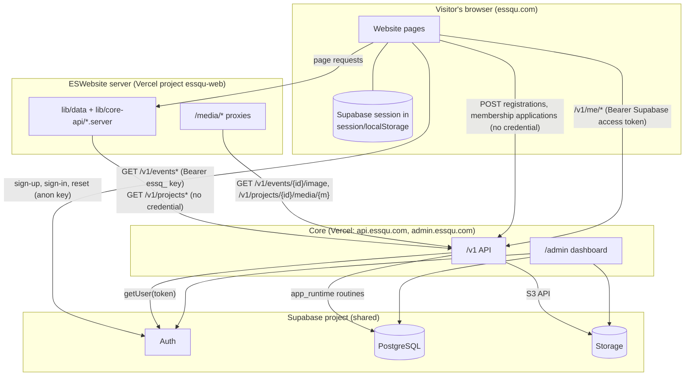

# System integration guide

How the public website (**ESWebsite**, GitHub `EngCrafters/essqu-web`) and **Core**
(`EngCrafters/engsoc-platform`, this repository) work together. This is the canonical shared
guide: the API, database and permission references live in Core's documentation, and the website
documentation links here.

Commits documented:

- ESWebsite `740d29d3c4281c7062b72213f34736037d0149b6`;
- Core `b4ec91faf17ff93566a671b8f074bd8bc70aaa6f`.

Both were inspected on 2026-10-24.

## Repositories and layout

```text
ESSQU/
├── ESWebsite/          public website   → https://github.com/EngCrafters/essqu-web
└── engsoc-platform/    Core             → https://github.com/EngCrafters/engsoc-platform
```

The repositories are independent: separate histories, CI and Vercel projects. Links from Core to
the website use GitHub URLs, for example the website's
[documentation index](https://github.com/EngCrafters/essqu-web/blob/main/docs/README.md). In a
sibling checkout they are under `../ESWebsite/docs/`.

## Ownership and boundaries

| Concern                                                | Owner                                              | Notes                                                                                          |
| ------------------------------------------------------ | -------------------------------------------------- | ---------------------------------------------------------------------------------------------- |
| Public pages, design, bilingual copy, prototypes       | ESWebsite                                          | Content files and `config/site-features.json`                                                  |
| Events, registrations, capacity, waitlists, attendance | Core                                               | Database routines; the website shows Core's answers                                            |
| Membership applications, review, activation            | Core                                               | Website collects the form and file and sends them                                              |
| Member profiles, photos, corrections                   | Core                                               | Website edits through `/v1/me/*`                                                               |
| Projects (drafts, review, publication)                 | Core                                               | Website submits and displays                                                                   |
| Identity (accounts, passwords, emails)                 | Supabase Auth, **one project shared** by both apps | Website: browser sign-in for members. Core: dashboard sessions, token verification, Admin API. |
| Administrative access, committees, deletion            | Core                                               | Dashboard only                                                                                 |
| Data and files                                         | Core (Supabase PostgreSQL and Storage)             | The website has no database or Storage access                                                  |

## How requests flow



**Calls that bypass the website server**, by design:

- **Browser → Core** for every write and every member call. Core sees the visitor's IP for rate
  limits and the visitor's own token for identity, and the website server never handles
  passwords, ID cards or tokens.
- **Browser → Supabase Auth** for sign-up, sign-in, confirmation, password reset and email change.

There are **no** website → database, website → Storage, or Core → website calls. Core sends no
webhooks.

## Authentication and session ownership

| Credential                       | Created by                             | Held where                                                             | Sent to                                               | Verified by                                                          |
| -------------------------------- | -------------------------------------- | ---------------------------------------------------------------------- | ----------------------------------------------------- | -------------------------------------------------------------------- |
| `CORE_EVENTS_API_KEY` (`essq_…`) | Core operator (`private.api_clients`)  | Website Vercel secret; website server only                             | `GET /v1/events*`                                     | `private.verify_api_client` (hash, scope `events:read`, environment) |
| Member Supabase session          | Supabase Auth (website browser)        | Website origin's `sessionStorage` or `localStorage` (`es-member-auth`) | Access token as `Authorization: Bearer` to `/v1/me/*` | Core: `supabase.auth.getUser(token)`, then database rules            |
| Dashboard session                | Supabase Auth (Core server)            | `@supabase/ssr` cookies on Core's origin                               | Core only                                             | Core: `getUser()` plus `administrative_access`                       |
| Membership status token          | Core (`POST /membership-applications`) | Applicant's `localStorage` (`es-membership-application`)               | JSON body of `/membership-applications/status`        | SHA-256 match in the database                                        |
| Check-in code                    | Core (per-minute derivation)           | QR fragment, then `sessionStorage` for at most 3 minutes               | JSON body of `POST /v1/me/events/{id}/attendance`     | `private.confirm_member_attendance`                                  |

- **No cookies cross between the systems.** All browser calls to Core use
  `credentials: 'omit'`, and Core's CORS never allows credentials.
- **Authorization lives in Core's database.** A Supabase account, a website session or a visible
  menu item grants nothing. See [Roles and permissions](../reference/roles-and-permissions.md).

## Contract map

| Website caller (ESWebsite)                                                             | Endpoint                                                           | Core handler                                        | Core domain → database                                                                                                                                                           |
| -------------------------------------------------------------------------------------- | ------------------------------------------------------------------ | --------------------------------------------------- | -------------------------------------------------------------------------------------------------------------------------------------------------------------------------------- |
| `lib/core-api/events.server.ts` `listCoreEvents`                                       | `GET /v1/events`                                                   | `app/v1/events/route.ts`                            | `lib/events` → `list_public_events`, `public_event_options`                                                                                                                      |
| `lib/core-api/events.server.ts` `getCoreEvent`                                         | `GET /v1/events/{id}`                                              | `app/v1/events/[eventId]/route.ts`                  | `get_public_event`, `public_event_options`                                                                                                                                       |
| `app/media/events/[eventId]/route.ts`                                                  | `GET /v1/events/{id}/image`                                        | `app/v1/events/[eventId]/image/route.ts`            | `get_public_event`, `public_event_options`; event bucket                                                                                                                         |
| `lib/core-api/registration.ts` `submitRegistration`                                    | `POST /v1/events/{id}/registrations`                               | `app/v1/events/[eventId]/registrations/route.ts`    | `lib/registrations` → `register_event_guest`                                                                                                                                     |
| `lib/core-api/membership.ts` `submitMembershipApplication`                             | `POST /v1/membership-applications`                                 | `app/v1/membership-applications/route.ts`           | `lib/membership` → `begin_membership_submission`, `submit_membership_application` or `submit_stored_membership_application`, `queue_abandoned_membership_upload`; ID-card bucket |
| `lib/core-api/membership.ts` `fetchApplicationStatus`                                  | `POST /v1/membership-applications/status`                          | `app/v1/membership-applications/status/route.ts`    | `get_membership_application_status`                                                                                                                                              |
| `lib/member-auth/membership.ts` `fetchOwnMembership`                                   | `GET /v1/me/membership`                                            | `app/v1/me/membership/route.ts`                     | `get_my_membership` (links and may activate)                                                                                                                                     |
| `lib/core-api/member-events.ts` `fetchMemberEvent`                                     | `GET /v1/me/events/{id}/attendance`                                | `app/v1/me/events/[eventId]/attendance/route.ts`    | `lib/event-management` → `get_member_event`                                                                                                                                      |
| `components/pages/events/AttendanceConfirmation.tsx`                                   | `POST /v1/me/events/{id}/attendance`                               | same                                                | `confirm_member_attendance`                                                                                                                                                      |
| `components/pages/events/RegistrationPanel.tsx`                                        | `POST /v1/me/events/{id}/registrations`                            | `app/v1/me/events/[eventId]/registrations/route.ts` | `register_event_member`                                                                                                                                                          |
| `RegistrationPanel.tsx`; `lib/core-api/member-profile.ts` `saveOwnProfile`             | `PATCH /v1/me/profile`                                             | `app/v1/me/profile/route.ts`                        | `update_member_phone` or `update_own_profile`                                                                                                                                    |
| `member-profile.ts` `fetchOwnProfile`; `lib/member-auth/account.tsx`                   | `GET /v1/me/profile`                                               | same                                                | `lib/members/profile` → `get_own_profile`                                                                                                                                        |
| `member-profile.ts` `requestCorrection`                                                | `POST /v1/me/profile/changes`                                      | `app/v1/me/profile/changes/route.ts`                | `request_profile_change`                                                                                                                                                         |
| `member-profile.ts` `fetchOwnRegistrations`                                            | `GET /v1/me/events`                                                | `app/v1/me/events/route.ts`                         | `list_own_registrations`                                                                                                                                                         |
| `member-profile.ts` `sendPhoto`; `account.tsx`                                         | `GET`, `PUT`, `DELETE /v1/me/profile/photo`                        | `app/v1/me/profile/photo/route.ts`                  | `get_own_photo_key`, `set_own_photo`; member-photo bucket                                                                                                                        |
| `lib/core-api/projects.server.ts`                                                      | `GET /v1/projects`, `GET /v1/projects/{id}`                        | `app/v1/projects/route.ts`, `[id]/route.ts`         | `lib/projects` → `public_projects`                                                                                                                                               |
| `app/media/projects/[id]/[media]/route.ts`; `member-projects.ts` `projectImageRequest` | `GET /v1/projects/{id}/media/{media}`                              | `app/v1/projects/[id]/media/[media]/route.ts`       | `project_media_key`; project bucket                                                                                                                                              |
| `lib/core-api/member-projects.ts` `fetchMemberProjects`, `writeMemberProject`          | `GET`, `POST /v1/me/projects`; `GET`, `PATCH /v1/me/projects/{id}` | `app/v1/me/projects/**/route.ts`                    | `project_read`, `project_write`                                                                                                                                                  |
| `member-projects.ts` `projectImageRequest`; `ProjectSubmission.tsx`                    | `POST /v1/me/projects/{id}/media`; `DELETE …/media/{media}`        | `app/v1/me/projects/[id]/media/**/route.ts`         | `project_media_change`; project bucket                                                                                                                                           |

Request and response details: [API reference](../reference/api.md). Website-side behaviour:
the website's
[Core API consumption](https://github.com/EngCrafters/essqu-web/blob/main/docs/reference/core-api-consumption.md).

## Shared configuration

### Values that must match across systems

| What                     | ESWebsite (Vercel `essqu-web`)            | Core (Vercel Core project)                                                                     | Supabase                                                               |
| ------------------------ | ----------------------------------------- | ---------------------------------------------------------------------------------------------- | ---------------------------------------------------------------------- |
| Supabase project         | `SUPABASE_URL`, `SUPABASE_ANON_KEY`       | `NEXT_PUBLIC_SUPABASE_URL`, `NEXT_PUBLIC_SUPABASE_ANON_KEY` (plus `SUPABASE_SERVICE_ROLE_KEY`) | The **same project** in each environment                               |
| Core address             | `CORE_API_BASE_URL` = Core origin + `/v1` | (where Core is served)                                                                         | n/a                                                                    |
| Event read key           | `CORE_EVENTS_API_KEY`                     | Row in `private.api_clients` with the matching environment and `events:read`                   | n/a                                                                    |
| Website origins          | Where the site is served                  | Listed exactly in `CORE_API_ALLOWED_ORIGINS`                                                   | `<origin>/login`, `<origin>/reset-password` on the redirect allow-list |
| QR destination           | n/a                                       | `PUBLIC_WEBSITE_ORIGIN`                                                                        | n/a                                                                    |
| Profile feature switches | `config/site-features.json` `profile.*`   | `MEMBER_PHOTO_UPLOADS`, `MEMBER_PROFILE_EDITING`                                               | n/a                                                                    |

### Domains

| Host                         | Serves                                                        | Evidence                  |
| ---------------------------- | ------------------------------------------------------------- | ------------------------- |
| `essqu.com`                  | ESWebsite                                                     | **Deployed** (2026-10-24) |
| `www.essqu.com`              | 308 to `essqu.com`                                            | **Deployed** (2026-10-22) |
| `essqu-web.vercel.app`       | ESWebsite                                                     | **Deployed** (2026-10-22) |
| `api.essqu.com`              | Core (`/v1`; host enforcement off, so `/admin` also responds) | **Deployed** (2026-10-24) |
| `admin.essqu.com`            | Core dashboard                                                | **Deployed** (2026-10-24) |
| `engsoc-platform.vercel.app` | Core                                                          | **Deployed** (2026-10-24) |

### Supabase Auth settings

The website depends on these settings in the shared Supabase project ([`AUTH_AND_EMAIL.md`](../AUTH_AND_EMAIL.md) §3 and §9):

1. Email provider with public sign-up **enabled** and email confirmation **enabled**.
2. Minimum password length **8**, which both apps' forms mirror.
3. **Redirect URLs** containing `<origin>/login` and `<origin>/reset-password` for every website
   origin (`https://essqu.com`, `https://www.essqu.com`, `https://essqu-web.vercel.app`), plus
   Core's `<AUTH_REDIRECT_ORIGIN>/auth/callback`. Local origins belong only in the staging project.
4. **Site URL** at Core's production origin.
5. **Email templates** using `{{ .RedirectTo }}?token_hash={{ .TokenHash }}&type=<type>`. A
   template hard-coded to `/auth/callback` sends members to Core's dashboard reset page.
6. **Custom SMTP** for delivery. The built-in mailer is heavily rate limited.

These affect confirmation, reset and invitation emails. They do **not** decide whether the
website's `/login` page renders: that depends only on the website's own `SUPABASE_URL` and
`SUPABASE_ANON_KEY`.

## Running both systems locally

1. **Pick ports.** Website on `3000` (`npm run dev` in ESWebsite) and Core on `3001`
   (`npm run dev -- -p 3001` in engsoc-platform). The website's `.env.example` assumes this.
   Core's `AUTH_AND_EMAIL.md` mentions the website on `3001`; use one convention consistently.
2. **Core `.env.local`:**
   - the staging Supabase values and the staging `app_runtime` URL;
   - `CORE_API_ALLOWED_ORIGINS=http://localhost:3000`;
   - `PUBLIC_WEBSITE_ORIGIN=http://localhost:3000`;
   - storage variables only if testing uploads.
3. **Website `.env.local`:**
   - `CORE_API_BASE_URL=http://127.0.0.1:3001/v1`;
   - `CORE_EVENTS_API_KEY` = an `essq_test_` key registered in the staging database;
   - `SUPABASE_URL` and `SUPABASE_ANON_KEY` = the same staging project as Core.
4. **Staging Supabase:** add `http://localhost:3000/login` and `http://localhost:3000/reset-password`
   to the redirect allow-list if you need emails to return locally.
5. **Restart both apps** after changing environment files.
6. **For a fully disposable setup** with no staging access, use Core's two-app browser harness
   (`npm run test:event-flow`, `test:profile-flow`, `test:project-flow`, `test:admin-flow`). It
   starts both apps against a local database with synthetic Auth and S3 adapters.

## Deployment order and compatibility

1. **Database first.** Apply Core's reviewed migrations to the target database (with approval).
2. **Core second.** Core's release gate refuses a production build when the database is older
   than the code.
3. **Website last**, once Core serves the endpoints and fields it needs. A website deployed
   early fails closed: event surfaces show "unavailable", and membership, profile and project
   actions answer "can't be done right now".
4. **Environment variables:** set them in the right Vercel scope of each project, then **redeploy
   that project**. Deployments keep the variables they were built with.
5. **Backward compatibility.** The `/v1` contract is additive: new optional fields, and an
   optional `reason` on 409. The website tolerates older Core (unknown reasons fall back to
   generic messages) and validates every response. Removing or renaming a field is a breaking
   change that needs a coordinated release.

## Diagnosing integration failures

| Symptom on the website                                                      | Where to look                                                                                                                                                                                                                                                                                                                                                                                                                                                                                       |
| --------------------------------------------------------------------------- | --------------------------------------------------------------------------------------------------------------------------------------------------------------------------------------------------------------------------------------------------------------------------------------------------------------------------------------------------------------------------------------------------------------------------------------------------------------------------------------------------- |
| `/login`: "Sign-in isn't available right now. Please try again later."      | **Website configuration only.** `SUPABASE_URL` or `SUPABASE_ANON_KEY` is missing or invalid in the website's runtime for that deployment: wrong name, a URL with a path, quotes, or a variable added without a redeploy. Not caused by API keys, CORS, Core or Supabase redirect settings. Checklist: [website troubleshooting](https://github.com/EngCrafters/essqu-web/blob/main/docs/how-to/deployment-and-troubleshooting.md#sign-in-isnt-available-right-now-please-try-again-later-on-login). |
| Signed in, then signed out again; or "membership status couldn't be loaded" | `GET /v1/me/membership`: a 401 means the website and Core use different Supabase projects; a CORS block means Core lacks the origin; a 503 means Core's `NEXT_PUBLIC_SUPABASE_*` are missing or Supabase is unreachable                                                                                                                                                                                                                                                                             |
| Events "can't be shown right now"                                           | Website logs: `unconfigured` (website variables) or `kind: unauthorized/forbidden` (key not registered in this Core's database, wrong environment, no `events:read`). Core: `GET /v1/health`.                                                                                                                                                                                                                                                                                                       |
| Registration or application "can't be done right now"                       | Browser console CORS error means `CORE_API_ALLOWED_ORIGINS` is missing the origin. Core 503 means no client IP, a database failure, or (applications) `membership_storage_misconfigured`.                                                                                                                                                                                                                                                                                                           |
| `/v1/health` 503 `schema-behind`, or Core production build refused          | The database is older than Core's code: migrate (with approval), then redeploy Core                                                                                                                                                                                                                                                                                                                                                                                                                 |
| Images missing or uploads failing                                           | Core's `SUPABASE_S3_*`: shared variables plus each feature's private, distinct bucket. Website proxies return 404, 502 or 503 based on Core's answer.                                                                                                                                                                                                                                                                                                                                               |
| QR codes open the wrong site                                                | Core's `PUBLIC_WEBSITE_ORIGIN`                                                                                                                                                                                                                                                                                                                                                                                                                                                                      |
| Confirmation or reset emails open the dashboard, or say invalid             | Supabase templates and redirect allow-list (see above)                                                                                                                                                                                                                                                                                                                                                                                                                                              |

## Which repository changes

| Task                                                       |            ESWebsite            |                                      Core                                      |
| ---------------------------------------------------------- | :-----------------------------: | :----------------------------------------------------------------------------: |
| Copy, translations, layout, animations, a new content page |                ✔                |                                                                                |
| Turn a website page on or off (Coming Soon)                |                ✔                |                                                                                |
| Show an existing Core field differently                    |                ✔                |                                                                                |
| A new event, project or member field                       |           ✔ (display)           |                   ✔ (ADR, migration, routine, DTO, OpenAPI)                    |
| A new rule (capacity, eligibility, limits, review)         |                                 |                                       ✔                                        |
| A new public or member endpoint                            |           ✔ (caller)            |                                       ✔                                        |
| Dashboard features, committees, roles, deletion            |                                 |                                       ✔                                        |
| A new website origin or domain                             |           ✔ (Vercel)            | ✔ (`CORE_API_ALLOWED_ORIGINS`, `PUBLIC_WEBSITE_ORIGIN`) and Supabase redirects |
| Disable profile editing or photo uploads                   | ✔ (`config/site-features.json`) |                    ✔ (`MEMBER_*` variables; Core enforces)                     |
| Rotate the event read key                                  |        ✔ (Vercel secret)        |                           ✔ (`private.api_clients`)                            |

## Observed configuration (read-only, 2026-10-24)

- **Production pages of both apps reference the staging project.** The production website's
  report-only CSP and Core's production client bundles (`engsoc-platform.vercel.app`,
  `admin.essqu.com`, `api.essqu.com`) all reference the Supabase project ID that
  [`docs/CURRENT_WORK.md`](../CURRENT_WORK.md) records as **staging**.
- **The production database is newer than recorded.** `GET https://api.essqu.com/v1/health`
  returned `ok` (schema ≥ 32), while `CURRENT_WORK.md` records the production database at 0024.

**Inferred:** both production deployments currently run on the staging Supabase project. Because
this changes where real member data lives, the owner should confirm whether it is intended:

- if it is, record it in `CURRENT_WORK.md`, and stop using "staging" for disposable testing;
- if it is not, plan a coordinated switch of both projects' variables, with migrations applied to
  the production project first.

Nothing was changed by this observation.
