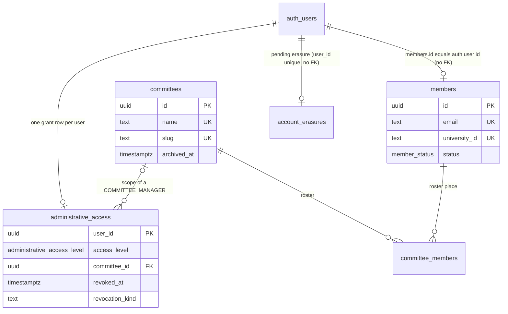
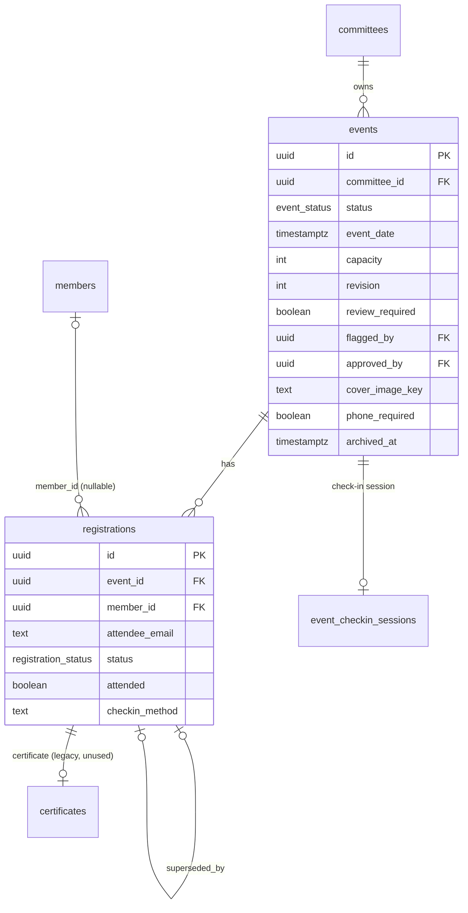
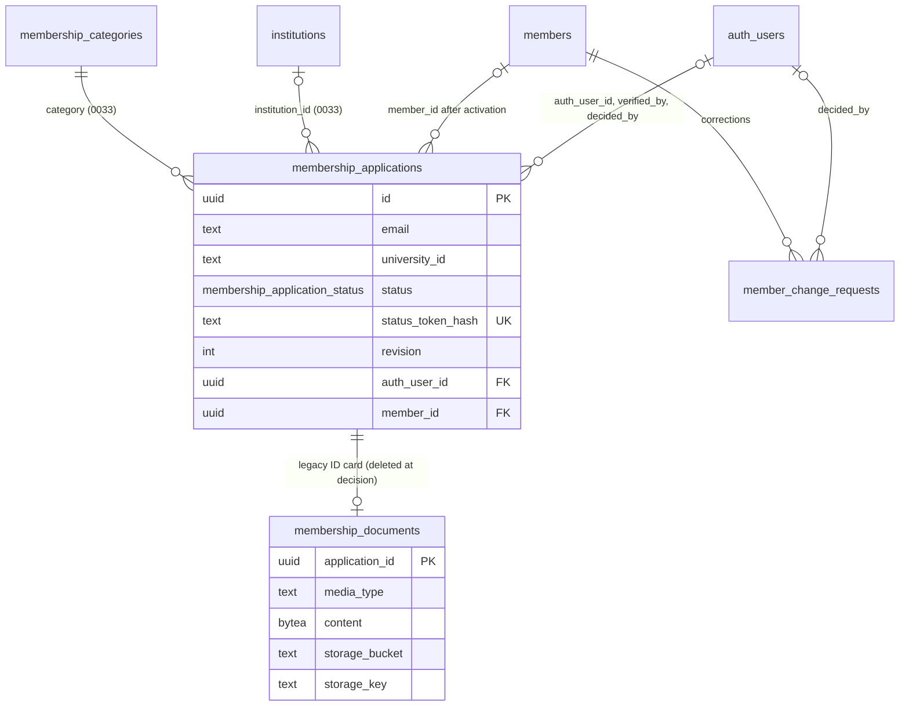
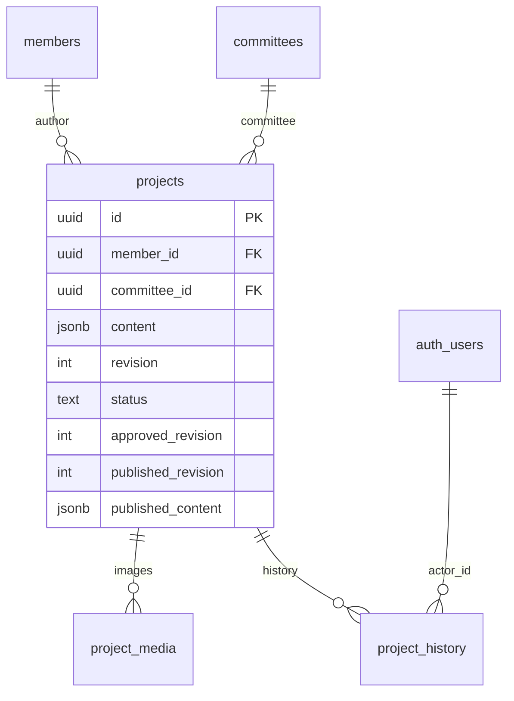
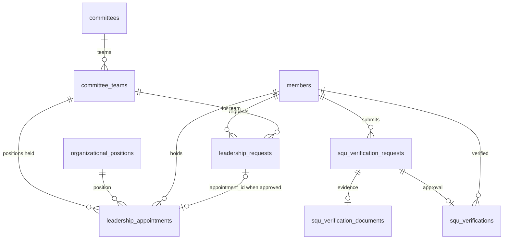

# Database schema

The application schema as defined by the journaled SQL migrations `0000`–`0033` in
[`db/migrations/`](../../db/migrations/). Migration 0033 (ADR 0025, Development Cycle 2) is
described from its source and was replayed on the same kind of disposable local database on
2026-11-18; it is not applied to any hosted database.

**How this was verified (2026-10-24).** The column, constraint, index, policy, routine and trigger
lists below were extracted **read-only** from a disposable local PostgreSQL 17 database. An
earlier session built it by replaying every journaled migration (`private.core_schema_version()`
= 32). Its routines match the `CREATE FUNCTION` statements in the migrations, except one
test-harness probe (`private.unapproved_probe`) and two routines that 0023 dropped. The local
database stubs Supabase's `auth` schema, so details of `auth.*` itself are not described here.
**No hosted database was queried.** Which migrations are applied remotely is covered in
[Migrations](../how-to/migrations.md#what-is-applied-where).

Security (roles, grants, RLS, routines) is in [Database security](database-security.md). Files
are in [Storage](storage.md).

## Schemas

| Schema    | Purpose                                                                                                                                                      |
| --------- | ------------------------------------------------------------------------------------------------------------------------------------------------------------ |
| `public`  | Core domain tables: committees, events, registrations, members, access. Forced RLS on every table; browser roles see almost nothing (see Database security). |
| `private` | Never exposed through PostgREST. Applications, documents, projects, audit, API clients, rate limits, check-in sessions, and every routine.                   |
| `auth`    | Supabase Auth (managed by Supabase). Core references `auth.users(id)` by foreign keys and reads it only through the view `private.access_auth_users`.        |

## Enumerated types

| Type                                    | Values                                               |
| --------------------------------------- | ---------------------------------------------------- |
| `public.administrative_access_level`    | `COMMITTEE_MANAGER`, `BOARD_ADMIN`, `TECHNICAL`      |
| `public.event_status`                   | `draft`, `published`, `full`                         |
| `public.registration_status`            | `confirmed`, `waitlisted`, `superseded`              |
| `public.member_status`                  | `member`, `graduate`                                 |
| `private.membership_application_status` | `pending_review`, `verified`, `approved`, `rejected` |
| `public.archive_type`                   | `project`, `magazine`                                |
| `public.archive_source`                 | `native`, `migrated`                                 |
| `public.mentorship_status`              | `requested`, `confirmed`                             |

Other closed vocabularies are CHECK constraints on `text` columns: project status, change-request
fields and status, approval policy, storage deletion reason, check-in method, revocation kind,
audit actor kind and action.

## Entity relationships

The diagrams use underscores for schema-qualified names (`auth_users` means `auth.users`).

### Identity, access and committees

### Events and registrations

### Membership

`membership_settings` (one row), `membership_submission_attempts` and
`membership_storage_deletions` have no foreign keys.

### Projects

### Audit and API clients

`private.uc02_audit` references `committees(id)` and `auth.users(id)` (actor). Since 0032 its
`event_id` and `registration_id` are plain UUIDs **without** foreign keys, so deleting an event
keeps its history readable. `private.api_clients` is standalone.

## Tables

Types are PostgreSQL types. "Null" means nullable. Defaults are shown without casts. Constraints
are summarized under each table. The complete definitions are in the migrations named.

### Identity, access and committees

#### `public.committees` (0000; slug 0016; description, archive 0032)

| Column        | Type        | Null | Default             |
| ------------- | ----------- | ---- | ------------------- |
| `id`          | uuid        | no   | `gen_random_uuid()` |
| `name`        | text        | no   |                     |
| `slug`        | text        | yes  |                     |
| `description` | text        | yes  |                     |
| `archived_at` | timestamptz | yes  |                     |
| `updated_at`  | timestamptz | yes  |                     |

- **Uniqueness:** `name`; `slug`; names are also unique ignoring case (checked by the routines).
- **Slug format:** `^[a-z0-9]+(-[a-z0-9]+)*$`. A `NULL` slug marks the legacy `Events` row, which
  is excluded from operations.
- **Description:** at most 1,000 characters, no control characters except line breaks.
- **Archiving:** a trigger, `events_committee_not_archived`, refuses new events in an archived
  committee.
- **Stable catalog** (ACCESS_CONTROL.md): `support-logistics`, `relations`, `society-affairs`,
  `finance`, `forum`, `evening`, `media`, `technical-team`.

#### `public.administrative_access` (0003 as `committee_managers`; renamed and extended 0016; `revocation_kind` 0032)

| Column            | Type                        | Null | Default             |
| ----------------- | --------------------------- | ---- | ------------------- |
| `user_id`         | uuid                        | no   |                     |
| `committee_id`    | uuid                        | yes  |                     |
| `granted_at`      | timestamptz                 | no   | `now()`             |
| `granted_by`      | uuid                        | no   |                     |
| `revoked_at`      | timestamptz                 | yes  |                     |
| `revoked_by`      | uuid                        | yes  |                     |
| `access_level`    | administrative_access_level | no   | `COMMITTEE_MANAGER` |
| `revocation_kind` | text                        | yes  |                     |

- **Primary key** `user_id`: one row per user, revoked rows kept.
- **Foreign keys:** `user_id`, `granted_by` and `revoked_by` reference `auth.users`;
  `committee_id` references `committees`.
- **Scope CHECK:** `committee_id` is present exactly when `access_level = 'COMMITTEE_MANAGER'`.
- **Revocation:** `revoked_by` requires `revoked_at`. `revocation_kind` is `revoked` or
  `suspended`. The trigger `administrative_access_revocation_kind` keeps the kind consistent on
  update.

#### `public.members` (0000; phone 0028; photo, interests, `updated_at` 0031)

| Column             | Type          | Null | Default  |
| ------------------ | ------------- | ---- | -------- |
| `id`               | uuid          | no   |          |
| `full_name`        | text          | no   |          |
| `email`            | text          | no   |          |
| `university_id`    | text          | yes  |          |
| `year`             | integer       | yes  |          |
| `major`            | text          | yes  |          |
| `status`           | member_status | no   | `member` |
| `created_at`       | timestamptz   | no   | `now()`  |
| `phone`            | text          | yes  |          |
| `photo_key`        | text          | yes  |          |
| `interests`        | text[]        | yes  |          |
| `updated_at`       | timestamptz   | yes  |          |
| `category`         | text          | yes  |          |
| `institution_id`   | text          | yes  |          |
| `institution_name` | text          | yes  |          |

- **0033:** `university_id` is nullable (members admitted after 0033 have none). `category`
  references `private.membership_categories`, `institution_id` references
  `private.institutions`, and `institution_name` (2–120 characters) holds a typed university.
  A row has an institution **or** a typed name, never both (`members_institution_choice`).
- **Identity:** `id` is the member's Auth user ID by convention (written by activation), but
  there is **no foreign key** to `auth.users`.
- **Uniqueness:** `email` and `university_id` (several `NULL`s are allowed).
- **Naming:** `year` holds the academic year and `major` the discipline ID. The API exposes them
  as `academicYear` and `discipline`.
- **Phone:** `^\+[1-9][0-9]{6,14}$`.
- **Photo:** `photo_key` matches `^member-photos/<uuid>.jpg$`.
- **Interests:** at most 4, no `NULL`s, a subset of `cad`, `simulation`, `embedded`, `robotics`,
  `structures`, `process`, `data`, `programming`, `power`, `reservoir`, `quality`, `management`,
  `sustainability`, `hse`.
- **Writers:** activation inserts rows; profile and photo routines update them;
  `delete_member_record` and `erase_account` delete them.

#### `private.committee_members` (0032)

| Column           | Type        | Null | Default             |
| ---------------- | ----------- | ---- | ------------------- |
| `committee_id`   | uuid        | no   |                     |
| `member_id`      | uuid        | no   |                     |
| `responsibility` | text        | yes  |                     |
| `added_at`       | timestamptz | no   | `clock_timestamp()` |

Primary key `(committee_id, member_id)`. Foreign keys to `committees` and `members`.
`responsibility` is 1–120 characters with no control characters. Being on a roster grants
nothing.

#### `private.account_erasures` (0032)

| Column         | Type        | Null | Default             |
| -------------- | ----------- | ---- | ------------------- |
| `id`           | uuid        | no   | `gen_random_uuid()` |
| `user_id`      | uuid        | no   |                     |
| `requested_by` | uuid        | no   |                     |
| `requested_at` | timestamptz | no   | `clock_timestamp()` |
| `attempts`     | integer     | no   | `0`                 |

`user_id` is unique, with no foreign key, so the row survives deletion of the Auth identity until
`complete_account_erasure` confirms it.

#### `private.access_auth_users` (view, 0017; extended later)

`id`, `email`, `email_confirmed_at`, `created_at`, `last_sign_in_at`, `invited_at` from
`auth.users`. It is owned by `postgres` and selectable only by `uc02_routine_owner`.

### Events and registrations

#### `public.events` (0000; review and capacity fields 0003; cover and phone 0028)

| Column              | Type         | Null | Default             |
| ------------------- | ------------ | ---- | ------------------- |
| `id`                | uuid         | no   | `gen_random_uuid()` |
| `title`             | text         | no   |                     |
| `description`       | text         | yes  |                     |
| `event_date`        | timestamptz  | no   |                     |
| `location`          | text         | yes  |                     |
| `committee_id`      | uuid         | no   |                     |
| `status`            | event_status | no   | `draft`             |
| `created_at`        | timestamptz  | no   | `now()`             |
| `capacity`          | integer      | yes  |                     |
| `revision`          | integer      | no   | `1`                 |
| `archived_at`       | timestamptz  | yes  |                     |
| `review_required`   | boolean      | no   | `false`             |
| `flagged_by`        | uuid         | yes  |                     |
| `approved_by`       | uuid         | yes  |                     |
| `approved_at`       | timestamptz  | yes  |                     |
| `approved_revision` | integer      | yes  |                     |
| `cover_image_key`   | text         | yes  |                     |
| `phone_required`    | boolean      | no   | `false`             |

- **Text bounds:** `title` is trimmed and 1–200 characters; `description` at most 10,000;
  `location` at most 500. A non-draft event needs a non-blank description.
- **Numbers:** `capacity > 0` when set; `revision > 0`.
- **Review CHECKs:**
  - approval fields are all set or all `NULL`;
  - `review_required` implies `flagged_by`;
  - when not review-required, `flagged_by` and every approval field are `NULL`;
  - `approved_by <> flagged_by` (no self-approval).
- **Cover:** `cover_image_key` matches `^event-covers/<uuid>.(jpg|png)$`.
- **Indexes:** `(committee_id, event_date, id)`, and a partial index on `(event_date, id)` for
  live published or full events.
- **Lifecycle** (derived by [`lib/admin-events/status.ts`](../../lib/admin-events/status.ts), not
  stored): draft → review → approved → published ↔ full; past once `event_date` passes; archived
  ↔ restored.

#### `public.registrations` (0000, with nullable `member_id` per ADR 0004; status and supersession 0003; phone 0028; check-in method 0030)

| Column           | Type                | Null | Default             |
| ---------------- | ------------------- | ---- | ------------------- |
| `id`             | uuid                | no   | `gen_random_uuid()` |
| `member_id`      | uuid                | yes  |                     |
| `event_id`       | uuid                | no   |                     |
| `attendee_name`  | text                | no   |                     |
| `attendee_email` | text                | no   |                     |
| `attended`       | boolean             | no   | `false`             |
| `checked_in_at`  | timestamptz         | yes  |                     |
| `registered_at`  | timestamptz         | no   | `now()`             |
| `status`         | registration_status | no   | `confirmed`         |
| `superseded_by`  | uuid                | yes  |                     |
| `attendee_phone` | text                | yes  |                     |
| `checkin_method` | text                | yes  |                     |

- **Attendee fields:** the email is stored lower-cased and trimmed, at most 254 characters; the
  name is 1–200 characters after trimming; the phone is in international format.
- **Supersession:** status `superseded` exactly when `superseded_by` is set, and never by itself.
- **Check-in:** `checkin_method` is `qr` or `manual` and requires `attended`.
- **Partial unique indexes** (active statuses `confirmed` and `waitlisted`): one active
  registration per `(event_id, attendee_email)`, and one per `(event_id, member_id)` when linked.
- **Ordering:** the index `(event_id, status, registered_at, id)` serves FIFO waitlist order and
  paging.

#### `private.event_checkin_sessions` (0028; per-minute codes 0030)

| Column        | Type        | Null | Default |
| ------------- | ----------- | ---- | ------- |
| `event_id`    | uuid        | no   |         |
| `is_open`     | boolean     | no   | `false` |
| `closes_at`   | timestamptz | yes  |         |
| `code_secret` | text        | yes  |         |

Primary key and foreign key `event_id`. An open session requires `closes_at` and a 64-hex
`code_secret`. Codes are `sha256(secret || ':' || minute)` (`private.checkin_code`), so they are
never stored.

#### `public.registration_attempts` (0001) and `private.member_registration_attempts` (0030)

Rate-limit logs: `(ip_address inet, created_at)` for guests and `(member_id, created_at)` for
members, indexed by key and time. `private.purge_rate_limit_attempts` deletes rows older than one
hour.

#### `public.certificates` (0000)

`id`, `registration_id` (unique, foreign key to `registrations`), `issued_at`,
`certificate_url`. No implemented code issues certificates. An existing certificate blocks
permanent deletion of its event.

### Membership

#### `private.membership_applications` (0025; `auth_user_id` 0027)

| Column                 | Type                          | Null | Default             |
| ---------------------- | ----------------------------- | ---- | ------------------- |
| `id`                   | uuid                          | no   | `gen_random_uuid()` |
| `full_name`            | text                          | no   |                     |
| `email`                | text                          | no   |                     |
| `university_id`        | text                          | yes  |                     |
| `academic_year`        | smallint                      | yes  |                     |
| `discipline`           | text                          | no   |                     |
| `interests`            | text[]                        | no   | `{}`                |
| `consent_version`      | text                          | no   |                     |
| `consent_accepted_at`  | timestamptz                   | no   | `now()`             |
| `status`               | membership_application_status | no   | `pending_review`    |
| `status_token_hash`    | text                          | no   |                     |
| `submitted_at`         | timestamptz                   | no   | `now()`             |
| `verified_by`          | uuid                          | yes  |                     |
| `verified_at`          | timestamptz                   | yes  |                     |
| `decided_by`           | uuid                          | yes  |                     |
| `decided_at`           | timestamptz                   | yes  |                     |
| `decision_note`        | text                          | yes  |                     |
| `member_id`            | uuid                          | yes  |                     |
| `activated_at`         | timestamptz                   | yes  |                     |
| `document_deleted_at`  | timestamptz                   | yes  |                     |
| `revision`             | integer                       | no   | `1`                 |
| `auth_user_id`         | uuid                          | yes  |                     |
| `category`             | text                          | yes  |                     |
| `institution_id`       | text                          | yes  |                     |
| `institution_name`     | text                          | yes  |                     |
| `auto_approved`        | boolean                       | no   | `false`             |
| `account_activation`   | text                          | yes  |                     |
| `immediate_account_id` | uuid                          | yes  |                     |

- **0038:** `account_activation` is the mode in force at submission (`email_confirmation` or
  `immediate`, ADR 0030); `immediate_account_id` (unique when set) is the Auth account Core reserved
  and created without email verification. A reserved ID requires `immediate`.
- **0037:** `auto_approved` marks an application the `automatic` policy approved at submission
  (ADR 0029): `decided_at` set, `decided_by` `NULL`.
- **0033:** `university_id` and `academic_year` are nullable; new applications have no student
  ID, and only University Students give a year. `category`, `institution_id` and
  `institution_name` are as on `members`, with `membership_institution_choice`. Rows from before
  0033 with an `squ.edu.om` email were backfilled to `university_student` at `squ`; others keep
  `NULL`.
- **Field CHECKs:**
  - `email` is lower-case, trimmed, at most 254 characters and `x@y.z`-shaped (0033; before, an
    `squ.edu.om` address);
  - `university_id` is 6–10 digits;
  - `academic_year` is 1–5;
  - `discipline` matches `^[a-z][a-z-]{1,40}$`;
  - at most 4 interests;
  - the note is at most 500 characters;
  - `status_token_hash` is 64 hex characters and unique.
- **Consistency CHECKs:**
  - verification fields are both set or both `NULL`;
  - `verified` requires a verifier;
  - `approved` or `rejected` exactly when `decided_at` is set; a decision names its reviewer
    in `decided_by` unless `auto_approved`, which only an `approved` row may be
    (`membership_decision_consistency`, rewritten in 0037);
  - `activated_at` and `member_id` are set together, and only on `approved` applications.
- **Partial unique indexes:** one open application (`pending_review`, `verified`, `approved`) per
  `email` and per `university_id`.
- **Foreign keys:** `member_id` references `members`; `verified_by`, `decided_by` and
  `auth_user_id` reference `auth.users`.

#### `private.membership_documents` (0025; Storage reference 0026)

| Column           | Type        | Null | Default |
| ---------------- | ----------- | ---- | ------- |
| `application_id` | uuid        | no   |         |
| `media_type`     | text        | no   |         |
| `byte_size`      | integer     | no   |         |
| `sha256`         | text        | no   |         |
| `content`        | bytea       | yes  |         |
| `created_at`     | timestamptz | no   | `now()` |
| `storage_bucket` | text        | yes  |         |
| `storage_key`    | text        | yes  |         |

- **Keys:** primary key and foreign key `application_id` (`ON DELETE CASCADE`).
- **Location:** exactly one of `content` or (`storage_bucket`, `storage_key`).
- **Type and size:** JPEG, PNG, WebP or PDF; 1 byte to 4 MiB. When `content` is stored, its length
  must equal `byte_size`.
- **Storage key:** `membership-id-cards/<uuid v4>.<ext>`, with an extension matching the type.
- **Removal:** the trigger `membership_document_removed` queues a storage-backed object for
  deletion when its row is deleted.

#### `private.membership_settings` (0025)

A single row (`singleton = true`) with `approval_policy` set to `two_step`, `single_step`,
`automatic` (0037: valid registrations approved at submission, ADR 0029) or `NULL` (unset:
approval refused), `account_activation` (0038: `email_confirmation` by default, or `immediate`,
ADR 0030), plus `updated_by` and `updated_at` (`NULL` after 0037 recorded the owner's
decision as a migration).

#### `private.membership_submission_attempts` (0025) and `private.membership_storage_deletions` (0026; key shapes widened 0032)

The submission log `(ip_address, created_at)` is pruned after one day.

The deletion queue `(storage_bucket, storage_key, reason, requested_at, attempts,
last_attempt_at, completed_at)`:

- `reason` is `document_removed`, `upload_abandoned` or `record_deleted`;
- keys match the five object prefixes (`membership-id-cards/`, `squ-verification/` since 0033,
  `event-covers/`, `project-images/`, `member-photos/`);
- `(bucket, key)` is unique.

#### `private.member_change_requests` (0031)

`id`, `member_id` (foreign key to `members`), `field` (`full_name` or `university_id`),
`requested_value` (1–200 characters), `status` (`pending`, `approved`, `rejected`),
`requested_at`, `decided_by` (foreign key to `auth.users`), `decided_at`, `decision_note`
(at most 500 characters). CHECKs tie `status = 'pending'` to an unset decision. A partial unique
index allows one pending request per member and field.

### Categories, SQU verification and leadership (0033, ADR 0025)

All ten tables are owned by `uc02_routine_owner`, with FORCE RLS and only the `routine_owner`
policy. Every other role has no table privileges.

| Table                                | Purpose and rules                                                                                                                                                                                                                                                                                                                                                        |
| ------------------------------------ | ------------------------------------------------------------------------------------------------------------------------------------------------------------------------------------------------------------------------------------------------------------------------------------------------------------------------------------------------------------------------ |
| `private.membership_categories`      | `id` (stable slug), `label_en`, `label_ar`, `institution_mode` (`required`, `optional`, `none`), `academic_year_required`, `sort_order`, `active`. Seeded with `university_student`, `graduate`, `academic`, `industry_professional`, `other`.                                                                                                                           |
| `private.institutions`               | `id` (slug), `name_en`, `name_ar`, `country_code` (default `OM`), `sort_order`, `active`. Seeded with eleven Omani universities, starting with `squ`. "Other university" is not a row.                                                                                                                                                                                   |
| `private.squ_verification_requests`  | One row per submission: `member_id`, `student_number` (6–10 digits), `status` (`pending`, `approved`, `rejected`), decision fields, `rejection_reason` (member-facing, ≤ 500), `reviewer_note` (internal, ≤ 1,000), `document_deleted_at`, `revision`. One pending request per member (partial unique index). Never rewritten.                                           |
| `private.squ_verification_documents` | The evidence: `request_id` (PK, cascade), `media_type`, `byte_size` (≤ 4 MiB), `sha256`, and **either** `content` **or** `storage_bucket` + `storage_key` (`squ-verification/<uuid v4>.<ext>`). Trigger `squ_verification_document_removed` queues the Storage object when the row is deleted.                                                                           |
| `private.squ_verifications`          | A confirmed verification: `member_id`, `request_id` (unique), `student_number`, `verified_by`, `verified_at`, and revocation fields (`revoked_at`, `revoked_by`, member-facing `revocation_reason`, internal `revocation_note`). Partial unique indexes: one unrevoked verification per member and per student number.                                                   |
| `private.committee_teams`            | `committee_id`, `name_en` (2–80, required), `name_ar` (optional), descriptions (≤ 1,000 each), `status` (`active`, `inactive`, `archived`), `archived_at` set exactly when archived. Names are unique per committee, case-insensitively, among unarchived teams.                                                                                                         |
| `private.organizational_positions`   | `id`, `label_en`, `label_ar`, `rank`, `max_holders_per_team` (`NULL` = no limit), `requestable`, `active`. Seeded with `chief` and `assistant_chief`, one holder each.                                                                                                                                                                                                   |
| `private.leadership_appointments`    | `member_id`, `team_id`, `position_id`, `source` (`request` or `direct`), `appointed_by`, `appointed_at`, optional note, update fields, and end fields (`ended_at`, `ended_by`, member-facing `end_reason`, internal `end_note`). One active appointment per member and team. **Never** referenced by `administrative_access` or any authority check.                     |
| `private.leadership_requests`        | `member_id`, `committee_id` (as chosen), `team_id`, `position_id`, `status` (`pending`, `approved`, `rejected`, `cancelled`), decision fields, `rejection_reason`, `cancellation_reason` (`team_moved`, `team_inactive`, `team_archived`, `committee_archived`), `reviewer_note`, `appointment_id` (set exactly when approved). One pending request per member and team. |
| `private.verification_settings`      | One row: `squ_submissions_per_30_days` (default 3), `document_retention_days` (`NULL` = keep, cleanup off), `leadership_requests_per_30_days` (default 5), `max_active_appointments_per_member` (default `NULL` = no limit across teams; one position per team is a unique index), `updated_by`, `updated_at`.                                                           |

Foreign keys from these tables to `public.members` have no `ON DELETE` action: member deletion and
account erasure (ADR 0024, replaced in 0033) delete a person's verification and leadership rows
first, and refuse while the person decided someone else's request.

### Committee-level leadership and the request switch (0034, ADR 0026)

Additive; existing rows are unchanged.

| Change                                           | Rule                                                                                                                                                                                                           |
| ------------------------------------------------ | -------------------------------------------------------------------------------------------------------------------------------------------------------------------------------------------------------------- |
| `leadership_appointments.committee_id` (new)     | Set **only** for committee leadership (no team). A team appointment keeps `team_id` and reads its committee from the team. Check `leadership_appointments_scope`: exactly one of `team_id` and `committee_id`. |
| `leadership_appointments.team_id`                | Now nullable (committee leadership).                                                                                                                                                                           |
| `leadership_appointments_one_per_committee`      | Unique `(member_id, committee_id)` among active committee-level appointments; with 0033's `(member_id, team_id)` index, one active position per member per scope, also when the team is absent.                |
| `leadership_requests.team_id`                    | Now nullable: no team is a committee-level request (`committee_id` was always recorded).                                                                                                                       |
| `leadership_requests_one_pending_committee`      | Unique `(member_id, committee_id)` among pending committee-level requests.                                                                                                                                     |
| `verification_settings.leadership_requests_open` | Boolean, default `true`: whether members may send new requests. Changed by Board Administration or Technical (`set_leadership_requests_open`), audited.                                                        |
| `organizational_positions.max_holders_per_team`  | Now read as holders **per scope** (the committee itself or one team); still 1 each by default, enforced under the organization lock.                                                                           |

### Permissions (0035, ADR 0027)

Additive; existing rows are unchanged. Private tables under forced RLS, owned by
`uc02_routine_owner`.

| Table or change                                      | Rule                                                                                                                                                                                                                                  |
| ---------------------------------------------------- | ------------------------------------------------------------------------------------------------------------------------------------------------------------------------------------------------------------------------------------- |
| `private.permission_catalog`                         | One row per permission: `key`, `area`, `label_en`, `description_en`, `scopable`, `sort_order`. 34 rows, seeded by the migration.                                                                                                      |
| `private.access_level_permissions`                   | `(access_level, permission)` primary key, `scope` `all` or `own` (`own` only for `COMMITTEE_MANAGER`). The fixed meaning of each personal level.                                                                                      |
| `private.group_permissions`                          | A committee's (`committee_id`) or a team's (`team_id`, cascade on team deletion) configuration: one row per granted permission with `scope`, `granted_by`, `granted_at`. Exactly one of the two ids; unique per group and permission. |
| `organizational_positions.max_holders_per_committee` | New: holders per position at committee level, initialised from `max_holders_per_team`, which is now the per-team limit only. `NULL`: no limit.                                                                                        |
| Audit                                                | `permissions.changed` (group, previous and new permissions, full access flag, note); index on the group id for the history view.                                                                                                      |

### Email Centre (0036, ADR 0028)

Additive. Private tables under forced RLS.

| Table                        | Rule                                                                                                                                                                                                                                                                                                             |
| ---------------------------- | ---------------------------------------------------------------------------------------------------------------------------------------------------------------------------------------------------------------------------------------------------------------------------------------------------------------- |
| `private.email_preferences`  | `member_id` (cascade with the member), `announcements`, `source` (`member` or `unsubscribe_link`). No row: subscribed.                                                                                                                                                                                           |
| `private.email_suppressions` | Lower-cased address, `reason` (`bounced`, `complained`, `invalid`, `manual`), `detail`. Never emailed again.                                                                                                                                                                                                     |
| `private.email_templates`    | Name, English and Arabic subject and body, revision, archived time.                                                                                                                                                                                                                                              |
| `private.email_campaigns`    | A draft or a send: `status` (`draft`, `queued`, `sending`, `completed`, `cancelled`, `halted`), `language`, the English and Arabic content, the `audience` filters (JSON), who created and queued it, `recipient_count`, `halt_reason`.                                                                          |
| `private.email_deliveries`   | One per recipient per campaign (unique by campaign and address, and by campaign and member): the address and name snapshot, `status` (`pending`, `sending`, `accepted`, `delivered`, `failed`, `skipped`), attempts, next attempt, lease, provider message id, last error, skip reason. Cascade with the member. |

Indexes for the audience filters: `members (category, institution_id)`, `members (major)`, GIN on
`members.interests`, `membership_applications (member_id)` and active appointments by member.

### Projects (0029)

#### `private.projects`

| Column               | Type        | Null | Default             |
| -------------------- | ----------- | ---- | ------------------- |
| `id`                 | uuid        | no   | `gen_random_uuid()` |
| `member_id`          | uuid        | no   |                     |
| `committee_id`       | uuid        | no   |                     |
| `content`            | jsonb       | no   | `{}`                |
| `revision`           | integer     | no   | `1`                 |
| `status`             | text        | no   | `draft`             |
| `approved_revision`  | integer     | yes  |                     |
| `published_revision` | integer     | yes  |                     |
| `published_content`  | jsonb       | yes  |                     |
| `created_at`         | timestamptz | no   | `now()`             |
| `updated_at`         | timestamptz | no   | `now()`             |

- **Status:** `draft`, `submitted`, `under_review`, `approved`, `rejected` or
  `changes_requested`.
- **Content:** `content` and `published_content` are each at most 64 KiB of JSON.
- **Publication:** `published_revision` and `published_content` are set together.
- **Approval:** `approved_revision` requires `status = 'approved'` and equals `revision`.
- **Foreign keys:** `members` and `committees`.
- **Indexes:** `(member_id, updated_at DESC, id)` and `(status, updated_at DESC, id)`.

#### `private.project_media`, `private.project_history`

- **`project_media`:** `id`, `project_id` (foreign key), `object_key` (unique,
  `project-images/<uuid>.(jpg|png)`), `created_at`.
- **`project_history`:**
  - `id`, `project_id` (foreign key), `actor_id` (foreign key to `auth.users`), `revision`,
    `feedback` (at most 2,000 characters), `occurred_at`;
  - `action` is one of `created`, `saved`, `submitted`, `under_review`, `approved`, `rejected`,
    `changes_requested`, `published`, `unpublished`, `media_added`, `media_removed`.

### Audit and API clients

#### `private.uc02_audit` (0003; widened by most later migrations)

| Column            | Type        | Null | Default             |
| ----------------- | ----------- | ---- | ------------------- |
| `id`              | uuid        | no   | `gen_random_uuid()` |
| `occurred_at`     | timestamptz | no   | `now()`             |
| `committee_id`    | uuid        | yes  |                     |
| `event_id`        | uuid        | yes  |                     |
| `registration_id` | uuid        | yes  |                     |
| `actor_kind`      | text        | no   |                     |
| `actor_user_id`   | uuid        | yes  |                     |
| `action`          | text        | no   |                     |
| `changes`         | jsonb       | no   |                     |

- **`actor_kind`:** `anonymous`, `authenticated`, `maintenance`, `migration` or `erased`.
  `actor_user_id` is required exactly for `authenticated` and `maintenance`.
- **`action`** is a closed list:
  - events: `event.created`, `event.updated`, `event.published`, `event.held`,
    `event.reopened`, `event.archived`, `event.restored`, `event.review_flagged`,
    `event.review_unflagged`, `event.approved`, `event.review_rejected`;
  - registrations: `registration.created`, `registration.waitlisted`, `registration.promoted`,
    `registration.superseded`, `registration.member_linked`, `registrations.exported`;
  - access: `grant.activated`, `grant.revoked`, `access.granted`, `access.reassigned`,
    `access.revoked`, `access.technical_changed`, `access.suspended`, `access.reactivated`,
    `manager.assigned`, `manager.reassigned`, `manager.revoked`, `board_admin.granted`,
    `board_admin.revoked`, `technical.granted`, `technical.revoked`;
  - users: `user.created`, `user.invited`, `user.invitation_resent`,
    `user.password_reset_sent`, `user.password_admin_reset`;
  - membership: `membership.submitted`, `membership.verified`, `membership.approved`,
    `membership.rejected`, `membership.activated`, `membership.document_viewed`,
    `membership.policy_changed`, `membership.account_linked`;
  - attendance: `attendance.session_changed`, `attendance.confirmed`, `attendance.exported`,
    `attendance.manual_confirmed`, `attendance.manual_reverted`;
  - members: `member.phone_updated`, `member.profile_updated`, `member.photo_changed`,
    `member.email_synced`, `member.change_requested`, `member.change_decided`;
  - committees: `committee.created`, `committee.updated`, `committee.archived`,
    `committee.restored`, `committee.member_added`, `committee.member_updated`,
    `committee.member_removed`;
  - deletions: `event.deleted`, `project.deleted`, `member.deleted`,
    `account.erasure_started`, `account.erased`;
  - other: `legacy.smoke_archived`, `history.imported`.
- **Append-only.** No role holds `DELETE`. The trigger `uc02_audit_update_guard`
  (`private.guard_audit_update`) refuses every update except the pseudonymization performed by
  account erasure.
- **Indexes:** `(event_id, occurred_at, id)`, `(committee_id, occurred_at, id)`, and an
  expression index on `changes->>'applicationId'` for membership actions.

#### `private.api_clients` (0024)

`id`, `name`, `key_prefix` (unique, `^[a-z0-9_]{8,40}$`), `key_hash` (64 hex: SHA-256 of the
full token), `environment` (`staging` or `production`), `scopes` (`text[]`), `active`,
`created_at`, `expires_at`, `revoked_at` (revoked implies inactive), `note`.

### Legacy tables with no application code

`public.archive_items` (foreign key `uploaded_by` → `members`) and
`public.mentorship_connections` (two foreign keys to `members`) come from the original data model
(0000). Nothing in `app/` or `lib/` reads or writes them. Their rows block permanent deletion of a
referenced member (ADR 0024).

## Authoritative sources and drift

| Source                                                             | Authority                                                                                                                                                                                                                                                                                                                                                                                                                             |
| ------------------------------------------------------------------ | ------------------------------------------------------------------------------------------------------------------------------------------------------------------------------------------------------------------------------------------------------------------------------------------------------------------------------------------------------------------------------------------------------------------------------------- |
| `db/migrations/*.sql` with `meta/_journal.json`                    | **Authoritative** for tables, constraints, routines, policies and grants                                                                                                                                                                                                                                                                                                                                                              |
| [`db/schema.ts`](../../db/schema.ts)                               | Partial Drizzle model for typing and generated migrations. It models `auth.users` (stub), `committees`, `members`, `administrative_access`, `events`, `registrations`, `certificates`, `archive_items`, `mentorship_connections`, `registration_attempts`, `private.event_checkin_sessions`, `private.member_registration_attempts`, `private.projects`, `private.project_media`, `private.project_history` and `private.uc02_audit`. |
| [`docs/UC-02_Data_and_Security.md`](../UC-02_Data_and_Security.md) | The UC-02 target contract (events and registrations), now historical for later migrations                                                                                                                                                                                                                                                                                                                                             |

Observed drift (**Source**):

1. `db/schema.ts` does not model:
   - `private.api_clients`;
   - the five `private.membership_*` tables;
   - `private.member_change_requests`, `private.committee_members` and
     `private.account_erasures`;
   - the view `private.access_auth_users`.

   The application reaches them only through routines, so this is a documentation gap, not a
   runtime fault.

2. `db/schema.ts` still declares foreign keys from `uc02_audit.event_id` and `registration_id` to
   `events` and `registrations`. Migration 0032 dropped them. A future `drizzle-kit generate` could
   try to re-add them; review generated SQL carefully.
3. `members.id` is commented as "= auth.users.id" in `schema.ts`, but no foreign key exists in the
   migrations.
4. [`db/README.md`](../../db/README.md) says the historical staging-only 0002 is not in the Drizzle
   journal. It is in the journal (`idx 2`, `0002_staging_rls_anon_landing_page`).
