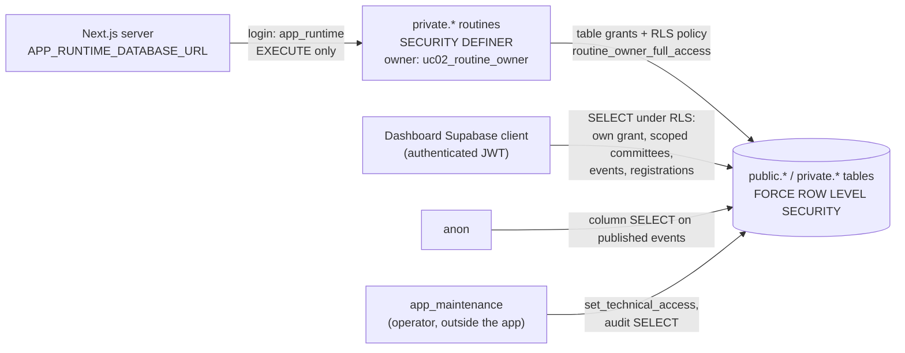

# Database security

How the database itself enforces access: roles, grants, row-level security (RLS), the routine
boundary, triggers and the Supabase Auth relationship. Source: the migrations, cross-checked
read-only against a local replay database (see [Database schema](database-schema.md)). Hosted
role passwords, Supabase dashboard settings and live grants were **not** inspected.

## The model in one paragraph

The Next.js server connects as the restricted login role `app_runtime`:

- it has **no table privileges** at all;
- it may execute only an explicit list of `private.*` routines;
- those routines are `SECURITY DEFINER`, owned by the non-login role `uc02_routine_owner`, and run
  with `search_path = public, pg_temp`;
- each routine receives the verified actor's user ID (`p_actor`) from the server, re-checks that
  actor's live access, locks the rows it changes, writes its audit row in the same transaction,
  and returns `jsonb` with a `code`.

Every application table has RLS **enabled and forced**, with policies that admit the routine owner
(and, narrowly, the dashboard's authenticated reads). The browser-facing Supabase roles see almost
nothing directly. ADR 0015 explains why the server, not the database session, supplies the actor.

## Roles

| Role                 | Login | Bypass RLS | Purpose                                                                                                                                                     |
| -------------------- | ----- | ---------- | ----------------------------------------------------------------------------------------------------------------------------------------------------------- |
| `app_runtime`        | yes   | no         | The application's only runtime connection. `EXECUTE` on approved routines; no table, sequence or schema-DDL privilege.                                      |
| `uc02_routine_owner` | no    | no         | Owns the routines and holds the table grants they need. Admitted through forced RLS by owner policies.                                                      |
| `app_maintenance`    | yes   | no         | Operator role used outside the app: Technical bootstrap or recovery (`private.set_technical_access`), audit and grant reads, purging registration attempts. |
| `authenticated`      | no    | no         | Supabase role of a signed-in browser session. Used by the dashboard's `getManagerContext()` reads.                                                          |
| `anon`               | no    | no         | Supabase anonymous role                                                                                                                                     |
| `service_role`       | no    | yes        | Supabase's privileged role. **Not used for data.** The application uses the service-role key only with the Auth Admin API (`lib/auth/admin.ts`).            |
| `postgres`           | yes   | yes        | Owner and superuser. Migrations and Supabase administration only, never the runtime.                                                                        |

0004 creates the two login roles with a placeholder password, which must be rotated
(`ALTER ROLE … PASSWORD`) on every real project ([`db/README.md`](../../db/README.md)). The
release gate ([`scripts/check-schema-compat.mjs`](../../scripts/check-schema-compat.mjs)) fails a
Vercel production build if the runtime URL logs in as a superuser or a role that bypasses RLS, and
warns if the role is not `app_runtime`.

## Grants

Table privileges (`information_schema`), excluding the owner's implicit rights:

| Object                                                                  | Grantee                                 | Privileges                                                                                                                 |
| ----------------------------------------------------------------------- | --------------------------------------- | -------------------------------------------------------------------------------------------------------------------------- |
| `public.events`                                                         | `anon`                                  | `SELECT (id, title, description, event_date, location)` only                                                               |
| `public.events`, `registrations`, `committees`, `administrative_access` | `authenticated`                         | `SELECT` (rows limited by RLS)                                                                                             |
| `public.events`, `registrations`, `administrative_access`               | `uc02_routine_owner`                    | `SELECT, INSERT, UPDATE, DELETE`                                                                                           |
| `public.committees`                                                     | `uc02_routine_owner`                    | `SELECT, INSERT`; `UPDATE (name, description, archived_at, updated_at)`                                                    |
| `public.members`                                                        | `uc02_routine_owner`                    | `SELECT, INSERT, DELETE`; `UPDATE` of the profile columns                                                                  |
| `public.registration_attempts`                                          | `uc02_routine_owner`; `app_maintenance` | `SELECT, INSERT, DELETE`; `SELECT, DELETE`                                                                                 |
| `public.certificates`, `archive_items`, `mentorship_connections`        | `uc02_routine_owner`                    | `SELECT`                                                                                                                   |
| `private.uc02_audit`                                                    | `uc02_routine_owner`                    | `SELECT, INSERT`; `UPDATE (actor_kind, actor_user_id, changes)` for erasure pseudonymization; **no `DELETE` for any role** |
| `private.uc02_audit`, `public.administrative_access`                    | `app_maintenance`                       | `SELECT`                                                                                                                   |
| Other `private.*` tables                                                | `uc02_routine_owner`                    | Full table privileges (owner-equivalent)                                                                                   |
| `private.access_auth_users` (view on `auth.users`)                      | `uc02_routine_owner`                    | `SELECT`                                                                                                                   |
| Schema `private`                                                        | `anon`, `authenticated`, `PUBLIC`       | none (0004 revokes all)                                                                                                    |

Default privileges in `public` revoke table and function rights from `anon`, `authenticated` and
`PUBLIC`. Every routine revokes `EXECUTE` from `PUBLIC` and grants it to `app_runtime` only when
the application needs it.

## Row-level security

Every `public` and `private` table has `relrowsecurity` and `relforcerowsecurity` set. Policies:

| Table                                                                                | Policy                                              | Command         | Role(s)              | Condition                                                   |
| ------------------------------------------------------------------------------------ | --------------------------------------------------- | --------------- | -------------------- | ----------------------------------------------------------- |
| `public.events`                                                                      | `anon_select_visible_events`                        | SELECT          | `anon`               | `status IN ('published','full') AND archived_at IS NULL`    |
| `public.events`                                                                      | `authenticated_select_admin_events`                 | SELECT          | `authenticated`      | `private.can_access_own_committee(committee_id)`            |
| `public.registrations`                                                               | `authenticated_select_admin_registrations`          | SELECT          | `authenticated`      | the event's committee is in scope                           |
| `public.committees`                                                                  | `authenticated_select_admin_committees`             | SELECT          | `authenticated`      | `slug IS NOT NULL AND private.can_access_own_committee(id)` |
| `public.administrative_access`                                                       | `authenticated_select_own_grants`                   | SELECT          | `authenticated`      | `user_id = auth.uid()`                                      |
| `public.administrative_access`, `private.uc02_audit`, `public.registration_attempts` | `maintenance_full_access`                           | ALL             | `app_maintenance`    | `true` (bounded by the table grants above)                  |
| Every table above and every `private.*` table                                        | `routine_owner*`                                    | ALL or narrower | `uc02_routine_owner` | `true`                                                      |
| `public.members`                                                                     | `routine_owner_select/insert/update/delete_members` | per command     | `uc02_routine_owner` | `true`                                                      |

`private.can_access_own_committee` reads the caller's user ID from `request.jwt.claims` (with a
fallback to the legacy `request.jwt.claim.sub`; fixed in 0022) and applies
`private.can_access_committee`. Active Board and Technical grants see every slugged committee; a
Committee Manager sees exactly one. Revocation takes effect on the next query. Tables with no
browser policy (members, applications, documents, projects, audit and the rest) are default-deny
to `anon` and `authenticated`.

**Tests:** `tests/db/app-runtime-security.test.ts`, `routines-and-authorization.test.ts`,
`jwt-claims-policy.test.ts`; the live staging anon check is `tests/integration/` (opt-in).

## Triggers

| Trigger                                 | Table                                              | Function                                    | Effect                                                                              |
| --------------------------------------- | -------------------------------------------------- | ------------------------------------------- | ----------------------------------------------------------------------------------- |
| `events_committee_not_archived`         | `public.events` (insert, update of `committee_id`) | `private.reject_archived_committee`         | Refuses events in an archived committee                                             |
| `administrative_access_revocation_kind` | `public.administrative_access` (update)            | `private.keep_revocation_kind`              | Keeps `revocation_kind` consistent with `revoked_at`                                |
| `membership_document_removed`           | `private.membership_documents` (after delete)      | `private.queue_removed_membership_document` | Queues the Storage object in `membership_storage_deletions` in the same transaction |
| `uc02_audit_update_guard`               | `private.uc02_audit` (update)                      | `private.guard_audit_update`                | Allows only the erasure pseudonymization; refuses every other update                |

## Supabase Auth relationships

- **Identity.** `auth.users.id` is the user ID everywhere:
  - `administrative_access.user_id`, `granted_by`, `revoked_by` (foreign keys);
  - `events.flagged_by` and `approved_by`;
  - `membership_applications.auth_user_id`, `verified_by` and `decided_by`;
  - `member_change_requests.decided_by`, `membership_settings.updated_by`;
  - `project_history.actor_id`, `uc02_audit.actor_user_id`.

  `members.id` carries the same value by convention, without a foreign key.

- **Reading Auth.** Supabase restricts custom roles' use of the `auth` schema, so 0017 added the
  view `private.access_auth_users` (owned by `postgres`, selectable only by
  `uc02_routine_owner`). Routines use it to check email confirmation, invitation and to resolve
  email addresses.
- **Writing Auth.** The database never writes to `auth.*`. Account creation, invitations,
  password changes and deletion go through the Supabase Auth Admin API with
  `SUPABASE_SERVICE_ROLE_KEY` in [`lib/auth/admin.ts`](../../lib/auth/admin.ts). Erasure records
  the pending Auth deletion in `private.account_erasures` and confirms it with
  `private.complete_account_erasure` once the identity is gone.
- **Linking.** An application links to an Auth identity only through a **confirmed** email (or an
  invitation). Signing in never grants membership or access.

## Routine catalog

Generated from the replay database's catalog and an application-wide search for `private.<name>(`
calls. "Internal" routines are called by other routines, policies or triggers only.
`register_for_event` (the original guest routine) remains executable by the runtime but is no
longer called by the application, which uses `register_event_guest`.

### Platform and API clients

| Routine               | Security definer | `app_runtime` may execute | Called from                                                   |
| --------------------- | ---------------- | ------------------------- | ------------------------------------------------------------- |
| `core_schema_version` | no               | yes                       | `lib/db/schema-version.ts`, `scripts/check-schema-compat.mjs` |
| `verify_api_client`   | yes              | yes                       | `lib/api/auth.ts`                                             |

### Public event reads

| Routine                     | Security definer | `app_runtime` may execute | Called from                                          |
| --------------------------- | ---------------- | ------------------------- | ---------------------------------------------------- |
| `get_public_event`          | yes              | yes                       | `lib/events/db.ts`                                   |
| `list_public_events`        | yes              | yes                       | `lib/events/db.ts`                                   |
| `public_event_availability` | yes              | no (internal)             | other routines, triggers or policies                 |
| `public_event_options`      | yes              | yes                       | `lib/event-management/server.ts`, `lib/events/db.ts` |

### Event administration

| Routine               | Security definer | `app_runtime` may execute | Called from                                                                                               |
| --------------------- | ---------------- | ------------------------- | --------------------------------------------------------------------------------------------------------- |
| `admin_event_options` | yes              | yes                       | `lib/admin-events/server.ts`, `lib/event-management/server.ts`                                            |
| `approve_event`       | yes              | yes                       | `lib/admin-events/server.ts`                                                                              |
| `archive_event`       | yes              | yes                       | `lib/admin-events/server.ts`                                                                              |
| `can_review_event`    | yes              | no (internal)             | other routines, triggers or policies                                                                      |
| `count_admin_events`  | yes              | yes                       | `lib/admin-events/server.ts`, `scripts/m8-production-role-check.mjs`, `scripts/m8-staging-role-check.mjs` |
| `create_event`        | yes              | yes                       | `lib/admin-events/server.ts`                                                                              |
| `edit_event`          | yes              | yes                       | `lib/admin-events/server.ts`                                                                              |
| `flag_review`         | yes              | yes                       | `lib/admin-events/server.ts`                                                                              |
| `get_admin_event`     | yes              | yes                       | `lib/admin-events/server.ts`                                                                              |
| `hold_event_full`     | yes              | yes                       | `lib/admin-events/server.ts`                                                                              |
| `list_admin_events`   | yes              | yes                       | `lib/admin-events/server.ts`, `scripts/m6-local-review.ts`                                                |
| `publish_event`       | yes              | yes                       | `lib/admin-events/server.ts`                                                                              |
| `reject_review`       | yes              | yes                       | `lib/admin-events/server.ts`                                                                              |
| `restore_event`       | yes              | yes                       | `lib/admin-events/server.ts`                                                                              |
| `save_event_details`  | yes              | yes                       | `lib/event-management/server.ts`                                                                          |

### Registrations and rate limits

| Routine                      | Security definer | `app_runtime` may execute | Called from                          |
| ---------------------------- | ---------------- | ------------------------- | ------------------------------------ |
| `count_admin_registrations`  | yes              | yes                       | `lib/admin-registrations/server.ts`  |
| `export_admin_registrations` | yes              | yes                       | `lib/admin-registrations/server.ts`  |
| `guest_registration_limit`   | no               | no (internal)             | other routines, triggers or policies |
| `link_member_registration`   | yes              | no (internal)             | other routines, triggers or policies |
| `list_admin_registrations`   | yes              | yes                       | `lib/admin-registrations/server.ts`  |
| `member_registration_limit`  | no               | no (internal)             | other routines, triggers or policies |
| `promote_waitlist`           | yes              | yes                       | `lib/admin-registrations/server.ts`  |
| `purge_rate_limit_attempts`  | yes              | no (internal)             | other routines, triggers or policies |
| `register_event_guest`       | yes              | yes                       | `lib/registrations/db.ts`            |
| `register_event_member`      | yes              | yes                       | `lib/event-management/server.ts`     |
| `register_for_event`         | yes              | yes                       | not called by the application        |
| `register_for_event_base`    | yes              | no (internal)             | other routines, triggers or policies |
| `register_for_event_seat`    | yes              | no (internal)             | other routines, triggers or policies |

### Attendance

| Routine                     | Security definer | `app_runtime` may execute | Called from                          |
| --------------------------- | ---------------- | ------------------------- | ------------------------------------ |
| `checkin_code`              | no               | no (internal)             | other routines, triggers or policies |
| `checkin_window`            | no               | no (internal)             | other routines, triggers or policies |
| `confirm_member_attendance` | yes              | yes                       | `lib/event-management/server.ts`     |
| `get_member_event`          | yes              | yes                       | `lib/event-management/server.ts`     |
| `list_event_attendance`     | yes              | yes                       | `lib/event-management/server.ts`     |
| `manage_event_checkin`      | yes              | yes                       | `lib/event-management/server.ts`     |
| `record_manual_attendance`  | yes              | yes                       | `lib/event-management/server.ts`     |

### Member profile

| Routine                        | Security definer | `app_runtime` may execute | Called from                          |
| ------------------------------ | ---------------- | ------------------------- | ------------------------------------ |
| `decide_profile_change`        | yes              | yes                       | `lib/members/profile.ts`             |
| `get_member_profile`           | yes              | yes                       | `lib/event-management/server.ts`     |
| `get_own_photo_key`            | yes              | yes                       | `lib/members/profile.ts`             |
| `get_own_profile`              | yes              | yes                       | `lib/members/profile.ts`             |
| `list_own_registrations`       | yes              | yes                       | `lib/members/profile.ts`             |
| `list_profile_change_requests` | yes              | yes                       | `lib/members/profile.ts`             |
| `member_discipline_ids`        | no               | no (internal)             | other routines, triggers or policies |
| `member_interest_ids`          | no               | no (internal)             | other routines, triggers or policies |
| `request_profile_change`       | yes              | yes                       | `lib/members/profile.ts`             |
| `set_own_photo`                | yes              | yes                       | `lib/members/profile.ts`             |
| `update_member_phone`          | yes              | yes                       | `lib/event-management/server.ts`     |
| `update_own_profile`           | yes              | yes                       | `lib/members/profile.ts`             |

### Membership applications

| Routine                                | Security definer | `app_runtime` may execute | Called from                          |
| -------------------------------------- | ---------------- | ------------------------- | ------------------------------------ |
| `activate_membership`                  | yes              | yes                       | `lib/membership/server.ts`           |
| `begin_membership_submission`          | yes              | yes                       | `lib/membership/db.ts`               |
| `can_review_membership`                | yes              | yes                       | `lib/membership/server.ts`           |
| `claim_membership_storage_deletions`   | yes              | yes                       | `lib/membership/db.ts`               |
| `complete_membership_storage_deletion` | yes              | yes                       | `lib/membership/db.ts`               |
| `get_membership_application`           | yes              | yes                       | `lib/membership/server.ts`           |
| `get_membership_application_status`    | yes              | yes                       | `lib/membership/db.ts`               |
| `get_membership_document`              | yes              | yes                       | `lib/membership/server.ts`           |
| `get_membership_review_overview`       | yes              | yes                       | `lib/membership/server.ts`           |
| `get_my_membership`                    | yes              | yes                       | `lib/membership/db.ts`               |
| `list_membership_application_history`  | yes              | yes                       | `lib/membership/server.ts`           |
| `list_membership_applications`         | yes              | yes                       | `lib/membership/server.ts`           |
| `membership_actor_email`               | yes              | no (internal)             | other routines, triggers or policies |
| `membership_complete_activation`       | yes              | no (internal)             | other routines, triggers or policies |
| `membership_invalid_field`             | no               | no (internal)             | other routines, triggers or policies |
| `membership_reviewer_kind`             | yes              | no (internal)             | other routines, triggers or policies |
| `membership_submission_limit`          | no               | no (internal)             | other routines, triggers or policies |
| `queue_abandoned_membership_upload`    | yes              | yes                       | `lib/membership/db.ts`               |
| `queue_removed_membership_document`    | no               | no (internal)             | other routines, triggers or policies |
| `review_membership_application`        | yes              | yes                       | `lib/membership/server.ts`           |
| `set_membership_approval_policy`       | yes              | yes                       | `lib/membership/server.ts`           |
| `submit_membership_application`        | yes              | yes                       | `lib/membership/db.ts`               |
| `submit_stored_membership_application` | yes              | yes                       | `lib/membership/db.ts`               |

### Projects

| Routine                    | Security definer | `app_runtime` may execute | Called from                          |
| -------------------------- | ---------------- | ------------------------- | ------------------------------------ |
| `project_content_valid`    | no               | no (internal)             | other routines, triggers or policies |
| `project_deletion_summary` | no               | no (internal)             | other routines, triggers or policies |
| `project_label`            | no               | no (internal)             | other routines, triggers or policies |
| `project_media_change`     | yes              | yes                       | `lib/projects/server.ts`             |
| `project_media_key`        | yes              | yes                       | `lib/projects/server.ts`             |
| `project_member`           | yes              | no (internal)             | other routines, triggers or policies |
| `project_read`             | yes              | yes                       | `lib/projects/server.ts`             |
| `project_reviewer`         | yes              | no (internal)             | other routines, triggers or policies |
| `project_write`            | yes              | yes                       | `lib/projects/server.ts`             |
| `public_projects`          | yes              | yes                       | `lib/projects/server.ts`             |

### Access and accounts

| Routine                        | Security definer | `app_runtime` may execute        | Called from                          |
| ------------------------------ | ---------------- | -------------------------------- | ------------------------------------ |
| `can_access_committee`         | yes              | no (internal)                    | other routines, triggers or policies |
| `can_access_own_committee`     | yes              | no (`authenticated`, RLS helper) | other routines, triggers or policies |
| `change_administrative_access` | yes              | yes                              | `lib/access/server.ts`               |
| `change_technical_access`      | yes              | yes                              | `lib/access/server.ts`               |
| `keep_revocation_kind`         | no               | no (internal)                    | other routines, triggers or policies |
| `list_access_audit`            | yes              | yes                              | `lib/access/server.ts`               |
| `list_administrative_access`   | yes              | yes                              | `lib/access/server.ts`               |
| `list_auth_directory`          | yes              | yes                              | `lib/access/server.ts`               |
| `list_auth_users_for_access`   | yes              | yes                              | `lib/access/server.ts`               |
| `list_user_audit`              | yes              | yes                              | `lib/access/server.ts`               |
| `lock_committee_access`        | yes              | no (internal)                    | other routines, triggers or policies |
| `record_auth_admin_action`     | yes              | yes                              | `lib/access/server.ts`               |
| `replace_committee_manager`    | yes              | yes                              | `lib/access/server.ts`               |
| `senior_admin_level`           | yes              | no (internal)                    | other routines, triggers or policies |
| `set_access_suspension`        | yes              | yes                              | `lib/administration/server.ts`       |
| `set_technical_access`         | yes              | no (`app_maintenance` only)      | other routines, triggers or policies |

### Administration, deletion and audit

| Routine                         | Security definer | `app_runtime` may execute | Called from                          |
| ------------------------------- | ---------------- | ------------------------- | ------------------------------------ |
| `admin_activity_actions`        | no               | no (internal)             | other routines, triggers or policies |
| `admin_activity_row`            | no               | no (internal)             | other routines, triggers or policies |
| `admin_change_committee_member` | yes              | yes                       | `lib/administration/server.ts`       |
| `admin_create_committee`        | yes              | yes                       | `lib/administration/server.ts`       |
| `admin_get_committee`           | yes              | yes                       | `lib/administration/server.ts`       |
| `admin_get_member`              | yes              | yes                       | `lib/administration/server.ts`       |
| `admin_list_committees`         | yes              | yes                       | `lib/administration/server.ts`       |
| `admin_list_members`            | yes              | yes                       | `lib/administration/server.ts`       |
| `admin_overview`                | yes              | yes                       | `lib/administration/server.ts`       |
| `admin_set_committee_archived`  | yes              | yes                       | `lib/administration/server.ts`       |
| `admin_update_committee`        | yes              | yes                       | `lib/administration/server.ts`       |
| `audit_identity_keys`           | no               | no (internal)             | other routines, triggers or policies |
| `audit_without_identity`        | no               | no (internal)             | other routines, triggers or policies |
| `committee_description_valid`   | no               | no (internal)             | other routines, triggers or policies |
| `committee_name_valid`          | no               | no (internal)             | other routines, triggers or policies |
| `complete_account_erasure`      | yes              | yes                       | `lib/administration/server.ts`       |
| `delete_event_permanently`      | yes              | yes                       | `lib/administration/server.ts`       |
| `delete_member_record`          | yes              | yes                       | `lib/administration/server.ts`       |
| `delete_project_permanently`    | yes              | yes                       | `lib/administration/server.ts`       |
| `erase_account`                 | yes              | yes                       | `lib/administration/server.ts`       |
| `event_deletion_summary`        | no               | no (internal)             | other routines, triggers or policies |
| `guard_audit_update`            | no               | no (internal)             | other routines, triggers or policies |
| `list_account_erasures`         | yes              | yes                       | `lib/administration/server.ts`       |
| `member_deletion_summary`       | no               | no (internal)             | other routines, triggers or policies |
| `person_emails`                 | no               | no (internal)             | other routines, triggers or policies |
| `preview_event_deletion`        | yes              | yes                       | `lib/administration/server.ts`       |
| `preview_member_deletion`       | yes              | yes                       | `lib/administration/server.ts`       |
| `preview_project_deletion`      | yes              | yes                       | `lib/administration/server.ts`       |
| `purge_member_data`             | no               | no (internal)             | other routines, triggers or policies |
| `reject_archived_committee`     | no               | no (internal)             | other routines, triggers or policies |
| `storage_bucket_valid`          | no               | no (internal)             | other routines, triggers or policies |
