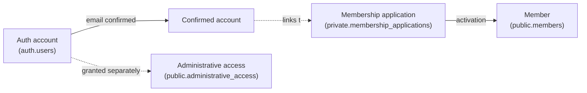
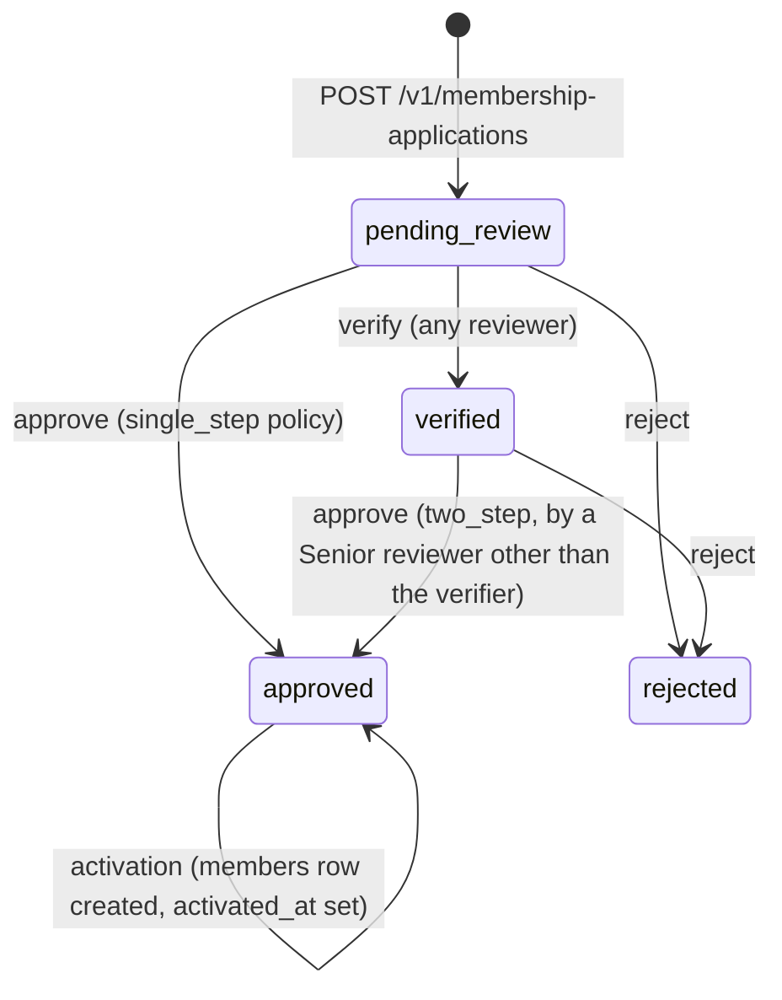
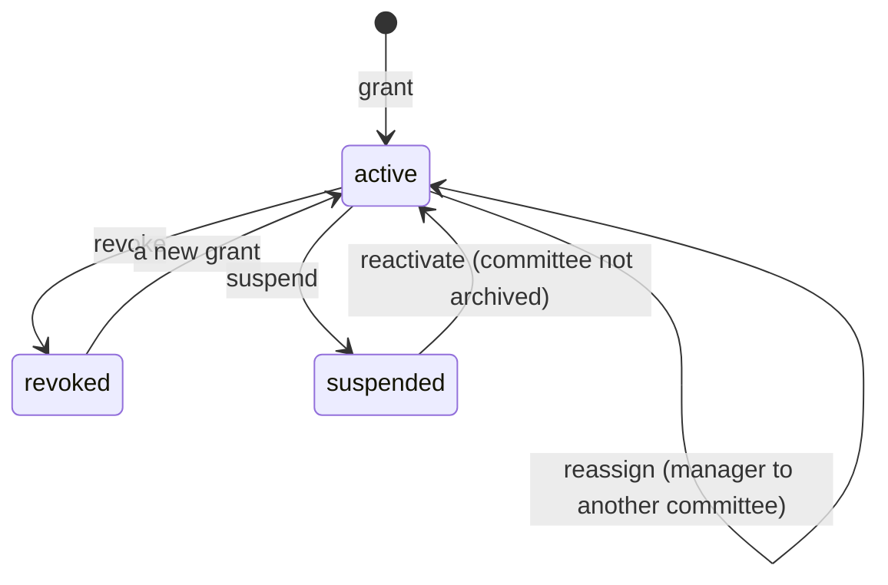

# Roles and permissions

What each kind of user can do, where each rule is enforced, and how the separate states (Auth
account, application, membership, administrative access) relate. Role and scope names come from
the database enum `public.administrative_access_level`, the routines in `db/migrations/`, and
the server code (**Source**). The accepted specification is
[ACCESS_CONTROL.md](../ACCESS_CONTROL.md), amended by ADRs
[0012](../adr/0012-application-access-hierarchy.md), [0014](../adr/0014-access-lifecycle-and-identity-retention.md),
[0017](../adr/0017-membership-applications-and-review.md), [0021](../adr/0021-website-pages-and-member-projects.md)
and [0024](../adr/0024-administration-and-permanent-deletion.md).

## Four independent states

Having one state never implies another:

- **A Supabase Auth account** is not a member.
- **A member** is not an administrator.
- **An administrator** is not a member, unless they also have a members row.

### Auth account

| State       | Meaning                                                                                                                                             |
| ----------- | --------------------------------------------------------------------------------------------------------------------------------------------------- |
| none        | No identity                                                                                                                                         |
| unconfirmed | Signed up (website) or created without confirmation. Member routes return `EMAIL_UNCONFIRMED`, and `/me/membership` returns `emailConfirmed:false`. |
| invited     | Created by an invitation (dashboard or membership activation). `invited_at` is set.                                                                 |
| confirmed   | `email_confirmed_at` is set                                                                                                                         |

Core reads these through `private.access_auth_users`, a read-only view over `auth.users` that
only the routine owner can select.

### Membership application

- **Approval** is refused with `POLICY_NOT_CONFIRMED` while `private.membership_settings.approval_policy`
  is `NULL`.
- **Approve and reject delete the ID card** (the row now, the Storage object through the queue).
- **Activation** needs exactly one Auth identity with the application's email, and that identity
  must be confirmed or invited. Without an identity the routine answers `NEEDS_INVITATION` and the
  dashboard sends an invitation. An unconfirmed self-registered identity waits until its first
  confirmed sign-in, when `GET /v1/me/membership` completes the activation.
- **Duplicates.** One open application (`pending_review`, `verified`, `approved`) per email and per
  student ID, enforced by partial unique indexes. A rejected applicant may apply again.
- **No expiry.** No automatic expiry or deletion exists for any status.

### Membership

| `members.status` | Meaning                                                                                                                                                        |
| ---------------- | -------------------------------------------------------------------------------------------------------------------------------------------------------------- |
| `member`         | Created by activation. Can use every member route.                                                                                                             |
| `graduate`       | Enum value only. **No implemented code path sets it** (**Source**). If set by hand, member routes accept a graduate, but project submission requires `member`. |
| no row           | Not a member. Member routes return `MEMBER_REQUIRED`.                                                                                                          |

There is no membership suspension (ADR 0024: no approved policy). Removing a membership means
permanent deletion of the record.

### Administrative access

One row per Auth user in `public.administrative_access` (primary key `user_id`):

| Column            | Meaning                                                                                                            |
| ----------------- | ------------------------------------------------------------------------------------------------------------------ |
| `access_level`    | `COMMITTEE_MANAGER`, `BOARD_ADMIN` or `TECHNICAL`                                                                  |
| `committee_id`    | Required for `COMMITTEE_MANAGER`, forbidden otherwise (CHECK `administrative_access_scope_check`)                  |
| `revoked_at`      | `NULL` means active. Every authorization predicate checks `revoked_at IS NULL`.                                    |
| `revocation_kind` | `revoked` or `suspended` (ADR 0024). Only a suspension can be reactivated, restoring the same level and committee. |

At least one active `TECHNICAL` row always remains (`LAST_TECHNICAL_ADMIN`). Access changes
serialize on a shared lock and take effect on the next request; no sign-out is required.

## Derived authorities

| Authority           | Definition (database)                                                                               | Routine                                                     |
| ------------------- | --------------------------------------------------------------------------------------------------- | ----------------------------------------------------------- |
| Committee scope     | Board or Technical: every committee with a slug. Committee Manager: its own committee.              | `private.can_access_committee`, `lock_committee_access`     |
| Senior              | Active `BOARD_ADMIN` or `TECHNICAL`                                                                 | `private.senior_admin_level`                                |
| Event reviewer      | Senior, and not the event's current review subject (`flagged_by`)                                   | `private.can_review_event`, CHECK `events_no_self_approval` |
| Membership reviewer | `senior`, or `society_affairs`: a Committee Manager of the committee with slug `society-affairs`    | `private.membership_reviewer_kind`                          |
| Project reviewer    | Committee scope over `society-affairs`, which means the Society Affairs manager, Board or Technical | `private.project_reviewer`                                  |
| Project author      | Email-confirmed account with a members row whose status is `member`                                 | `private.project_member`                                    |
| Maintenance         | Login role `app_maintenance`, used outside the app for bootstrap or recovery only                   | `private.set_technical_access`                              |

Names, emails, Auth metadata and organisational titles grant nothing. The Society Affairs
committee is identified by slug, never by display name.

## Permissions matrix

Key: ✔ allowed · ✖ denied · _own_ own records only · _scope_ committees in scope

| Capability                                                      | Visitor | Account, not a member |         Member          | Committee Manager | Society Affairs manager |                  Board                   |          Technical          |
| --------------------------------------------------------------- | :-----: | :-------------------: | :---------------------: | :---------------: | :---------------------: | :--------------------------------------: | :-------------------------: |
| Read published events and projects                              |    ✔    |           ✔           |            ✔            |         ✔         |            ✔            |                    ✔                     |              ✔              |
| Guest event registration                                        |    ✔    |           ✔           |            ✔            |         ✔         |            ✔            |                    ✔                     |              ✔              |
| Member event registration, check-in                             |    ✖    |           ✖           |          _own_          | if also a member  |    if also a member     |             if also a member             |      if also a member       |
| Apply for membership (SQU email)                                |    ✔    |           ✔           |         ✖ (409)         |         ✔         |            ✔            |                    ✔                     |              ✔              |
| View own profile; edit; photo; corrections                      |    ✖    |           ✖           |          _own_          | if also a member  |    if also a member     |             if also a member             |      if also a member       |
| Submit projects                                                 |    ✖    |           ✖           | _own_ (status `member`) | if also a member  |    if also a member     |             if also a member             |      if also a member       |
| Dashboard: list, create, edit, lifecycle of events              |    ✖    |           ✖           |            ✖            |      _scope_      |         _scope_         |                  ✔ all                   |            ✔ all            |
| Approve or reject review-required events                        |    ✖    |           ✖           |            ✖            |         ✖         |            ✖            |               ✔ (not self)               |        ✔ (not self)         |
| Registrations: list, count, export, promote                     |    ✖    |           ✖           |            ✖            |      _scope_      |         _scope_         |                    ✔                     |              ✔              |
| Attendance: open, rotate, close; manual record; export          |    ✖    |           ✖           |            ✖            |      _scope_      |         _scope_         |                    ✔                     |              ✔              |
| Membership review: list, view ID card, verify, reject, activate |    ✖    |           ✖           |            ✖            |         ✖         |            ✔            |                    ✔                     |              ✔              |
| Final approval under `two_step`                                 |    ✖    |           ✖           |            ✖            |         ✖         |            ✖            |           ✔ (not the verifier)           |    ✔ (not the verifier)     |
| Set the approval policy                                         |    ✖    |           ✖           |            ✖            |         ✖         |            ✖            |                    ✖                     |              ✔              |
| Decide name and student ID corrections                          |    ✖    |           ✖           |            ✖            |         ✖         |            ✔            |                    ✔                     |              ✔              |
| Review and publish projects                                     |    ✖    |           ✖           |            ✖            |         ✖         | ✔ (not author or team)  |                    ✔                     |              ✔              |
| Administration section: committees, rosters, members            |    ✖    |           ✖           |            ✖            |         ✖         |            ✖            |                    ✔                     |              ✔              |
| Grant, reassign, replace, suspend, revoke Committee Managers    |    ✖    |           ✖           |            ✖            |         ✖         |            ✖            | ✔ (never on Board or Technical accounts) |              ✔              |
| Grant or revoke Board Administration                            |    ✖    |           ✖           |            ✖            |         ✖         |            ✖            |                    ✖                     |              ✔              |
| Grant, revoke, suspend Technical                                |    ✖    |           ✖           |            ✖            |         ✖         |            ✖            |                    ✖                     |  ✔ (last owner protected)   |
| Invite accounts                                                 |    ✖    |           ✖           |            ✖            |         ✖         |            ✖            |  no role or Committee Manager, by email  |          any role           |
| Password reset email, temporary password                        |    ✖    |           ✖           |            ✖            |         ✖         |            ✖            |                    ✖                     |              ✔              |
| View accounts directory and access history                      |    ✖    |           ✖           |            ✖            |         ✖         |            ✖            |                    ✔                     |              ✔              |
| Permanently delete events, projects, membership records         |    ✖    |           ✖           |            ✖            |         ✖         |            ✖            |                    ✔                     |              ✔              |
| Delete a sign-in account completely                             |    ✖    |           ✖           |            ✖            |         ✖         |            ✖            |                    ✖                     |              ✔              |
| Infrastructure: secrets, migrations, RLS                        |    ✖    |           ✖           |            ✖            |         ✖         |            ✖            |                    ✖                     | ✖ (external procedure only) |

Nobody reviews their own membership application (matched by Auth email), approves their own
event flag, approves a project they authored or are a team member of, changes their own access,
or deletes their own records.

## Where each rule is enforced

| Layer                | What it enforces                                                                                                                                                             | Where                                                                                                                                                                     |
| -------------------- | ---------------------------------------------------------------------------------------------------------------------------------------------------------------------------- | ------------------------------------------------------------------------------------------------------------------------------------------------------------------------- |
| Database routines    | **The authority.** Every rule above, re-checked for the live actor inside `SECURITY DEFINER` routines, with row locks where state changes.                                   | `private.*` routines in [`db/migrations/`](../../db/migrations/); see [Database security](database-security.md)                                                           |
| Database constraints | Scope shape, one grant per user, review consistency, no self-approval, partial unique indexes                                                                                | [Database schema](database-schema.md)                                                                                                                                     |
| RLS                  | Browser roles see only their own grant and committees or events in scope; everything else is denied                                                                          | [Database security](database-security.md#row-level-security)                                                                                                              |
| Server (dashboard)   | Identity from the cookie session; level checks before calling routines (`requireSenior`, a Technical check, the Board limits in `changeAccessAction` and `createUserAction`) | [`lib/auth/manager.ts`](../../lib/auth/manager.ts), [`lib/administration/access.ts`](../../lib/administration/access.ts), the `app/admin/(protected)/**/actions.ts` files |
| Server (public API)  | Identity from the API key or the Supabase token; origin; input validation                                                                                                    | [`lib/api/`](../../lib/api/), [`lib/auth/member.ts`](../../lib/auth/member.ts)                                                                                            |
| UI                   | Visibility only: navigation sections, review buttons, hidden controls                                                                                                        | [`components/admin/admin-sidebar.tsx`](../../components/admin/admin-sidebar.tsx), pages                                                                                   |
| Website              | Visibility only: account menu, Coming Soon switches, profile switches                                                                                                        | ESWebsite `config/site-features.json`; Core still enforces `MEMBER_PHOTO_UPLOADS` and `MEMBER_PROFILE_EDITING`                                                            |

The tests that prove these rules with real PostgreSQL roles are in [`tests/db/`](../../tests/db/),
for example `routines-and-authorization.test.ts`, `app-runtime-security.test.ts` and
`administration.test.ts` (**Tests**, not executed during this task).

## Discrepancies found

| #   | Finding                                                                                                                                                                                                                                                                 | Evidence                                   |
| --- | ----------------------------------------------------------------------------------------------------------------------------------------------------------------------------------------------------------------------------------------------------------------------- | ------------------------------------------ |
| 1   | `ACCESS_CONTROL.md` "Assignment and recovery" still says `/admin/access` is available to Technical users. Since ADR 0024 it is open to Board, within limits, as its own hierarchy table says.                                                                           | **Source**                                 |
| 2   | The website shows "submit a project" to every member the account store recognizes, including status `graduate` (`fetchOwnMembership` treats `graduate` as member). Core's `project_member` requires `member`. No path sets `graduate` today, so this cannot happen yet. | **Source**, impact **Inferred**            |
| 3   | `GET` member routes can write (linking, activation, email sync). This is intentional and audited, but surprising for an HTTP GET.                                                                                                                                       | **Source**                                 |
| 4   | Board can view the access directory and history and invite Committee Managers, but cannot send password resets or set temporary passwords. The navigation shows the same "Accounts & access" page to both levels, with the controls filtered.                           | **Source** (consistent, noted for clarity) |
