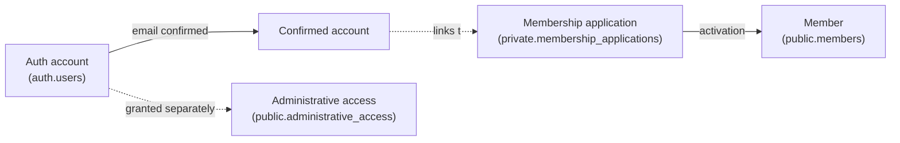
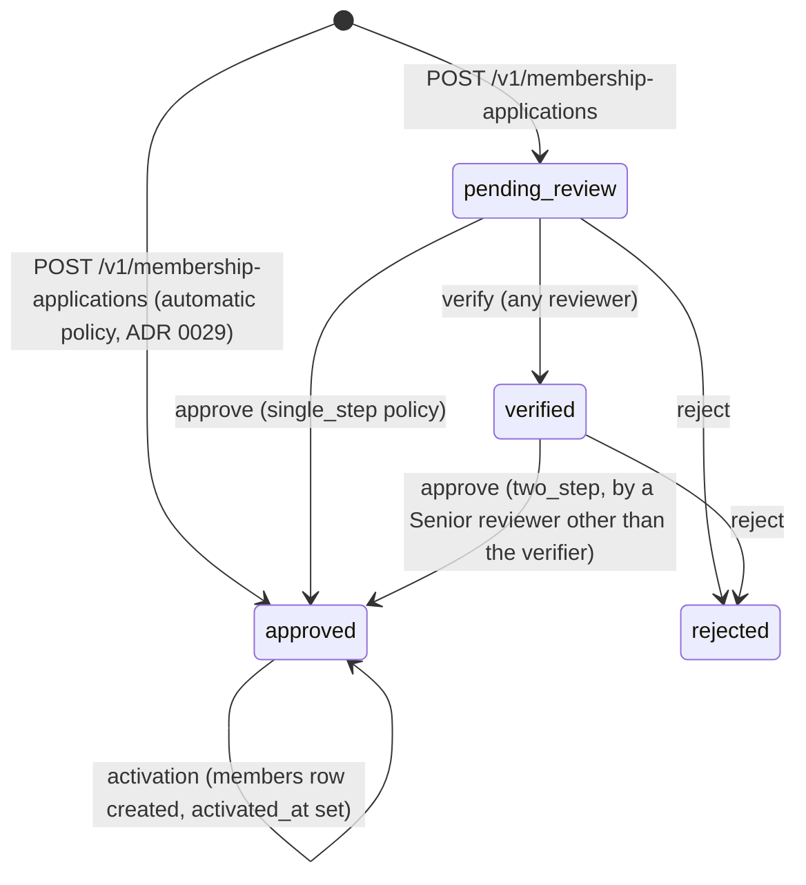
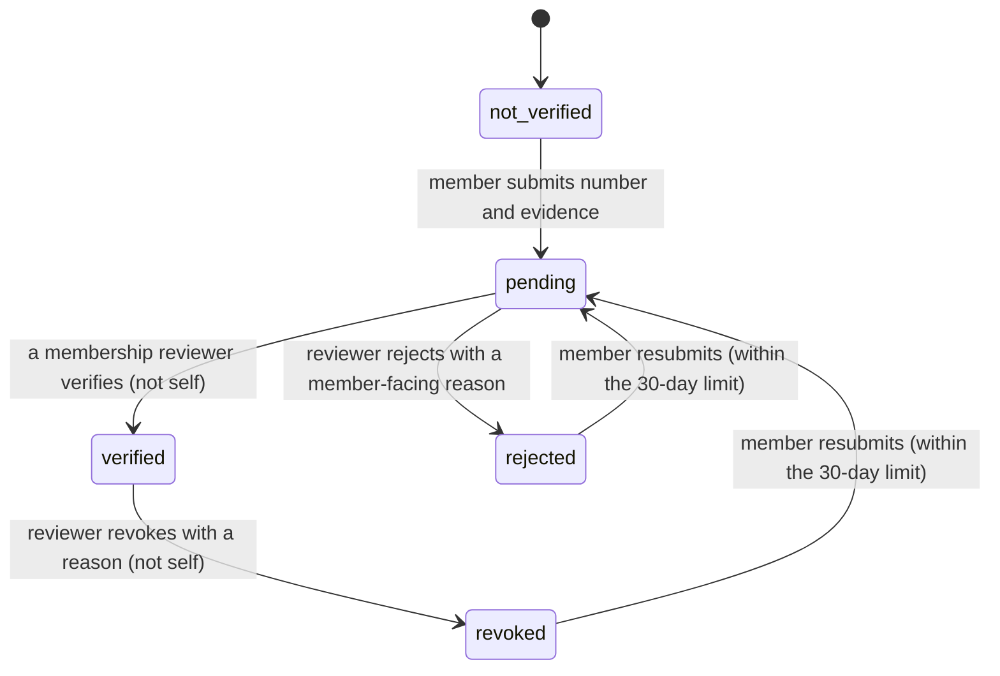
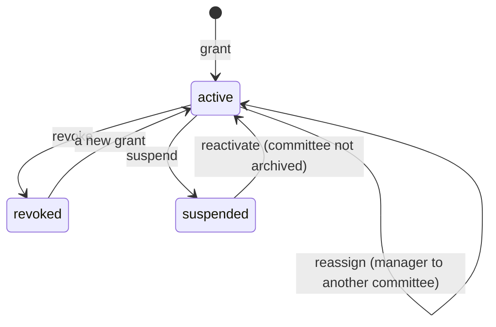

# Roles and permissions

What each kind of user can do, where each rule is enforced, and how the separate states (Auth
account, application, membership, administrative access, leadership appointments) relate. Since
migration 0035 every protected operation requires a named **permission**
([ADR 0027](../adr/0027-configurable-committee-and-team-permissions.md)); personal access levels,
Committee Manager access and approved leadership appointments are the three ways to hold one.
Names come from `private.permission_catalog`, `private.access_level_permissions`, the routines in
`db/migrations/` and the server code (**Source**). The accepted specification is
[ACCESS_CONTROL.md](../ACCESS_CONTROL.md), amended by ADRs
[0012](../adr/0012-application-access-hierarchy.md), [0014](../adr/0014-access-lifecycle-and-identity-retention.md),
[0017](../adr/0017-membership-applications-and-review.md), [0021](../adr/0021-website-pages-and-member-projects.md),
[0024](../adr/0024-administration-and-permanent-deletion.md) and, for the permission model,
[0027](../adr/0027-configurable-committee-and-team-permissions.md).

## Four independent states

Having one state never implies another:

- **A Supabase Auth account** is not a member.
- **A member** is not an administrator.
- **An administrator** is not a member, unless they also have a members row.

### Auth account

| State       | Meaning                                                                                                                                             |
| ----------- | --------------------------------------------------------------------------------------------------------------------------------------------------- |
| none        | No identity                                                                                                                                         |
| unconfirmed | Signed up (website) or created without confirmation. Member routes return `EMAIL_UNCONFIRMED`, and `/me/membership` returns `emailConfirmed:false`. |
| invited     | Created by an invitation (dashboard or membership activation). `invited_at` is set.                                                                 |
| confirmed   | `email_confirmed_at` is set                                                                                                                         |

Core reads these through `private.access_auth_users`, a read-only view over `auth.users` that
only the routine owner can select.

### Membership application

- **Approval** is refused with `POLICY_NOT_CONFIRMED` while `private.membership_settings.approval_policy`
  is `NULL`.
- **Automatic approval** (`automatic`, the active policy since migration 0037, ADR 0029): a valid
  registration is stored as `approved` with no reviewer. It grants no permission, administrator
  level, committee place or leadership; the member record follows at the applicant's first confirmed
  sign-in. Applications submitted earlier are still reviewed, approval being one step.
- **Approve and reject delete a legacy ID card** (applications from before migration 0033 carry
  one): the row now, the Storage object through the queue. Since 0033 no card is collected.
- **Activation** needs exactly one Auth identity with the application's email, and that identity
  must be confirmed or invited. Without an identity the routine answers `NEEDS_INVITATION` and the
  dashboard sends an invitation. An unconfirmed self-registered identity waits until its first
  confirmed sign-in, when `GET /v1/me/membership` completes the activation.
- **Duplicates.** One open application (`pending_review`, `verified`, `approved`) per email (and
  per student ID, for legacy applications that have one), enforced by partial unique indexes. A
  rejected applicant may apply again.
- **No expiry.** No automatic expiry or deletion exists for any status.
- **Membership does not verify anyone as an SQU student** (ADR 0025). Approval says nothing about
  the category or institution beyond what the reviewer checked.

### SQU student verification (0033)

Verification is optional and independent of membership. It never changes `members.status`, a
category or any access. A student number can be verified for one member at a time.

### Leadership requests and appointments (0033)

```mermaid
stateDiagram-v2
  [*] --> pending: member requests committee → (team) → position, while requests are open
  pending --> approved: leadership reviewer approves (not self; position has room)
  pending --> rejected: reviewer rejects with a member-facing reason
  pending --> cancelled: team moved, deactivated or archived; committee archived
  approved --> [*]: appointment created
```

An appointment (Chief or Assistant Chief of a committee itself, or of one of its teams, ADR 0026)
writes nothing to `administrative_access`. Since 0035 it **does** give dashboard access when its
own scope (the committee, or the team) has been assigned permissions under Administration →
Permissions; see [Permissions](#permissions). Pending requests, ended appointments and ordinary
membership give nothing. Leadership reviewers (holders of `leadership.review`, initially Board
Administration and, through its committee's configuration, Society Affairs) decide requests,
change and revoke appointments; holders of `leadership.assign` appoint directly. Both can be
scoped to a group's own committee. A member may hold positions in several teams, but only one
position in each scope; each scope has one Chief and one Assistant Chief by default, with
separate limits for committee level and team level since 0035. Holders of
`settings.verification` open or close new requests (Membership → Leadership); closing them never
hides appointments or blocks decisions. Revocation keeps the record with its reason.

### Membership

| `members.status` | Meaning                                                                                                                                                        |
| ---------------- | -------------------------------------------------------------------------------------------------------------------------------------------------------------- |
| `member`         | Created by activation. Can use every member route.                                                                                                             |
| `graduate`       | Enum value only. **No implemented code path sets it** (**Source**). If set by hand, member routes accept a graduate, but project submission requires `member`. |
| no row           | Not a member. Member routes return `MEMBER_REQUIRED`.                                                                                                          |

There is no membership suspension (ADR 0024: no approved policy). Removing a membership means
permanent deletion of the record.

### Administrative access

One row per Auth user in `public.administrative_access` (primary key `user_id`):

| Column            | Meaning                                                                                                            |
| ----------------- | ------------------------------------------------------------------------------------------------------------------ |
| `access_level`    | `COMMITTEE_MANAGER`, `BOARD_ADMIN` or `TECHNICAL`                                                                  |
| `committee_id`    | Required for `COMMITTEE_MANAGER`, forbidden otherwise (CHECK `administrative_access_scope_check`)                  |
| `revoked_at`      | `NULL` means active. Every authorization predicate checks `revoked_at IS NULL`.                                    |
| `revocation_kind` | `revoked` or `suspended` (ADR 0024). Only a suspension can be reactivated, restoring the same level and committee. |

At least one active `TECHNICAL` row always remains (`LAST_TECHNICAL_ADMIN`). Access changes
serialize on a shared lock and take effect on the next request; no sign-out is required.

## Permissions

`private.has_permission(actor, permission, committee)` decides every routine (migration 0035). A
person's permissions are the union of:

1. **their personal level**, through the fixed mapping `private.access_level_permissions`;
2. **their committee's configuration**, when they are its Committee Manager;
3. **the configuration of each active appointment's own scope**: a committee-level appointment
   the committee's, a team-level appointment the team's. Teams do not inherit their committee's
   configuration. An archived committee, or a team that is not active, grants nothing.

Each grant keeps its scope: society-wide, or the group's own committee (for a team, its parent
committee). Several appointments combine without widening any scope. There is no ceiling: **full
access** is every permission society-wide, which is more than Board Administration has.

### The catalog

| Area                 | Permissions                                                                                                                                                                                                                                                                                     | Scopable |
| -------------------- | ----------------------------------------------------------------------------------------------------------------------------------------------------------------------------------------------------------------------------------------------------------------------------------------------- | :------: |
| Events               | View `events.view`; create `events.create`; edit `events.edit`; publish, hold, archive and restore `events.publish`; approve or reject reviewed events `events.approve`; delete permanently `events.delete`                                                                                     |    ✔     |
| Registrations        | View, count, export and attendance lists `registrations.view`; promote, check-in and manual attendance `registrations.manage`                                                                                                                                                                   |    ✔     |
| Projects             | View `projects.view`; review decisions `projects.review`; publish and unpublish `projects.publish`; delete `projects.delete`                                                                                                                                                                    |          |
| Membership           | View applications `membership.view`; review, activate and corrections `membership.review`; final two-step approval `membership.final_approval`; member directory `members.view`; delete records `members.delete`                                                                                |          |
| SQU verification     | View requests and evidence `squ.view`; verify, reject and revoke `squ.review`                                                                                                                                                                                                                   |          |
| Leadership           | View requests `leadership.view`; decide, change and revoke `leadership.review`; appoint directly `leadership.assign`                                                                                                                                                                            |    ✔     |
| Committees and teams | View committees `committees.view`; manage committees and rosters `committees.manage`; manage teams `teams.manage` (scopable)                                                                                                                                                                    |  teams   |
| Settings             | Verification and leadership settings `settings.verification`; membership settings (approval policy and account activation) `settings.membership_policy`, held by Board and Technical                                                                                                            |          |
| Accounts and access  | View accounts and history `accounts.view`; invite and manage Committee Managers `accounts.manage`; Board and Technical access `accounts.admin_levels`; credentials `accounts.credentials`; delete sign-in accounts `accounts.erase`; manage committee and team permissions `permissions.manage` |          |
| Communications       | Email Centre `email.send` ([ADR 0028](../adr/0028-email-centre.md))                                                                                                                                                                                                                             |          |

### What each personal level includes

Fixed by migration 0035. It reproduces the access each level had before, plus three additions the
owner asked for (marked ★).

| Level             | Includes                                                                                                                                                                                                                                          |
| ----------------- | ------------------------------------------------------------------------------------------------------------------------------------------------------------------------------------------------------------------------------------------------- |
| Technical         | Everything except SQU review, leadership (view, review, assign) and the Email Centre. Society-wide.                                                                                                                                               |
| Board             | Everything except administrator levels, credentials and deleting sign-in accounts (the membership settings, `settings.membership_policy`, since migration 0039); ★ `permissions.manage`, ★ `settings.verification`, ★ `email.send`. Society-wide. |
| Committee Manager | `events.view`, `events.create`, `events.edit`, `events.publish`, `registrations.view` and `registrations.manage` for their committee, **plus** that committee's configuration.                                                                    |

The committee with slug `society-affairs` starts with `membership.view`, `membership.review`,
`squ.view`, `squ.review`, `leadership.view`, `leadership.review`, `leadership.assign`,
`projects.view`, `projects.review`, `projects.publish` and `settings.verification`, society-wide.
That replaced the slug checks of ADR 0017; it can be changed like any other committee's
configuration.

### Changing permissions

Under **Administration → Permissions** (`/admin/administration/permissions`), holders of
`permissions.manage` choose each committee's and each team's permissions (`set_group_permissions`):

- grouped checkboxes with descriptions, "own committee" or "all committees" for scopable ones,
  **Grant full access** and **Remove access**;
- a preview of the people affected (active Chiefs and Assistant Chiefs, and a committee's
  Committee Managers) and what they will be able to do;
- confirmation for full access and for adding or removing `permissions.manage` (the routine
  refuses without it: `CONFIRMATION_REQUIRED`);
- the group's history from `private.uc02_audit` (`permissions.changed`: actor, previous and new
  permissions, time and note).

Safeguards:

- nobody changes a group through which they hold access (`SELF_CHANGE`);
- an editor working from an outdated view is refused (`STALE_REVISION`);
- a permission change, access revocation or suspension, appointment revocation, team deactivation
  or member deletion that would leave no active account able to manage both permissions and
  administrator access society-wide fails with `LAST_RECOVERY_ACCOUNT`
  (`private.recovery_account_count`). At least one Technical account must also remain
  (`LAST_TECHNICAL_ADMIN`, unchanged).

Names, emails, Auth metadata and organisational titles grant nothing by themselves. A committee is
identified by id and slug, never by display name.

Nobody reviews their own membership application (matched by Auth email), approves their own event
flag, approves a project they authored or are a team member of, decides or revokes their own SQU
verification or appointment, changes their own access or their own group's permissions, or
deletes their own records.

## Where each rule is enforced

| Layer                | What it enforces                                                                                                                                                   | Where                                                                                                                                                                                                                                 |
| -------------------- | ------------------------------------------------------------------------------------------------------------------------------------------------------------------ | ------------------------------------------------------------------------------------------------------------------------------------------------------------------------------------------------------------------------------------- |
| Database routines    | **The authority.** Every rule above, re-checked for the live actor inside `SECURITY DEFINER` routines, with row locks where state changes.                         | `private.*` routines in [`db/migrations/`](../../db/migrations/); see [Database security](database-security.md)                                                                                                                       |
| Database constraints | Scope shape, one grant per user, review consistency, no self-approval, partial unique indexes                                                                      | [Database schema](database-schema.md)                                                                                                                                                                                                 |
| RLS                  | Browser roles see only their own grant and committees or events in scope; everything else is denied                                                                | [Database security](database-security.md#row-level-security)                                                                                                                                                                          |
| Server (dashboard)   | Identity from the cookie session; the person's permissions from one `get_dashboard_access` call per request; `requirePermission` and `can` before calling routines | [`lib/auth/manager.ts`](../../lib/auth/manager.ts), [`lib/auth/permissions.ts`](../../lib/auth/permissions.ts), [`lib/administration/access.ts`](../../lib/administration/access.ts), the `app/admin/(protected)/**/actions.ts` files |
| Server (public API)  | Identity from the API key or the Supabase token; origin; input validation                                                                                          | [`lib/api/`](../../lib/api/), [`lib/auth/member.ts`](../../lib/auth/member.ts)                                                                                                                                                        |
| UI                   | Visibility only: navigation entries (`dashboardNav`), review buttons, hidden controls                                                                              | [`components/admin/admin-navigation.ts`](../../components/admin/admin-navigation.ts), pages                                                                                                                                           |
| Website              | Visibility only: account menu, Coming Soon switches, profile switches                                                                                              | ESWebsite `config/site-features.json`; Core still enforces `MEMBER_PHOTO_UPLOADS` and `MEMBER_PROFILE_EDITING`                                                                                                                        |

The tests that prove these rules with real PostgreSQL roles are in [`tests/db/`](../../tests/db/),
for example `routines-and-authorization.test.ts`, `app-runtime-security.test.ts` and
`administration.test.ts` (**Tests**, not executed during this task).

## Discrepancies found

| #   | Finding                                                                                                                                                                                                                                                                 | Evidence                                   |
| --- | ----------------------------------------------------------------------------------------------------------------------------------------------------------------------------------------------------------------------------------------------------------------------- | ------------------------------------------ |
| 1   | `ACCESS_CONTROL.md` "Assignment and recovery" still says `/admin/access` is available to Technical users. Since ADR 0024 it is open to Board, within limits, as its own hierarchy table says.                                                                           | **Source**                                 |
| 2   | The website shows "submit a project" to every member the account store recognizes, including status `graduate` (`fetchOwnMembership` treats `graduate` as member). Core's `project_member` requires `member`. No path sets `graduate` today, so this cannot happen yet. | **Source**, impact **Inferred**            |
| 3   | `GET` member routes can write (linking, activation, email sync). This is intentional and audited, but surprising for an HTTP GET.                                                                                                                                       | **Source**                                 |
| 4   | Board can view the access directory and history and invite Committee Managers, but cannot send password resets or set temporary passwords. The navigation shows the same "Accounts & access" page to both levels, with the controls filtered.                           | **Source** (consistent, noted for clarity) |
